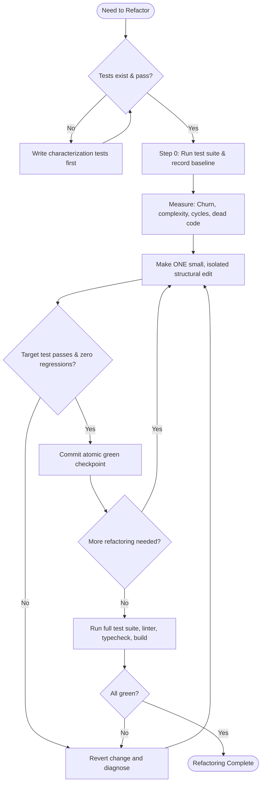

# Systematic Code Refactoring

## Overview
Refactoring improves internal structure, readability, and maintainability without altering observable runtime behavior. It is an iterative, test-backed engineering discipline—never a rewrite from scratch.

## When to Use & When NOT to Use
- **Apply When**: High cognitive complexity (>15), circular dependencies, duplicated logic, dead exports/models, monolithic classes, telescoping parameters, primitive obsession, or resource leaks.
- **Do NOT Apply When**: Fixing bugs (use test-first bugfix), adding features (separate PR), untested legacy code (write characterization tests first), or dormant stable code with zero churn.

---

## Refactoring Process Flowchart

---

## The 10 Cardinal Principles

1. **Preserve External Behavior**: Public APIs and runtime contracts must produce identical observable behavior.
2. **Establish Baseline First**: Verify passing tests and clean static checks before editing—never refactor broken code.
3. **Lock Down Safety Nets**: Expand test coverage across critical paths before high-churn edits.
4. **Take Baby Steps**: Make small, incremental modifications and verify tests after each isolated edit.
5. **Commit at Every Green State**: Create atomic checkpoint commits at every passing step for instant rollback.
6. **Trace Before Deleting**: Trace AST call trees and test mocks before deleting symbols; prune orphan tests synchronously.
7. **Full-Spectrum Verification**: Conclude every refactor with unit tests, typechecks, linters, formatter, and build.
8. **Enforce Shrink-Only Baselines**: Use tool baselines on legacy code so technical debt only decreases.
9. **Persistence & Contract Parity**: Run dry-run migration diffs to guarantee zero unintended schema drift.
10. **Hermetic Test Double Isolation**: Use in-memory dummy adapters/mocks to execute tests in sub-seconds without daemon dependencies.

*See [The 100 Golden Rules](references/golden-rules-of-refactoring.md) for the complete rules catalog.*

---

## Diagnostic Routing Matrix

| Problem Area | Symptoms & Topics | Authoritative Reference |
|---|---|---|
| **Diagnostic Catalog** | Index mapping 113 symptoms to root causes and fixes | [Problem-to-Remediation Matrix](references/problem-to-remediation-matrix.md) |
| **Engineering Invariants** | 100 universal disciplines for data, UI, services, protocols & tooling | [100 Golden Rules](references/golden-rules-of-refactoring.md) |
| **Code Smells** | 72 smells with before/after diffs: micro-tools, untyped maps, clones | [Code Smells & Fixes](references/code-smells.md) |
| **UI & Components** | Container-Presenter, memoization stripping, URL state adapters | [UI & Component Refactoring](references/ui-and-component-refactoring.md) |
| **Config, Types & Enums** | Schema-validated env, route registries, domain models, gateway parity | [Config & Type Refactoring](references/configuration-and-type-refactoring.md) |
| **Design Patterns** | Action-Dispatcher, Boundary Guards, Pipelines, Builder, Facades | [Design Patterns](references/design-patterns-for-refactoring.md) |
| **Complexity & Hotspots** | Cognitive complexity, Churn × Complexity, Granularity Goldilocks zone | [Complexity & Hotspots](references/complexity-and-hotspots.md) |
| **Architecture & Cycles** | Composition root, engine unification, YAGNI pruning, cycle breaking | [Architectural Refactoring](references/architectural-refactoring-and-cycles.md) |
| **Tooling & Testability** | Noop test adapters, toolchain unification, static analysis modernization | [Tool-Assisted Refactoring](references/tool-assisted-refactoring.md) |
