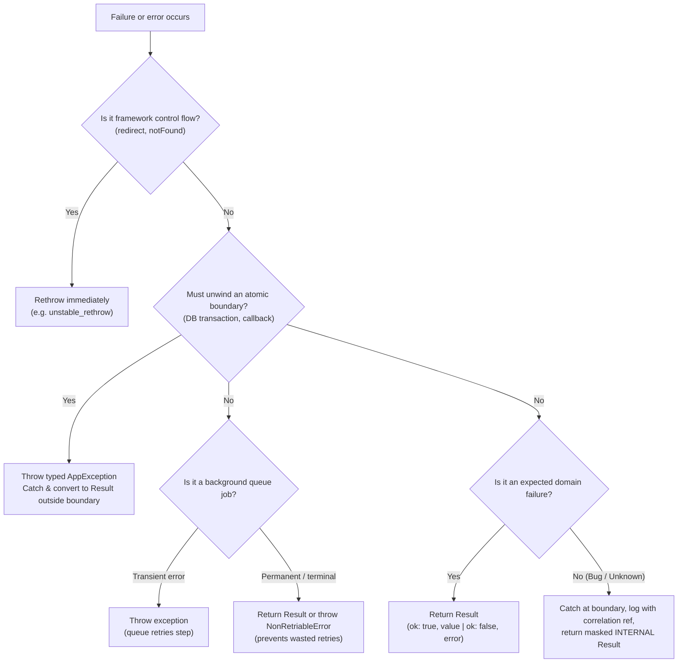

# Result Pattern

## Overview

Errors become first-class return values via sum types (`ok(value) | fail(error)`) instead of thrown exceptions. The type system forces callers to handle both outcomes, making failure paths visible in signatures, checkable at compile time, and safe across network and RPC boundaries.

## When to use / not use

**Use for:**
- Expected domain failures (validation errors, not found, conflicts, rate limits, payment declined).
- Service-layer contracts, Server Actions, RPC endpoints, and inter-service boundaries.
- Anywhere a caller must decide how to handle failure or present user feedback.

**Not for:**
- Framework navigation and control-flow signals (e.g. Next.js `redirect()`, `notFound()`) — these throw internally; never catch or wrap them without rethrowing.
- True bugs and broken invariants (null dereferences, memory exhausted) — let them crash/throw to top-level handlers.
- Retriable background queue failures (e.g. transient network timeouts in Inngest/BullMQ) — returning a Result marks the step successful and cancels retries; throw instead.

## Decision Flowchart



## Core Pattern

In modern full-stack, distributed, or RPC environments, the **object form** is standard because it survives JSON serialization cleanly, prevents tuple-ordering mistakes, and avoids leaking untyped JavaScript `Error` objects:

```ts
// Wire-safe result contract: JSON-safe data only (no Error classes or functions)
export interface AppError {
  readonly code: string;
  readonly message: string;
  readonly [key: string]: unknown;
}

export type Result<T, E extends AppError = AppError> =
  | { readonly ok: true; readonly value: T }
  | { readonly ok: false; readonly error: E };

export const ok = <T>(value: T): Result<T, never> => ({ ok: true, value });
export const fail = <E extends AppError>(error: E): Result<never, E> => ({ ok: false, error });
```

### Consumer Narrowing

```ts
const res = await updateUser(id, input);

if (!res.ok) {
  // Narrowed to failure: res.error is typed and exhaustive
  switch (res.error.code) {
    case "NOT_FOUND": return showNotFound();
    case "CONFLICT": return showConflict(res.error.message);
    default: {
      const _: never = res.error; // Compile error if variant unhandled
      return showGenericError(res.error.message);
    }
  }
}

// Narrowed to success: res.value is available
console.log(res.value.id);
```

*(Alternative Go-style tuple form `[err, value]` is covered in [typescript.md](typescript.md) for local zero-dependency utilities).*

## Architectural Boundaries

### 1. The Boundary Unwind Pattern (`AppException`)
Pure Results cannot unwind transactional boundaries (e.g. Drizzle or Prisma rollbacks require an exception, and third-party fetch overrides must throw to interrupt).
- Define a dedicated `AppException extends Error` holding `{ readonly error: AppError }`.
- Throw `AppException` **only** inside the boundary that demands unwinding.
- **Never** leak `AppException` across RPC, Server Action, or client boundaries — catch it immediately outside the transaction and return `fail(e.error)`.
- **Never** throw `AppException` in client-side UI code.

### 2. Boundary Wrappers & Framework Traps
- **Production Error Masking:** Frameworks like Next.js mask thrown errors from Server Actions in production (e.g. React error #441, replacing custom messages with opaque hashes). Actions returning `Result` preserve typed error codes and friendly messages intact across the network.
- **Framework Control Flow:** Frameworks use thrown symbols for navigation (`redirect()`, `notFound()`). Wrap action boundaries with a higher-order handler (e.g. `defineAction`) that executes `unstable_rethrow(err)` first before catching errors.
- **Correlation Ref:** For unhandled internal exceptions, log the stack trace with a unique random correlation `ref` (e.g. 8-char hex) and return `{ code: "INTERNAL", message: "Something went wrong. (Ref: abc12345)", ref }`.

### 3. Background Queues & Durable Workflows
In systems like Inngest, Temporal, or BullMQ:
- A returned value (even `{ ok: false }`) signals **step success** to the engine; it will not retry.
- Use returned Results for **expected or terminal failures** (e.g. invalid document, unknown ID) to avoid burning useless retries.
- **Throw** for transient network/DB errors so the engine automatically retries with backoff.
- Return only JSON-safe primitives from steps (never return `Error` instances, which serialize to `{}`).

## Language Quick-Reference

| Language | Primary Pattern | Library Alternative | Reference |
|---|---|---|---|
| TypeScript | Object union `{ ok: true, value } \| { ok: false, error }` + `never` check | neverthrow v8.x | [typescript.md](typescript.md) |
| Java 21+ | Sealed interface + records + pattern switch | Vavr Either / Try | [java.md](java.md) |
| Python 3.12+ | Dataclasses + `Literal` tag + `match` | rustedpy/result (archived) | [python.md](python.md) |

## Common Mistakes

| Mistake | Why It Breaks | What To Do Instead |
|---|---|---|
| Returning raw `Error` instances in Result | Serializes to `{}` over JSON / Flight RPC boundaries | Use plain objects with `{ code, message }` and JSON-safe fields |
| Throwing inside Server Actions | Next.js masks thrown error messages with generic digests in production (React #441) | Return `{ ok: false, error }` via boundary wrapper (`defineAction`) |
| Catching Next `redirect()` or `notFound()` | Swallows framework navigation control flow | Always call `unstable_rethrow(err)` before converting caught errors |
| Throwing `AppException` in client code | Breaks Result consistency on frontend, forcing redundant try/catches | Client functions return `Result` and pass `res.error` to toast/alert handlers |
| Leaking `AppException` outside actions | Lost types across network, degraded to 500 digest | Catch `AppException` at transaction boundary or in `defineAction` |
| Returning Result for transient queue steps | Queue engine treats return as success and aborts retries | Throw for transient errors; return Result only for terminal outcomes |
| Omitting compile-time exhaustiveness | Added error variants silently fall through unhandled | Assign unhandled branches to `const _: never = err` in default case |

## References

- [typescript.md](typescript.md) — fullstack object Result, `AppException`, `defineAction`, `toAppError`, and enforcement
- [java.md](java.md) — sealed interfaces, records, and pattern matching
- [python.md](python.md) — dataclass variants, literals, and pattern matching
- [references.md](references.md) — theoretical foundations, ROP, and history
