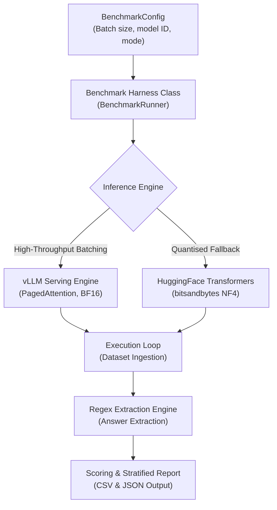

# Introduction

Generate documentation for Large Language Model (LLM) benchmarking projects. Produce `Home.md`, `Benchmarking-Pipeline.md`, and `ITALIC-Dataset-&-Data-Engineering.md` using ASD-STE100 language and modern Mermaid diagrams.

---

# Section 1: Benchmarking Landing Page (`Home.md` - Blueprint D1)

1. **Overview Paragraph**: Single concise paragraph explaining the benchmarking study, evaluated model family, and baseline vs reasoning objectives. No title above this paragraph.
2. **Capabilities & Scope**: Macro-domain split analysis (Culture vs Language) and Inference Modes (Standard vs Reasoning).
3. **Evaluated Model Table**: Model ID, Parameters, Tokeniser, and Native Multilingual status.
4. **ITALIC Benchmark Summary**: Cite NAACL 2025 benchmark [1] covering 10,000 authentic Italian questions.
5. **Results Table**: Variant, Mode, Culture Accuracy (%), Language Accuracy (%), Overall Accuracy (%), Deviation.
6. **Wiki Documentation**: Navigation table linking `Benchmarking-Pipeline.md` and `ITALIC-Dataset-&-Data-Engineering.md`. Must strictly list internal pages of this wiki only; never reference other wikis.

---

# Section 2: Evaluation Pipeline (`Benchmarking-Pipeline.md` - Blueprint D2)

## What to do
1. **Overview**: Technical summary of evaluation harness, serving engine selection, and hardware orchestration.
2. **Architecture Flowchart**: Modern `flowchart TD` showing Config -> Harness -> Engine selection (vLLM vs Transformers+bitsandbytes) -> Execution Loop -> Regex Extraction -> Scoring Report.
3. **Serving Engine Strategy**:
   - vLLM Engine: High-throughput continuous batching and PagedAttention for unquantised and merged models.
   - Transformers Engine: Quantised 4-bit NF4 fallback for high-parameter models on constrained memory.
4. **Prompt Formulations**:
   - Standard Mode: Single-letter greedy generation.
   - Reasoning Mode: Chain-of-thought elicited generation with length cap and extraction anchor `FINALE: [X]`.
5. **Answer Extraction & Scoring Logic**:
   - Regex parsing: reasoning mode targets `FINALE:\s*([A-E])`; standard mode matches `\b([A-E])\b`.
   - Fallback: Invalid parses score as `"INVALID"` and receive zero credit.
6. **Mandatory Source References**: Conclude with `# Source Code References` table.
7. **Append References**: Conclude with a `# References` section formatted strictly as a numbered list of markdown links with no descriptions.

## Canonical Template: `Benchmarking-Pipeline.md`

```markdown
# Overview

[Technical overview of evaluation harness, serving engine selection, and hardware orchestration.]

---

# Architecture & Codebase Organisation



---

# Inference Engine & Serving Strategy

- **vLLM Engine (Default):** Employs PagedAttention and continuous batching. Executes all baseline and merged LoRA evaluations.
- **Transformers + BitsAndBytes (Fallback):** Evaluates 4-bit NF4 quantized models on memory-constrained GPUs.

---

# Evaluation Modes & Prompt Formulations

## Standard Mode
In standard mode, the model outputs the single correct option letter directly. Prompts are constructed via `[benchmark/utils.py: build_standard_prompt]`.

## Reasoning Mode
In reasoning mode, the prompt elicits explicit chain-of-thought. It caps output length and provides a deterministic extraction anchor (`FINALE: [X]`). Prompts are constructed via `[benchmark/utils.py: build_reasoning_prompt]`.

---

# Answer Extraction & Scoring Logic

Extraction uses deterministic regex parsing implemented in `[benchmark/utils.py: extract_answer]`:
1. In reasoning mode, the regex targets `FINALE:\s*([A-E])` to extract the concluding choice.
2. In standard mode, the regex matches the primary option character `\b([A-E])\b`.
3. If no option letter is matched, the engine logs the answer as `"INVALID"` and scores zero.

---

# Source Code References

| Benchmark Component | Source File Path | Key Symbols / Exports | Architectural Role |
|---|---|---|---|
| Benchmark Orchestration | `benchmark/runner.py` | `BenchmarkRunner.run()` | Loads dataset, batches inference, collects outputs |
| Configuration | `benchmark/config.py` | `BenchmarkConfig` | Dataclass governing batch sizes and model paths |
| Extraction & Evaluation | `benchmark/utils.py` | `extract_answer()`, `score()` | Regex answer parser and metric calculations |

---

# References

1. [Efficient Memory Management for Large Language Model Serving with PagedAttention](https://arxiv.org/abs/2309.06180)
2. [ITALIC: An Italian Culture-Aware Natural Language Benchmark](https://arxiv.org/abs/2410.05260)
```

---

# Section 3: Dataset Taxonomy (`ITALIC-Dataset-&-Data-Engineering.md` - Blueprint D3)

1. **Metadata & Sourcing Table**: Name, Venue, DOI, HuggingFace Hub repository, Sample count (10,000 MCQ), and Language (100% Native Italian).
2. **Domain Taxonomy Table**: Macro-Categories (Culture & Commonsense, Language Capability) across all 12 domains.
3. **Mandatory Source References**: Conclude with `# Source Code References` table.

---

# Quality Bar

- **ASD-STE100 Compliance**: Procedural sentences under 20 words; descriptive sentences under 25 words.
- **British English**: 100% British English orthography (`categorise`, `initialise`).
- **Zero Raw Code**: Prohibit Python inference loops and raw JSON dumps.

