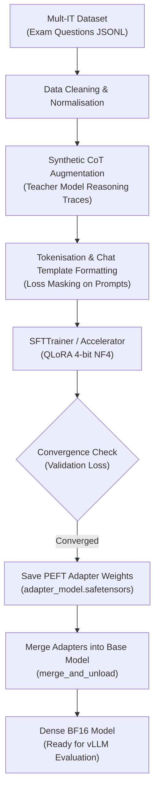

# Introduction

Generate documentation for Large Language Model (LLM) fine-tuning projects. Produce `Home.md`, `Fine-Tuning-Pipeline.md`, and `Mult-IT-Dataset-&-Data-Engineering.md` using ASD-STE100 language and modern Mermaid diagrams.

---

# Section 1: Fine-Tuning Landing Page (`Home.md` - Blueprint C1)

1. **Overview Paragraph**: Single concise paragraph explaining fine-tuning goals, base model family, and academic examination context. No title above this paragraph.
2. **Features & Capabilities**: Group into Domain Adaptation and Training Modes (Standard, Reasoning, Mixed).
3. **Base Model Architecture Table**: Model ID, Parameters, Attention Mechanism (e.g. GQA), and Context Window.
4. **Training Dataset Summary**: Cite Mult-IT dataset [1] across Culture & Commonsense and Language Capability.
5. **Wiki Documentation**: Navigation table linking `Fine-Tuning-Pipeline.md` and `Mult-IT-Dataset-&-Data-Engineering.md`. Must strictly list internal pages of this wiki only; never reference other wikis.

---

# Section 2: Training Pipeline (`Fine-Tuning-Pipeline.md` - Blueprint C2)

## What to do
1. **Overview**: Technical summary of the fine-tuning harness, compute hardware, and PEFT methodology.
2. **PEFT / QLoRA Configuration Table**: Parameter, Value, and Technical Justification (e.g. 4-bit NF4, Bfloat16 compute, Rank $r=16$, Alpha $\alpha=32$, Target Modules).
3. **Pipeline Flowchart**: Visualise raw data ingestion, CoT augmentation, tokenisation, SFT execution, convergence check, and adapter merging via modern `flowchart TD`.
4. **Hyperparameters Table**: Optimiser, Learning Rate, Batch Size, Gradient Accumulation, and Epochs.
5. **Loss Masking Strategy**: Explain setting user tokens to `-100` (`CrossEntropyLoss` ignore index) and computing loss exclusively over response tokens.
6. **Adapter Merging Workflow**: Numbered procedural steps detailing `merge_and_unload()` into dense BF16 weights.
7. **Mandatory Source References**: Conclude with `# Source Code References` table.
8. **Append References**: Conclude with a `# References` section formatted strictly as a numbered list of markdown links with no descriptions.

## Canonical Template: `Fine-Tuning-Pipeline.md`

```markdown
# Overview

[Technical overview of the fine-tuning harness, parameter-efficient fine-tuning methodology, and compute allocation.]

---

# Architecture & PEFT Configuration

The training pipeline implements Parameter-Efficient Fine-Tuning (PEFT) using QLoRA:

| Configuration Parameter | Value | Technical Justification |
|---|---|---|
| Quantisation | 4-bit NormalFloat (NF4) | Reduces base model VRAM footprint for single-GPU execution |
| Compute Precision | Bfloat16 | Prevents numerical underflow during backpropagation |
| LoRA Rank ($r$) | 16 | Balances parameter capacity with training stability |
| LoRA Alpha ($\alpha$) | 32 | Scales adapter weight updates with scaling factor 2 |
| Target Modules | Attention & MLP Projections | Enables cross-layer adaptation across all projection layers |

---

# Fine-Tuning Pipeline



---

# Training Hyperparameters

| Hyperparameter | Value |
|---|---|
| Optimiser | AdamW (Paged 8-bit) |
| Learning Rate | $2 \times 10^{-4}$ (Cosine decay schedule) |
| Warmup Ratio | 0.03 |
| Batch Size (Per Device) | 4 |
| Gradient Accumulation Steps | 4 (Effective batch size = 16) |
| Epochs | 1 to 3 |

---

# Loss Masking & Objective

Loss masking guarantees the model learns response generation rather than prompt memorisation:
- System and user prompt tokens are set to `-100` (`CrossEntropyLoss` ignore index).
- Loss calculation occurs strictly over assistant response tokens.

---

# Adapter Merging & Export Workflow

1. Load base model weights in full Bfloat16 precision.
2. Load trained PEFT adapter checkpoint.
3. Call `merge_and_unload()` to merge adapter delta weights into base matrices.
4. Export dense model weights using HuggingFace `save_pretrained(..., safe_serialization=True)`.

---

# Source Code References

| Pipeline Component | Source File Path | Key Symbols / Exports | Architectural Role |
|---|---|---|---|
| Training Runner | `train.py` | `train()`, `main()` | Orchestrates SFTTrainer and Accelerator loop |
| Configuration Dataclass | `config.py` | `TrainingConfig` | Governs hyperparameters, LoRA rank, and paths |
| Adapter Merging Script | `merge_adapters.py` | `merge_and_export()` | Folds LoRA weights into dense base checkpoint |

---

# References

1. [QLoRA: Efficient Finetuning of Quantized LLMs](https://arxiv.org/abs/2305.14314)
2. [LoRA: Low-Rank Adaptation of Large Language Models](https://arxiv.org/abs/2106.09685)
```

---

# Section 3: Dataset & Engineering (`Mult-IT-Dataset-&-Data-Engineering.md` - Blueprint C3)

1. **Dataset Provenance**: Detail authentic Italian public exam sourcing [1] eliminating translation artefacts.
2. **Domain Distribution**: Tabulate Macro-Domains (Culture & Commonsense, Language Capability) and sample counts.
3. **Pipeline Flowchart**: Visualise normalization, train/val split, template formatting, and CoT augmentation via `flowchart LR`.
4. **Synthetic Chain-of-Thought (CoT) Rules**:
   - Language Invariant: Reasoning generated natively in Italian.
   - Length Constraint: Inner monologue capped to maximum three sentences.
   - Delimiter Constraint: Reasoning block must terminate with `FINALE: [X]`.
5. **Mandatory Source References**: Conclude with `# Source Code References` table.

---

# Quality Bar

- **ASD-STE100 Compliance**: Procedural sentences under 20 words; descriptive sentences under 25 words.
- **British English**: 100% British English orthography (`quantisation`, `initialised`).
- **Zero Raw Code**: Prohibit Python training loops and raw JSON dumps. Use tables and diagrams.

