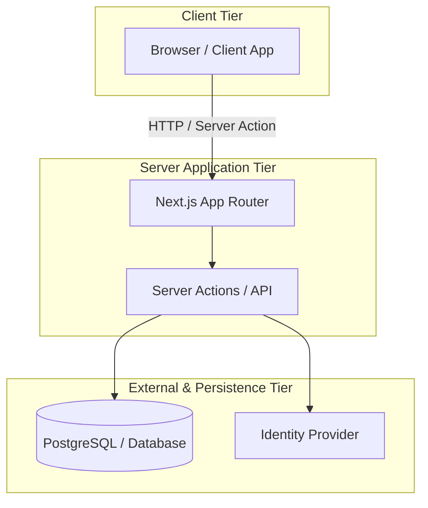
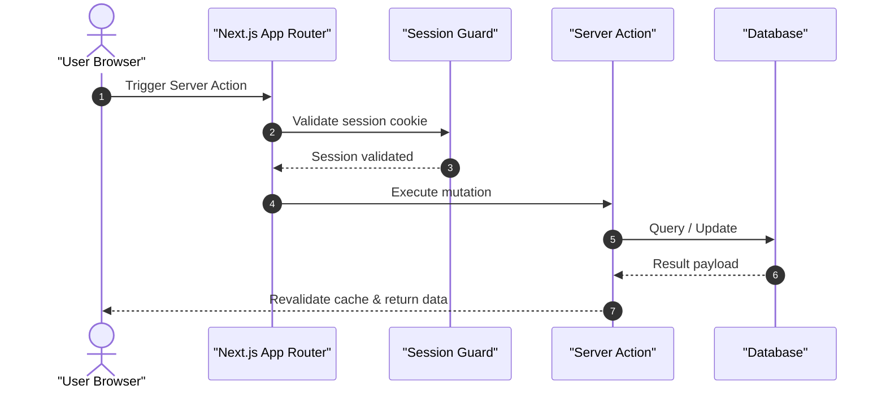

# Introduction

Generate the comprehensive `2.-Architecture-Overview.md` document for software applications. Detail system topology, technology stacks, execution patterns, and request lifecycles using ASD-STE100 language and modern Mermaid diagrams.

---

# What to do

1. **Write the Overview**:
   - Provide a concise technical summary of the architectural pattern and execution model.
   - Keep descriptive sentences under 25 words following ASD-STE100.
2. **Visualise System Topology**:
   - Create a modern `flowchart TD` diagram illustrating client, server, and persistence tiers.
   - Enclose all node labels containing spaces or parentheses in double quotes.
   - Use semantic node shapes (`["Component"]`, `[("Database")]`, `(["Boundary"])`).
3. **Tabulate Technology Stack**:
   - Detail every stack component in a structured table:
     `| Layer / Concern | Technology | Version | Purpose / Responsibility |`
4. **Document Architectural Patterns**:
   - Explain overarching design patterns (e.g. Server-First Mutation, Layered Separation of Concerns) under H2 headings.
   - Describe structural guarantees and invariants without pasting source code.
   - Cite relevant modules inline: `[src/actions/index.ts: handleAction]`.
5. **Illustrate Request Lifecycles**:
   - Construct a Mermaid `sequenceDiagram` with `autonumber` tracing request flow across tiers.
6. **Compile Mandatory Source References**:
   - End the document with a `# Source Code References` table mapping components to concrete file paths and symbols.
7. **Append Academic or Technical References**:
   - Provide a `# References` section formatted strictly as a numbered list of markdown links with no descriptions.

---

# What not to do

- **Strictly No Implementation Code**: Prohibit multi-line code snippets (`ts`, `js`, `py`, `sql`, `json`). Use diagrams, tables, and inline citations instead.
- **No Database DDL**: Exclude database table schemas and migration definitions (reserve for `3.-Database-Design.md`).
- **No Deprecated Mermaid Syntax**: Do not use `graph TD` or unquoted node labels.
- **No Bold Headings**: Never write `# **Title**`.
- **No Conversational Filler**: Eliminate phrases such as "In this section..." or "Now we look at...".

---

# Canonical Template: `2.-Architecture-Overview.md`

```markdown
# Overview

[Concise technical introduction describing core architectural philosophy, framework tier, and execution model.]

---

# System Topology



---

# Technology Stack

| Layer / Concern | Technology | Version | Purpose / Responsibility |
|---|---|---|---|
| Runtime / Framework | Next.js | 16.x | Full-stack server and client execution |
| Language | TypeScript | 5.x | Strict compile-time type safety |
| Persistence | PostgreSQL | 17.x | Relational data persistence |
| ORM | Drizzle ORM | 0.38.x | Type-safe schema definitions and queries |

---

# Architectural Patterns

## Server-First Execution Model
The application executes mutations via Server Actions. This pattern eliminates intermediate client API layers. Code citation: `[src/actions/mutations.ts: mutateRecord]`.

## Layered Data Access
Data operations separate strictly into Data Access Layers (DAL) and presentation components. Direct database queries from client components are prohibited. Code citation: `[src/dal/users.ts: getUserProfile]`.

---

# Request Lifecycle



---

# Source Code References

| Component / Mechanism | Source File Path | Key Symbols / Exports | Responsibility |
|---|---|---|---|
| Middleware Security | `middleware.ts` | `middleware()` | Threat filtering and session token refresh |
| Database Client Factory | `src/lib/db.ts` | `db` | Configured database connection pool instance |
| Session Guard | `src/lib/auth/guard.ts` | `requireAuth()` | Enforces authenticated caller context |

---

# References

1. [Next.js App Router Architecture Specification](https://nextjs.org/docs/app)
2. [RFC 6749: The OAuth 2.0 Authorization Framework](https://datatracker.ietf.org/doc/html/rfc6749)
```

---

# Quality Bar

- **ASD-STE100 Compliance**: Max 20 words per procedural sentence; max 25 words per descriptive sentence.
- **British English**: 100% British English orthography throughout.
- **Diagram Syntax**: Valid Mermaid v11 syntax with quoted labels and semantic shapes.
- **Zero Raw Code**: Zero non-mermaid code blocks.
