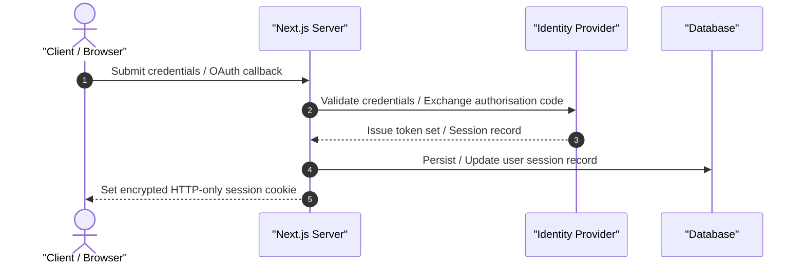

# Introduction

Generate `4.-Authentication.md` for Web Dev projects. Detail security architectures, authentication flows, session lifecycles, and access controls using ASD-STE100 language and modern Mermaid diagrams.

---

# What to do

1. **Write the Overview**:
   - Explain identity provider selection, session models, and token architecture.
   - Keep descriptive sentences under 25 words following ASD-STE100.
2. **Detail Authentication Methods**:
   - Document credential handling, OAuth 2.0 PKCE, and passkey/WebAuthn support.
3. **Illustrate Authentication Flows**:
   - Construct a Mermaid `sequenceDiagram` with `autonumber` tracing login, token exchange, and cookie issuance.
4. **Tabulate Session Management**:
   - Tabulate Cookie Storage, Expiration boundaries, and Invalidation strategies.
5. **Document Route & Data Security**:
   - Detail middleware route protection and data layer authorisation (RBAC, RLS).
   - Cite relevant source modules inline: `[src/features/auth/guards.ts: requireAuth]`.
6. **Compile Mandatory Source References**:
   - Conclude with a `# Source Code References` table mapping mechanisms to concrete files and symbols.
7. **Provide References**:
   - Provide a `# References` section formatted strictly as a numbered list of markdown links with no descriptions.

---

# What not to do

- **Strictly No Implementation Code**: Prohibit raw code blocks (`ts`, `js`, `py`, `json`).
- **No Provider Suffixes in Filename**: Name the document `4.-Authentication.md`, never `4.-Authentication-(Provider).md`.
- **No Vague Security Descriptions**: State concrete algorithms (e.g. Argon2id, PKCE, HTTP-only cookies).

---

# Canonical Template: `4.-Authentication.md`

```markdown
# Overview

[Technical summary of the identity provider, session model, and token architecture.]

---

# Authentication Methods

- **Email & Password**: Argon2id password hashing with server-side credential isolation.
- **OAuth 2.0 / OIDC**: Federated identity via Google and GitHub using the PKCE flow.
- **Passkeys / WebAuthn**: Hardware-bound FIDO2 credential authentication.

---

# Authentication Flows



---

# Session Management

| Concern | Strategy | Implementation Details |
|---|---|---|
| Cookie Storage | HTTP-only, Secure, SameSite=Lax | Stores encrypted session identifier |
| Expiration | 7 Days Rolling | Session extends automatically upon user interaction |
| Invalidation | Explicit Revocation | Logout purges database session record immediately |

---

# Route & Data Access Security

## Middleware Route Protection
Edge middleware intercepts incoming HTTP requests. It validates session tokens before routing to protected subtrees. Unauthenticated callers redirect to the login route. Code citation: `[src/middleware.ts: middleware]`.

## Data Layer Authorisation
Server Actions enforce role-based access control (RBAC) via session assertion helpers. Code citation: `[src/lib/auth/guards.ts: requireRole]`.

---

# Source Code References

| Security Mechanism | Source File Path | Key Symbols / Exports | Architectural Role |
|---|---|---|---|
| Auth Configuration | `src/lib/auth.ts` | `auth`, `authOptions` | Central identity service definition |
| Typed Client SDK | `src/lib/auth-client.ts` | `signIn`, `signOut`, `useSession` | Client-side reactive authentication hooks |
| Session Guard | `src/lib/auth/guards.ts` | `requireAuth()`, `requireRole()` | Protects server actions and mutation handlers |

---

# References

1. [RFC 7636: Proof Key for Code Exchange by OAuth Public Clients](https://datatracker.ietf.org/doc/html/rfc7636)
2. [OWASP Session Management Cheat Sheet](https://cheatsheetseries.owasp.org/cheatsheets/Session_Management_Cheat_Sheet.html)
```

---

# Quality Bar

- **ASD-STE100 Compliance**: Procedural sentences under 20 words; descriptive sentences under 25 words.
- **British English**: 100% British English orthography (`authorisation`, `initialised`).
- **Zero Raw Code**: Represent all contracts via declarative markdown tables and sequence diagrams.

