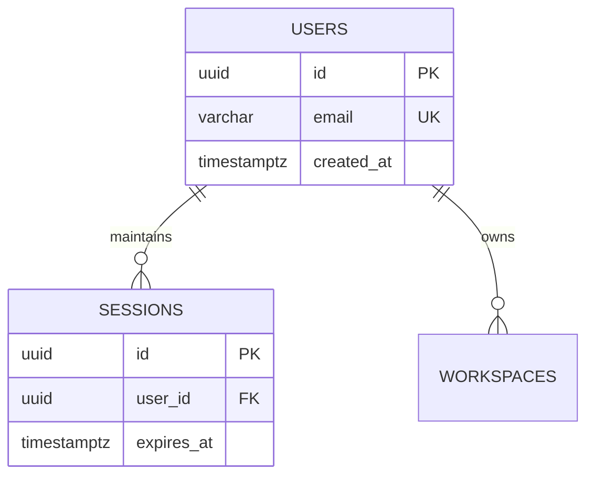

# Introduction

Generate the `3.-Database-Design.md` document for software applications. Detail entity schemas, relationships, normalisation analysis, and entity-relationship diagrams using ASD-STE100 language.

---

# What to do

1. **Write the Overview**:
   - Provide a concise summary of the persistence platform, ORM/driver, and migration model.
   - Keep descriptive sentences under 25 words following ASD-STE100.
2. **Tabulate Platform & Infrastructure**:
   - Create a table detailing Database Engine, ORM, and Migration tooling.
3. **Specify Entities & Attributes**:
   - List each table or collection under an H3 heading.
   - List each field as a bullet with type, primary/foreign key status, and nullability constraints.
   - Do NOT paste raw SQL DDL or ORM schema code blocks.
4. **Define Entity Relationships**:
   - Explicitly list One-to-Many and Many-to-Many relationships, naming join keys and cascade behaviours.
5. **Conduct Normalisation Analysis**:
   - **1NF & 2NF**: Assess atomicity, primary key definitions, and full functional dependencies.
   - **3NF & BCNF**: Assess transitive dependencies and candidate key determinants.
   - **Deliberate Denormalisations**: Explain any intentional denormalisation for read performance.
6. **Construct Mermaid ER Diagram**:
   - Visualise entities, attributes, and relationships using modern `erDiagram` syntax.
7. **Compile Mandatory Source References**:
   - Conclude with a `# Source Code References` table mapping entities to concrete schema files and exported symbols.
8. **Provide References**:
   - Provide a `# References` section formatted strictly as a numbered list of markdown links with no descriptions.

---

# What not to do

- **Strictly No Implementation Code**: Do not paste raw SQL `CREATE TABLE` statements, Prisma schemas, or Drizzle schema code.
- **No Vague Data Types**: Specify exact types (`UUID`, `VARCHAR(255)`, `TIMESTAMPTZ`, `JSONB`).
- **No Unquoted Diagram Labels**: Ensure diagram labels with special characters are quoted.
- **No Missing Normalisation**: Never omit the formal normalisation assessment.

---

# Canonical Template: `3.-Database-Design.md`

```markdown
# Overview

[Technical overview of the database engine, ORM/driver, and schema architecture.]

---

# Platform & Infrastructure

| Concern | Technology | Notes |
|---|---|---|
| Database Engine | PostgreSQL 17 | Hosted transactional persistence |
| ORM / Driver | Drizzle ORM | Type-safe SQL builder |
| Migrations | drizzle-kit | Declarative migration generator |

---

# Tables

### users
* **`id` (UUID)** - Primary key, generated randomly via `gen_random_uuid()`
* **`email` (VARCHAR(255))** - Unique constraint, non-nullable
* **`created_at` (TIMESTAMPTZ)** - Default current timestamp, non-nullable

### sessions
* **`id` (UUID)** - Primary key
* **`user_id` (UUID)** - Foreign key referencing `users.id` with `CASCADE` delete
* **`expires_at` (TIMESTAMPTZ)** - Session expiration boundary, non-nullable

---

# Relationships

* **`users` to `sessions`**: One-to-Many. A user maintains multiple concurrent sessions. Deleting a user deletes related sessions.
* **`users` to `roles`**: Many-to-Many. Linked via junction table `user_roles`.

---

# Normalisation Analysis

* **1NF & 2NF**: All attributes contain atomic scalar values. Every non-key attribute depends entirely on the primary key.
* **3NF & BCNF**: No transitive functional dependencies exist. All determinants are candidate keys.
* **Deliberate Denormalisations**: The `workspace_summary` table caches entity counts to prevent expensive multi-table joins.

---

# ER Diagram



---

# Source Code References

| Entity / Model | Source Schema File | Key Exported Symbols | Database Table |
|---|---|---|---|
| User & Session | `src/db/schema/auth.ts` | `usersTable`, `sessionsTable` | `users`, `sessions` |
| Workspaces | `src/db/schema/workspaces.ts` | `workspacesTable` | `workspaces` |

---

# References

1. [A Relational Model of Data for Large Shared Data Banks](https://doi.org/10.1145/362384.362685)
2. [PostgreSQL Documentation: Data Definition and Constraints](https://www.postgresql.org/docs/current/ddl-constraints.html)
```

---

# Quality Bar

- **ASD-STE100 Compliance**: Procedural sentences under 20 words; descriptive sentences under 25 words.
- **British English**: 100% British English orthography (`normalisation`, `initialised`).
- **Complete Schema**: Every entity in the codebase must appear with primary keys and relationships.
- **Zero Raw Code**: Represent all schemas via declarative markdown lists and tables.
