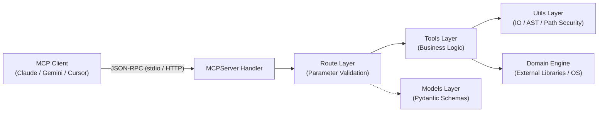

# Introduction

Generate comprehensive documentation for Model Context Protocol (MCP) servers adhering to the modern 2026-07-28 stateless protocol specification. Produce `Home.md`, `Design-Overview.md`, and `Tools-Design.md` using ASD-STE100 language and modern Mermaid diagrams.

---

# Section 1: MCP Landing Page (`Home.md` - Blueprint B1)

1. **Overview Paragraph**: Single concise paragraph explaining server purpose, supported client hosts, and domain goals. No title above this paragraph.
2. **Alert**: Include GitHub alert detailing sandbox security or critical runtime prerequisites:
   ```markdown
   > [!NOTE]
   > Custom data transformations execute inside an AST-validated sandbox that restricts dangerous builtins and filesystem traversal.
   ```
3. **Features**: Group tool capabilities under domain `## [Category]` headings.
4. **Wiki Documentation**: Navigation table linking `Design-Overview.md` and `Tools-Design.md`. Must strictly list internal pages of this wiki only; never reference other wikis.

---

# Section 2: Architecture & Protocol (`Design-Overview.md` - Blueprint B2)

## What to do
1. **Three-Layer Architecture**:
   - Tabulate layer boundaries: Routes (protocol facades), Tools (pure domain logic), and Utils (security, AST, IO).
   - Visualise layer interactions with a modern `flowchart LR` diagram.
2. **Transport & Protocol Specification**:
   - Detail Standard I/O (`stdio`, default) with JSON-RPC over stdin/stdout and stderr logging isolation.
   - Detail Stateless Streamable HTTP (`stateless_http=True`) via ASGI Starlette mounts with zero server session stickiness.
3. **Tool Contracts & Error Handling**:
   - Detail Pydantic schema validation, structured output models (`structured_content`), and `ToolError` conventions.
4. **Security Architecture**:
   - Path Traversal Protection: Canonical path resolution boundaries (`resolve_path()`).
   - Execution Sandboxing: AST inspection blocking `import`, `exec`, `eval`, `open`, and `__builtins__`.
5. **Mandatory Source References**: Conclude with `# Source Code References` table.
6. **Append References**: Conclude with a `# References` section formatted strictly as a numbered list of markdown links with no descriptions.

## Canonical Template: `Design-Overview.md`

```markdown
# Overview

[Technical overview of server design: stateless protocol, layer boundaries, and single-responsibility tools.]

---

# Architecture & System Topology

The server implements a strict three-layer architecture:

| Layer | Responsibility | Export / Signature |
|---|---|---|
| **Routes** | Protocol facades registering tools with `MCPServer`, parameter validation | `register(mcp: MCPServer)` |
| **Tools** | Pure business logic handling domain computation. Decoupled from protocol | Returns dicts or Pydantic models |
| **Utils** | Shared infrastructure: file path security, IO wrappers, AST validation | Helper modules |



---

# Transport & Protocol Specification

The server adheres to the MCP v2 stateless protocol specification:

- **Standard I/O (`stdio`, default):** The host spawns the server as a subprocess. Communication flows across stdin and stdout using JSON-RPC 2.0. Logging routes exclusively to stderr to prevent stream corruption.
- **Stateless Streamable HTTP:** For containerised and distributed deployments, the server mounts an ASGI application. All request context exists within incoming headers with zero server-side session affinity.

---

# Tool Organisation & Contracts

- **Input Validation:** Every tool parameter defines a Pydantic `BaseModel` with runtime validation.
- **Structured Content:** Tools return structured payloads conforming to auto-generated JSON schemas.
- **Error Handling:** Domain and validation failures raise `ToolError` instances. This mechanism delivers clear error feedback to LLM clients.

---

# Security Architecture

## Path Traversal Protection
All file operations validate paths against configured root directories. Canonical path resolution prevents directory traversal attacks.

## Execution Sandboxing
Custom code execution tools validate user scripts using Python Abstract Syntax Tree (AST) inspection. The parser rejects `import`, `exec`, `eval`, and access to `__builtins__`.

---

# Source Code References

| Layer / Mechanism | Source File Path | Key Symbols / Exports | Architectural Role |
|---|---|---|---|
| Route Facade | `src/server/routes/domain.py` | `register()` | Binds tools to `MCPServer` instance |
| Tool Logic | `src/server/tools/domain.py` | `execute_tool()` | Domain execution logic decoupled from MCP |
| AST Security Guard | `src/server/utils/security.py` | `validate_python_ast()` | AST analysis blocking dangerous builtins |
| CLI Entrypoint | `src/server/server.py` | `main()` | CLI argument parsing and transport binding |

---

# References

1. [Model Context Protocol Specification](https://spec.modelcontextprotocol.io/)
2. [RFC 6570: URI Template](https://datatracker.ietf.org/doc/html/rfc6570)
```

---

# Section 3: Tools Specification (`Tools-Design.md` - Blueprint B3)

For each tool, provide:
1. Category H1 and tool name H2 with read-only/mutating tag: `## tool_name (read-only | mutating)`.
2. Purpose paragraph (ASD-STE100, under 25 words).
3. Parameters table: `| Parameter | Type | Required | Description |`.
4. Execution Algorithm: Numbered procedural steps (under 20 words each).
5. Return Structure table: Field, Type, Description.
6. Error Conditions list: Named `ToolError` variants and failure causes.
7. Source Code Reference: Route and Tool logic file paths.

---

# Quality Bar

- **ASD-STE100 Compliance**: Procedural sentences under 20 words; descriptive sentences under 25 words.
- **British English**: 100% British English orthography (`serialise`, `optimised`).
- **Zero Raw Code**: Represent tool parameters and returns exclusively through markdown tables.

