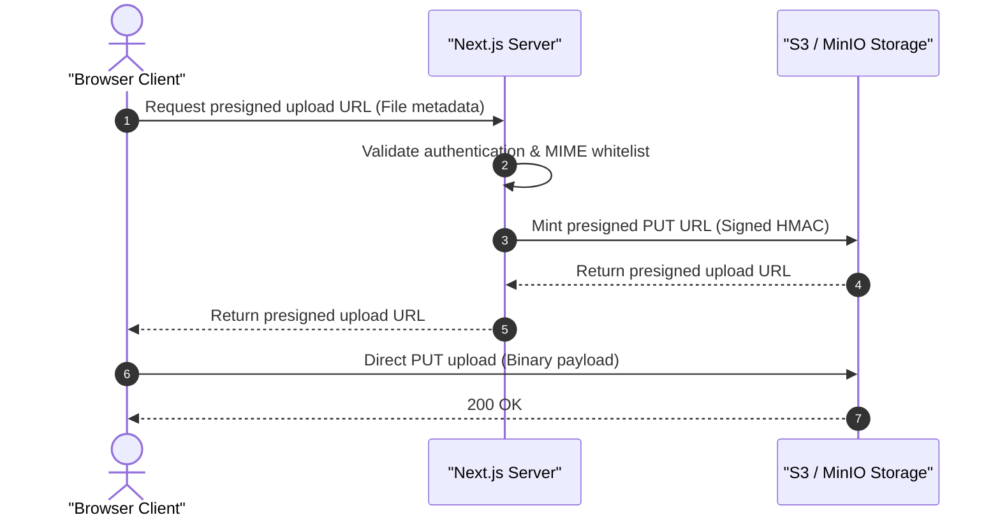

# Introduction

Generate `5.-Storage.md` for Web Dev projects. Detail binary object storage architectures, bucket configurations, presigned upload lifecycles, and access controls using ASD-STE100 language and modern Mermaid diagrams.

---

# What to do

1. **Write the Overview**:
   - Explain binary storage provider selection, bucket isolation, and upload architecture.
   - Keep descriptive sentences under 25 words following ASD-STE100.
2. **Tabulate Infrastructure & Buckets**:
   - Detail Bucket Name, Access Level, Allowed MIME Types, Max Size, and Cache Policy.
3. **Illustrate Upload Pipeline**:
   - Construct a Mermaid `sequenceDiagram` with `autonumber` showing presigned URL generation and direct client PUT upload.
4. **Detail Security & Access Control**:
   - Explain direct-to-storage upload protection, storage quotas, and quarantine/scanning procedures.
   - Cite relevant source modules inline: `[src/actions/storage.ts: getPresignedUploadUrl]`.
5. **Compile Mandatory Source References**:
   - Conclude with a `# Source Code References` table mapping storage operations to source files and symbols.
6. **Provide References**:
   - Provide a `# References` section formatted strictly as a numbered list of markdown links with no descriptions.

---

# What not to do

- **Strictly No Implementation Code**: Prohibit raw code blocks (`ts`, `js`, `py`, `json`).
- **No Provider Suffixes in Filename**: Name the document `5.-Storage.md`, never `5.-Storage-(Provider).md`.
- **No Direct Binary Proxying through App Server**: Architecture must enforce direct client-to-storage uploads.

---

# Canonical Template: `5.-Storage.md`

```markdown
# Overview

[Overview of binary object storage architecture, bucket isolation, and presigned upload lifecycle.]

---

# Infrastructure & Buckets

| Bucket Name | Access Level | Allowed MIME Types | Max Size | CDN / Cache Policy |
|---|---|---|---|---|
| `user-avatars` | Public Read | `image/png`, `image/jpeg`, `image/webp` | 2 MB | Max-age 86400 (Public CDN) |
| `attachments` | Private | `application/pdf`, `image/*` | 25 MB | Presigned GET URL (15 min expiry) |

---

# Upload Pipeline



---

# Security & Access Control

## Direct-to-Storage Protection
Direct PUT uploads bypass the application server. This design prevents memory exhaustion and request timeouts on large payloads.

## Quarantine & Content Verification
Storage triggers scan uploaded binaries for malicious payloads. Files failing signature verification are deleted immediately. Code citation: `[src/actions/storage.ts: verifyUpload]`.

---

# Source Code References

| Storage Operation | Source File Path | Key Symbols / Exports | Responsibility |
|---|---|---|---|
| Presigned URL Minting | `src/actions/storage.ts` | `getPresignedUploadUrl()` | Generates authenticated direct PUT target |
| Storage Client | `src/lib/storage.ts` | `storageClient` | Configured AWS SDK / MinIO client instance |

---

# References

1. [Amazon S3 REST API: Presigned URLs for Object Uploads](https://docs.aws.amazon.com/AmazonS3/latest/API/sigv4-UsingHTTPPOST.html)
2. [OWASP File Upload Security Cheat Sheet](https://cheatsheetseries.owasp.org/cheatsheets/File_Upload_Cheat_Sheet.html)
```

---

# Quality Bar

- **ASD-STE100 Compliance**: Procedural sentences under 20 words; descriptive sentences under 25 words.
- **British English**: 100% British English orthography (`authorisation`, `initialised`).
- **Zero Raw Code**: Represent all contracts via declarative markdown tables and sequence diagrams.

