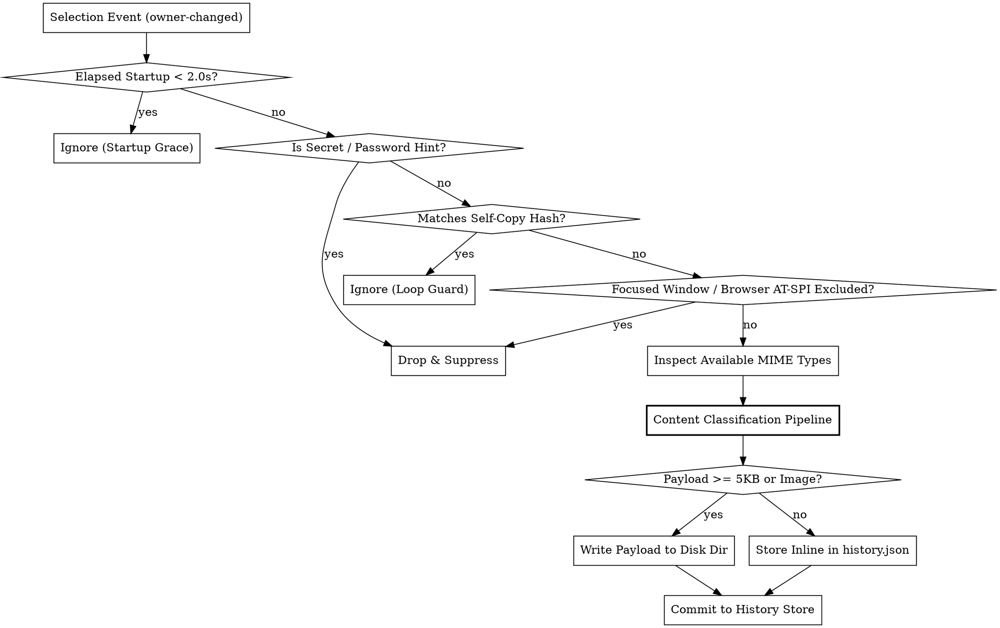

# GNOME Clipboard Management (GNOME 45+)

## Overview

Clipboard management in GNOME Shell (GNOME 45+) requires coordinating Mutter compositor selections (`Meta.Selection`), Shell Toolkit abstractions (`St.Clipboard`), Clutter virtual input devices, and accessibility trees (`Atspi`). Extensions run directly inside the single-threaded Shell compositor process, meaning all clipboard inspections, content classifications, media decodes, and disk persistence must be strictly non-blocking.

**Core principles:**
1. Always synchronize both `CLIPBOARD` and `PRIMARY` selections when writing.
2. Release Clutter modal grabs and stage key focus before dispatching virtual keystrokes, and guarantee modifier release in a `finally` block.
3. Filter password hints (`x-kde-passwordManagerHint`), gate deep AT-SPI traversal to web browsers, and debounce focus events.
4. Classify incoming items using a strict priority pipeline (Image → File → URL → Contact → Color → Code → Text) before committing.
5. Offload large payloads (≥ 5 KB or binary images) to dedicated disk directories (`texts/`, `images/`) while keeping small items inline in `history.json`.
6. Strictly adhere to Unicode UTS #51: never append `VS16` (`\uFE0F`) after Fitzpatrick skin tone modifiers.
7. Perform all media downloading and thumbnail scaling asynchronously via GIO streams without blocking the compositor thread.

---

## When to Use

- Building clipboard history extensions, managers, or companion drawers.
- Intercepting clipboard modifications (`owner-changed` signal) reliably across Wayland and X11 without duplicate captures or startup races.
- Reading and writing multi-format clipboard payloads (`text/plain`, `text/uri-list`, `image/*`).
- Injecting automated paste keystrokes into client applications using virtual keyboard devices (`Clutter.InputDeviceType.KEYBOARD_DEVICE`), with automatic terminal detection (`Main.inputMethod.contentPurpose`).
- Filtering credentials from password managers (`x-kde-passwordManagerHint`, window blacklists, and in-browser popups via AT-SPI).
- Implementing picker tabs for Unicode Emojis (with ZWJ sequences and skin tones conforming to UTS #51), Kaomojis, and Special Symbols without Pango markup errors.
- Asynchronously searching, caching, and pasting animated GIFs via `Soup 3.0` and async GdkPixbuf streams.
- Integrating clipboard history, emojis, or symbols into GNOME Shell's Activities Overview search.

## When NOT to Use

- Pre-GNOME 45 environments (legacy `imports.gi` or standalone `init()` architecture).
- Standalone GTK applications running outside GNOME Shell (use standard `GdkClipboard` / `GtkClipboard`).
- General extension lifecycle, Libadwaita preferences, or Quick Settings UI wiring (refer to `gnome-shell-extension` skill).

---

## Decision Flowchart



---

## Quick Reference Table

| Task | Key API / Primitive | Deep Reference |
|---|---|---|
| **Selection Monitoring** | `global.display.get_selection().connect('owner-changed')` + startup grace | [clipboard-monitoring-and-mimetypes.md](references/clipboard-monitoring-and-mimetypes.md) |
| **MIME Inspection** | `selection.get_mimetypes(Meta.SelectionType.SELECTION_CLIPBOARD)` | [clipboard-monitoring-and-mimetypes.md](references/clipboard-monitoring-and-mimetypes.md) |
| **Streaming Binary / Images** | `selection.transfer_async(..., Gio.MemoryOutputStream)` | [clipboard-monitoring-and-mimetypes.md](references/clipboard-monitoring-and-mimetypes.md) |
| **File Copying** | Format `file:///...` with CRLF (`\r\n`) as `text/uri-list` | [clipboard-monitoring-and-mimetypes.md](references/clipboard-monitoring-and-mimetypes.md) |
| **Auto-Paste Simulation** | `create_virtual_device(KEYBOARD_DEVICE)` + `Shift+Insert` / `Ctrl+Shift+V` | [auto-paste-and-virtual-input.md](references/auto-paste-and-virtual-input.md) |
| **Terminal Context Detection**| `Main.inputMethod.contentPurpose === Clutter.InputContentPurpose.TERMINAL` | [auto-paste-and-virtual-input.md](references/auto-paste-and-virtual-input.md) |
| **Modifier Release Safety** | `try { ... } finally { keyboard.notify_key(..., RELEASED); }` | [auto-paste-and-virtual-input.md](references/auto-paste-and-virtual-input.md) |
| **Secret & Password Shield** | `x-kde-passwordManagerHint` & `Shell.WindowTracker` checks | [security-and-secret-filtering.md](references/security-and-secret-filtering.md) |
| **Browser Extension Popups** | `Atspi.EventListener` gated to HTTP browser apps + 40ms debounce | [security-and-secret-filtering.md](references/security-and-secret-filtering.md) |
| **Feedback Loop Guard** | SHA-256 Hash registry (`GLib.compute_checksum_for_string`) | [security-and-secret-filtering.md](references/security-and-secret-filtering.md) |
| **Content Classification** | Priority pipeline: Image → File → URL → Contact → Color → Code → Text | [content-classification-and-storage.md](references/content-classification-and-storage.md) |
| **Large Storage Offloading** | Inline (<5KB) vs Offloaded (`storage/texts/<id>.txt`, `storage/images/`) | [content-classification-and-storage.md](references/content-classification-and-storage.md) |
| **Overview Search Provider** | `Main.overview.searchController.addProvider(provider)` | [content-classification-and-storage.md](references/content-classification-and-storage.md) |
| **Emoji Skin Tones (UTS #51)**| Fitzpatrick modifiers (`\u{1F3FB}`–`\u{1F3FF}`) without trailing `VS16` | [emoji-kaomoji-symbols.md](references/emoji-kaomoji-symbols.md) |
| **Kaomoji Rendering** | Disable `use_markup` or call `GLib.markup_escape_text()` | [emoji-kaomoji-symbols.md](references/emoji-kaomoji-symbols.md) |
| **Async Media & Thumbnails** | Libsoup 3.0 + `GdkPixbuf.Pixbuf.new_from_stream_at_scale_async` | [gif-and-media-handling.md](references/gif-and-media-handling.md) |

---

## Core Patterns

### 1. Unified Text and Binary Clipboard Setter
Always synchronize both `CLIPBOARD` and `PRIMARY` selections:

```javascript
import St from 'gi://St';
import GLib from 'gi://GLib';

export function setClipboardText(text) {
    const clipboard = St.Clipboard.get_default();
    clipboard.set_text(St.ClipboardType.CLIPBOARD, text);
    clipboard.set_text(St.ClipboardType.PRIMARY, text);
}

export function setClipboardContent(mimeType, bytes) {
    const glibBytes = bytes instanceof GLib.Bytes ? bytes : new GLib.Bytes(bytes);
    const clipboard = St.Clipboard.get_default();
    clipboard.set_content(St.ClipboardType.CLIPBOARD, mimeType, glibBytes);
    clipboard.set_content(St.ClipboardType.PRIMARY, mimeType, glibBytes);
}
```

### 2. Context-Aware Auto-Paste with Release Safety
Detect terminal context, release Clutter modal grabs, and guarantee modifier release:

```javascript
import Clutter from 'gi://Clutter';
import GLib from 'gi://GLib';
import * as Main from 'resource:///org/gnome/shell/ui/main.js';

export async function triggerAutoPaste(menu, delayMs = 50) {
    // 1. Release modal grab
    if (menu && menu.isOpen) menu.close();

    // 2. Clear stage focus so client window receives keystrokes
    if (global.stage.get_key_focus()) global.stage.set_key_focus(null);

    // 3. Dispatch keystrokes with guaranteed modifier release
    return new Promise((resolve) => {
        GLib.timeout_add(GLib.PRIORITY_DEFAULT, delayMs, () => {
            const seat = global.stage.context.get_backend().get_default_seat();
            const keyboard = seat.create_virtual_device(Clutter.InputDeviceType.KEYBOARD_DEVICE);
            const isTerminal = Main.inputMethod.contentPurpose === Clutter.InputContentPurpose.TERMINAL;

            if (isTerminal) {
                // Emit Ctrl + Shift + V for terminals
                const time = Clutter.get_current_event_time();
                try {
                    keyboard.notify_keyval(time, Clutter.KEY_Control_L, Clutter.KeyState.PRESSED);
                    keyboard.notify_keyval(time, Clutter.KEY_Shift_L, Clutter.KeyState.PRESSED);
                    keyboard.notify_keyval(time + 10, Clutter.KEY_v, Clutter.KeyState.PRESSED);
                    keyboard.notify_keyval(time + 20, Clutter.KEY_v, Clutter.KeyState.RELEASED);
                } finally {
                    keyboard.notify_keyval(time + 30, Clutter.KEY_Shift_L, Clutter.KeyState.RELEASED);
                    keyboard.notify_keyval(time + 40, Clutter.KEY_Control_L, Clutter.KeyState.RELEASED);
                }
            } else {
                // Emit Shift + Insert (Evdev 42 + 110) for universal GUI compatibility
                const now = GLib.get_monotonic_time();
                const KEY_LEFTSHIFT = 42;
                const KEY_INSERT = 110;
                try {
                    keyboard.notify_key(now, KEY_LEFTSHIFT, Clutter.KeyState.PRESSED);
                    keyboard.notify_key(now + 10, KEY_INSERT, Clutter.KeyState.PRESSED);
                    keyboard.notify_key(now + 20, KEY_INSERT, Clutter.KeyState.RELEASED);
                } finally {
                    keyboard.notify_key(now + 30, KEY_LEFTSHIFT, Clutter.KeyState.RELEASED);
                }
            }

            resolve(true);
            return GLib.SOURCE_REMOVE;
        });
    });
}
```

---

## Common Pitfalls & Traps

| Symptom / Trap | Root Cause | Solution |
|---|---|---|
| **Spurious double-capture on Wayland** | Mutter uses an internal `GMemoryOutputStream` intermediate buffer triggering a second `owner-changed` signal. | Maintain an active `_transferring` lock flag and debounce processing by 50ms. |
| **Startup capture storm / re-capturing old items** | `owner-changed` triggers during shell startup or extension enable before user action. | Enforce a 2.0-second startup grace period via monotonic time comparison. |
| **Stuck Shift / Ctrl keys after auto-paste** | Unhandled exception or timing interruption before key release event is dispatched. | Always wrap key presses and release calls in a `try ... finally` block. |
| **Entire desktop stutters when clicking inputs** | Ungated AT-SPI listener recursively walking 30+ parent levels on every focus change across the OS. | Gate parent traversal exclusively to known web browser application IDs and debounce by 40ms. |
| **UI freezes during thumbnail creation** | Calling synchronous `Pixbuf.new_from_file_at_scale` or `savev` inside `GLib.idle_add`. | Use `file.read_async` + `Pixbuf.new_from_stream_at_scale_async` + `save_to_streamv_async`. |
| **Pango XML parse crashes on Kaomojis** | Kaomojis containing `<` or `>` trigger XML parsing errors when `use_markup = true`. | Set `clutter_text.use_markup = false` or wrap with `GLib.markup_escape_text()`. |
| **Broken emoji glyphs after applying skin tone** | Appending `VS16` (`\uFE0F`) after a Fitzpatrick modifier violates Unicode UTS #51 Section 2.2. | Remove `VS16` from the base component when applying a skin tone modifier (`base + tone`). |
| **Laggy menu opening and high memory spikes** | Storing large code dumps or multi-megabyte texts inline inside `history.json`. | Offload payloads ≥ 5KB to dedicated disk files (`storage/texts/<id>.txt`) and store pointers. |

---

## Detailed References

For full production-tested implementations and architectures, refer to the following documents:
- [Clipboard Monitoring & MIME Types](references/clipboard-monitoring-and-mimetypes.md) — Low-level `Meta.Selection`, `transfer_async`, startup guards, and MIME handling.
- [Auto-Paste & Virtual Input](references/auto-paste-and-virtual-input.md) — Evdev scancodes, terminal context detection, Clutter seat virtual devices, and release safety.
- [Security & Secret Filtering](references/security-and-secret-filtering.md) — Password hints, debounced browser AT-SPI tree traversal, and loop guards.
- [Content Classification & Storage](references/content-classification-and-storage.md) — Priority pipeline, large payload offloading, file healing, and overview search provider.
- [Emojis, Kaomojis & Symbols](references/emoji-kaomoji-symbols.md) — Unicode UTS #51 emoji modifier sequences, Fitzpatrick tones, and Pango markup escaping.
- [GIF & Rich Media Handling](references/gif-and-media-handling.md) — Libsoup 3.0 async networking, magic bytes, and non-blocking async thumbnail scaling.
