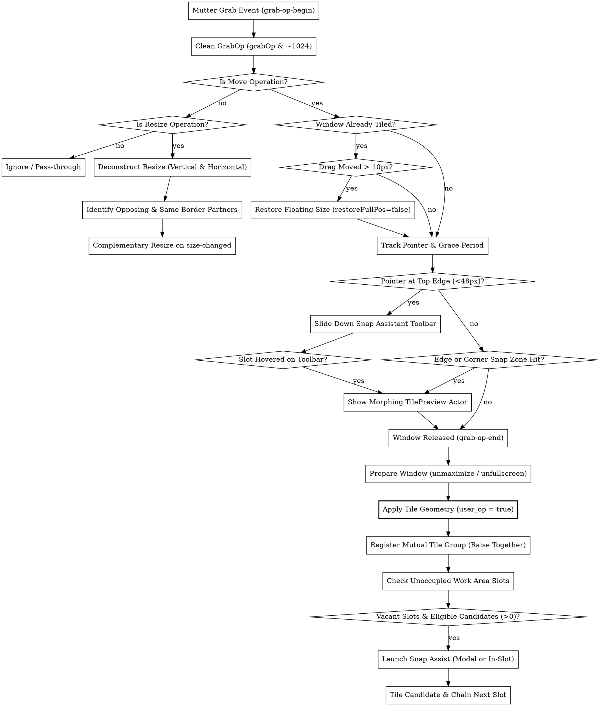

# GNOME Tiling & Window Management (GNOME 45+)

## Overview

Tiling and window management in GNOME Shell (GNOME 45+) requires direct orchestration of the Mutter window manager (`Meta`), geometry types (`Mtk.Rectangle`), Clutter input grabs (`global.display`), and the Shell UI toolkit (`St`). Extensions execute directly inside the single-threaded Shell compositor process, meaning all snap-zone computations, layout projections, window raises, and resize synchronizations must be strictly non-blocking and free of signal loops.

**Core Principles:**
1. **Normalized Grid Geometry `[0.0, 1.0]`:** Model layouts using resolution-independent normalized units and project onto monitor work areas (`workspace.get_work_area_for_monitor()`) at runtime, incorporating uniform inner and outer gaps scaled by monitor DPI.
2. **Two-Step Move/Resize Mechanics:** When applying tiled bounds, always call `window.move_frame(true, x, y)` followed by `window.move_resize_frame(true, x, y, width, height)` with `user_op = true` to circumvent terminal cell size clamping (e.g. `gnome-terminal`).
3. **Signal Storm Recursion Defense:** Never invoke `window.raise()` inside a `raised` signal listener or `window.move_resize_frame()` inside a `size-changed` listener without temporarily muting the target's signal handler via `block_signal_handler()` / `unblock_signal_handler()`.
4. **Grab-Op Masking & Multi-Direction Parsing:** Strip unconstrained grab flags (`grabOp & ~1024`) when intercepting `grab-op-begin`/`grab-op-end`. Deconstruct resize operations into independent vertical and horizontal components to handle corner drags (`RESIZING_NE`, `RESIZING_NW`, etc.) and keyboard resizes.
5. **Modal Lifecycle & Actor Allocation:** Suggestions popups inheriting from `SwitcherPopup` must override `vfunc_allocate` to center child lists inside target screen slots rather than calling `set_position()`. Acquire seat grabs via `Main.pushModal()` and release them with `Main.popModal()` in `finally` blocks.
6. **Dynamic Untile on Drag:** When the user drags an already-tiled window, restore floating size after 10px of movement while seamlessly continuing the move operation under the cursor (`restoreFullPos: false`).
7. **Multi-Monitor Edge Grace Period:** When dragging across adjacent monitors, apply a short timer-based lock (150ms) to allow edge snapping on the current display before switching monitor context.
8. **Flicker-Free Clone Proxy Animations:** Animate window geometric transitions using a temporary `Clutter.Clone` proxy actor while holding `windowActor.opacity = 0`, avoiding asynchronous client redraw stutter.
9. **Smart Border Radius via Cairo:** Use `St.DrawingArea` with Cairo rendering (`vfunc_repaint`) to render active focus borders with rounded top corners and square bottom corners matching modern GTK CSD windows.

---

## When to Use

- Building custom auto-tiling, manual tiling, or quarter/grid snapping extensions.
- Adding top-screen animated layout toolbars (drop-down Snap Assistants with peek/shown states) or top-panel indicator menus.
- Implementing Snap Assist (window suggestions via centered modal switchers or in-slot desktop masonry grids).
- Synchronizing adjacent window borders during resizing (complementary resizing in lockstep across cardinal and corner drags).
- Grouping tiled windows together so focusing one raises the entire tiled cluster ("Raise Together") and moving workspaces moves the group.
- Integrating tiled groups into the Alt+Tab window switcher or adding active window Cairo focus outlines.
- Porting legacy pre-GNOME 45 window management extensions to `Mtk.Rectangle` and ESM.

## When NOT to Use

- Pre-GNOME 45 environments (legacy `Meta.Rectangle` or `imports.gi` architecture).
- Standalone GTK applications running outside GNOME Shell (use standard Wayland/X11 protocols).
- General extension lifecycle, Libadwaita preference pages, or Quick Settings menus (refer to `gnome-shell-extension` or `gnome-quick-settings-management`).

---

## Decision Flowchart

---

## Quick Reference Table

| Feature / Task | Key API / Primitive | Deep Reference |
|---|---|---|
| **Normalized Grid Model** | Unit ratios `[0.0, 1.0]` projected to `ws.get_work_area_for_monitor()` | [layout-grids-and-geometry.md](references/layout-grids-and-geometry.md) |
| **Inner & Outer Gaps** | Boundary classification (`isTileOnContainerBorder`) + DPI scaling | [layout-grids-and-geometry.md](references/layout-grids-and-geometry.md) |
| **Vacant Slot Detection** | Grid slot matching (`tilingshell`) vs Free rect slicing (`tiling-assistant`) | [layout-grids-and-geometry.md](references/layout-grids-and-geometry.md) |
| **Span Maximize Flags** | `window.set_maximize_flags(Meta.MaximizeFlags.VERTICAL)` | [layout-grids-and-geometry.md](references/layout-grids-and-geometry.md) |
| **Drag & Snap Interception** | `global.display.connectObject('grab-op-begin')` + `grabOp & ~1024` | [window-drag-and-snap-detection.md](references/window-drag-and-snap-detection.md) |
| **Dynamic Drag Untile** | Restore floating rect after > 10px drag with `restoreFullPos: false` | [window-drag-and-snap-detection.md](references/window-drag-and-snap-detection.md) |
| **Multi-Monitor Grace Period**| 150ms lock before updating active monitor on display transitions | [window-drag-and-snap-detection.md](references/window-drag-and-snap-detection.md) |
| **Tile Preview Actor** | `St.Widget` in `global.windowGroup` positioned below dragged actor | [window-drag-and-snap-detection.md](references/window-drag-and-snap-detection.md) |
| **Snap Assistant Toolbar** | Slide-down overlay (`addTopChrome`) with `HIDDEN`/`PEEK`/`SHOWN` states | [top-bar-and-overlay-toolbars.md](references/top-bar-and-overlay-toolbars.md) |
| **Panel Indicator Menu** | `PanelMenu.Button` emitting `open-preferences` to `Extension.openPreferences()` | [top-bar-and-overlay-toolbars.md](references/top-bar-and-overlay-toolbars.md) |
| **Modal Suggestion Switcher** | Centered `SwitcherPopup` allocating `_switcherList` via `vfunc_allocate` | [suggestions-and-snap-assist.md](references/suggestions-and-snap-assist.md) |
| **In-Slot Desktop Masonry** | Desktop cards subclassing `Shell.WindowPreview` in vacant slots | [suggestions-and-snap-assist.md](references/suggestions-and-snap-assist.md) |
| **Raise Together (Groups)** | Mutual grouping with `block_signal_handler()` loop guard | [synchronized-resizing-and-groups.md](references/synchronized-resizing-and-groups.md) |
| **Corner & Keyboard Resizing**| Parse `grabOp` into vertical (`N`/`S`) and horizontal (`E`/`W`) components | [synchronized-resizing-and-groups.md](references/synchronized-resizing-and-groups.md) |
| **Seam Detection & Resizing**| Classify `OPPOSING` vs `SAME` border partners with inner gap deduction | [synchronized-resizing-and-groups.md](references/synchronized-resizing-and-groups.md) |
| **Alt+Tab Group Integration**| `Main.wm.setCustomKeybindingHandler('switch-applications')` | [multitasking-animations-and-quirks.md](references/multitasking-animations-and-quirks.md) |
| **Cairo Smart Border Radius**| `St.DrawingArea` with `vfunc_repaint` (11px top, 0px bottom) | [multitasking-animations-and-quirks.md](references/multitasking-animations-and-quirks.md) |
| **Flicker-Free Clone Ease** | `new Clutter.Clone({ source: winActor })` ease to target rect | [multitasking-animations-and-quirks.md](references/multitasking-animations-and-quirks.md) |
| **Terminal Cell Size Rule** | `window.move_frame(true, x, y)` then `move_resize_frame(true, ...)` | [multitasking-animations-and-quirks.md](references/multitasking-animations-and-quirks.md) |

---

## Detailed References

The following focused topic guides provide production patterns, algorithms, and complete implementations:

1. **[Layout Grids & Coordinate Geometry](references/layout-grids-and-geometry.md)**
   Normalized coordinate space, `Mtk.Rectangle` math, outer screen gaps vs inner window gaps, container border classification, multi-monitor work area offsets, reverse projection, and dual free space calculation paradigms.
2. **[Window Drag & Snap Detection](references/window-drag-and-snap-detection.md)**
   Mutter grab operation handling, unmasking unconstrained flags, dynamic drag untiling, multi-monitor grace period lock, touch delta tracking, titlebar edge detection, and the `TilePreview` actor.
3. **[Top Bar & Overlay Layout Toolbars](references/top-bar-and-overlay-toolbars.md)**
   Dynamic Snap Assistant overlay toolbar with 3-state slide-down easing, actor clipping, mini layout card widgets, top panel indicator menu (`PanelMenu.Button`), and clean preference opening.
4. **[Suggestions & Snap Assist](references/suggestions-and-snap-assist.md)**
   Vacant slot identification pipeline, MRU candidate filtering, `SwitcherPopup` modal grab with `vfunc_allocate` centering, desktop in-slot masonry previews via `Shell.WindowPreview`, and consecutive multi-slot chaining.
5. **[Synchronized Resizing & Window Groups](references/synchronized-resizing-and-groups.md)**
   Window grouping architecture, infinite recursion prevention via `block_signal_handler()`, workspace group migration, corner and keyboard GrabOp parsing, opposing/same border relationship mapping, and lockstep delta resizing on `size-changed`.
6. **[Multi-Tasking, Animations & Platform Quirks](references/multitasking-animations-and-quirks.md)**
   Alt+Tab custom keybinding handler integration, active window smart border radius via Cairo `St.DrawingArea`, `Clutter.Clone` proxy animation technique, terminal grid cell hints (`user_op = true`), and pre-tile state restoration.

---

## Edge Cases & Common Traps Checklist

- [ ] **Mtk vs Meta Geometry:** Did you import `Mtk` from `'gi://Mtk'`? In GNOME 45+, `Meta.Rectangle` is deprecated/removed in favor of `Mtk.Rectangle`.
- [ ] **Unconstrained Flag Masking:** Did you strip `1024` from `grabOp`? Mutter sets `META_GRAB_OP_WINDOW_FLAG_UNCONSTRAINED` when dragging windows with modifiers (e.g. Super+LMB).
- [ ] **Corner & Keyboard Resizes:** Does your resizing logic handle corner grabs (`Meta.GrabOp.RESIZING_NE`, etc.) and keyboard grabs (`KEYBOARD_RESIZING_*`) by decomposing them into independent vertical and horizontal components?
- [ ] **Signal Recursion Lockup:** Are partner window `raised` and `size-changed` handlers blocked with `block_signal_handler()` prior to invoking synchronous window operations?
- [ ] **Dynamic Drag Untile:** Does dragging an already-tiled window restore its floating dimensions with `restoreFullPos: false` so the window remains pinned under the cursor?
- [ ] **Multi-Monitor Edge Grace Period:** Is there a 150ms grace period before switching monitor context when dragging windows near the boundary between two adjacent displays?
- [ ] **SwitcherPopup Centering in vfunc_allocate:** Are you centering suggestion popups inside `vfunc_allocate(box)` rather than calling `set_position()` in `show()`?
- [ ] **Odd Inner Gap Preservation:** Does your gap projection use complementary margin deductions (`inner - halfInner`) so odd pixel gaps do not lose pixels or cause asymmetric seams?
- [ ] **Terminal Cell Resizing:** Are you passing `user_op = true` to `move_frame()` and `move_resize_frame()`? Passing `false` causes terminals to snap to grid increments or ignore moves.
- [ ] **Compositor Private Actor Existence:** Are you checking `window.get_compositor_private()` before manipulating actor properties or instantiating a `Clutter.Clone`? Wayland windows can destroy their actor before unmanaging.
- [ ] **Modal Release in Finally Block:** Does your Snap Assist switcher guarantee `Main.popModal()` execution even if an unmanaged signal or exception occurs during popup rendering?
- [ ] **Multi-Monitor Coordinate Offsets:** Did you test window snapping on a secondary monitor where `workArea.x` or `workArea.y` is non-zero?
