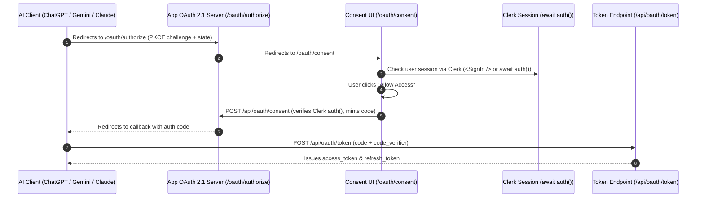

# Third-Party Integrations: Convex, MCP, and Downstream Backends

## Overview

When building applications that combine Clerk with external databases (e.g. Convex, Supabase), AI assistants via Model Context Protocol (MCP), or custom OAuth 2.1 servers, Clerk acts as the foundational identity provider. This guide details how to verify Clerk tokens, mint downstream session tokens, and configure external services safely.

---

## 1. Convex Database Integration

Convex natively integrates with Clerk via JWT validation. Convex verifies incoming tokens against Clerk's JSON Web Key Set (JWKS).

### Configuration (`convex/auth.config.ts`)

> [!IMPORTANT]
> **Convex `customJwt` Schema Requirements**:
> - Always write `convex/auth.config.ts` (typed TypeScript), NOT untyped `.js`.
> - The provider object requires: `type: "customJwt"`, `issuer`, `jwks` (**NOT** `jwksUri`), and `algorithm: "RS256"` (or `"ES256"`).
> - Naming `jwks` incorrectly or omitting `algorithm` causes Convex Cloud deployment pushes to fail with:
>   `400 Bad Request: InvalidAuthConfig: data did not match any variant of untagged enum SerializedAuthInfo`.

```typescript
// convex/auth.config.ts
import type { AuthConfig } from "convex/server";

const config: AuthConfig = {
  providers: [
    // 1. Standard Convex application provider
    {
      domain: process.env.CLERK_JWT_ISSUER_DOMAIN || "https://your-app.clerk.accounts.dev",
      applicationID: "convex",
    },
    // 2. Custom JWT provider for direct token verification (e.g. MCP / API clients)
    {
      type: "customJwt",
      issuer: process.env.CLERK_JWT_ISSUER_DOMAIN || "https://your-app.clerk.accounts.dev",
      jwks: `${process.env.CLERK_JWT_ISSUER_DOMAIN || "https://your-app.clerk.accounts.dev"}/.well-known/jwks.json`,
      algorithm: "RS256",
    },
  ],
};

export default config;
```

### Clerk Dashboard JWT Template Setup
1. In Clerk Dashboard → **JWT Templates**, click **New Template** and select **Convex**.
2. Name the template `convex` (matches `applicationID: "convex"`).
3. The default claims (`aud: "convex"`, `sub: "{{user.id}}"`) will automatically populate.

---

## 2. Minting Downstream Session Tokens

When a server-side route handler, background worker, or OAuth token endpoint needs to make authenticated database requests on behalf of a user, mint a scoped JWT token using the Clerk Backend API client.

```typescript
// lib/clerk-tokens.ts
import { createClerkClient } from "@clerk/nextjs/server";

const clerk = createClerkClient({
  secretKey: process.env.CLERK_SECRET_KEY,
});

/**
 * Mints a scoped JWT for downstream services (e.g. Convex) using an active session ID.
 *
 * @param sessionId - Clerk session ID from auth() or OAuth state.
 * @param template - Name of the JWT template configured in Clerk Dashboard (e.g. "convex").
 * @returns Minted JWT string.
 */
export async function getDownstreamSessionToken(
  sessionId: string,
  template = "convex",
): Promise<string | undefined> {
  try {
    const sessionToken = await clerk.sessions.getToken(sessionId, template);
    return sessionToken?.jwt;
  } catch (error) {
    console.error("Failed to mint Clerk session token:", error);
    return undefined;
  }
}
```

### Passing Scoped Tokens to Database Clients
Always instantiate downstream clients **per-request** with `.setAuth(token)` rather than mutating a shared singleton under serverless concurrency:

```typescript
// lib/convex-client.ts
import { ConvexHttpClient } from "convex/browser";

export function createConvexClient(token?: string): ConvexHttpClient {
  const client = new ConvexHttpClient(process.env.NEXT_PUBLIC_CONVEX_URL!);
  if (token) {
    client.setAuth(token);
  }
  return client;
}
```

---

## 3. Direct Bearer Token Verification (`verifyToken`)

When external callers (such as Model Context Protocol clients, mobile apps, or CLI tools) send requests with `Authorization: Bearer <token>`, verify the token server-side without requiring cookies or active browser sessions.

```typescript
// lib/verify-bearer.ts
import { verifyToken } from "@clerk/nextjs/server";

export interface VerifiedClerkUser {
  userId: string;
  clientId?: string;
  claims: Record<string, unknown>;
}

export async function verifyClerkBearerToken(
  bearerToken: string,
): Promise<VerifiedClerkUser | null> {
  try {
    const payload = await verifyToken(bearerToken, {
      secretKey: process.env.CLERK_SECRET_KEY,
    });

    return {
      userId: payload.sub,
      clientId: (payload as { azp?: string }).azp ?? payload.sub,
      claims: payload as Record<string, unknown>,
    };
  } catch {
    return null;
  }
}
```

---

## 4. Clerk as Identity Provider for Universal OAuth 2.1 & AI Assistants

Third-party AI clients (ChatGPT Custom Actions, Claude Desktop, Google Gemini Connected Apps) connect to Next.js backends via standard OAuth 2.1 (RFC 7636 PKCE, RFC 7591 Dynamic Client Registration, and RFC 8414 metadata).

Clerk does not expose dynamic client registration for external AI assistants by default. You can bridge Clerk authentication with a universal OAuth 2.1 server in your application:



### Implementing the Consent Route (`app/api/oauth/consent/route.ts`)

> [!IMPORTANT]
> **Always wrap `await auth()` defensively**:
> If a request reaches the Route Handler without `clerkMiddleware()` (e.g. missing `proxy.ts` in Next.js 16+, or network glitch), `auth()` throws an error. Wrap `auth()` in `try/catch` to return standard RFC 6749 HTTP 401 JSON instead of an uncaught 500 crash.

```typescript
// app/api/oauth/consent/route.ts
import { auth } from "@clerk/nextjs/server";

export const dynamic = "force-dynamic";

export async function POST(req: Request) {
  let userId: string | null = null;
  let sessionId: string | null | undefined = null;

  try {
    const authContext = await auth();
    userId = authContext.userId;
    sessionId = authContext.sessionId;
  } catch {
    return Response.json(
      {
        error: "unauthorized",
        error_description: "Unable to verify user authentication session",
      },
      { status: 401 },
    );
  }

  if (!userId) {
    return Response.json(
      { error: "unauthorized", error_description: "User is not authenticated" },
      { status: 401 },
    );
  }

  // Mint authorization code and return redirect_url...
  return Response.json({ redirect_url: "https://callback.url..." });
}
```

