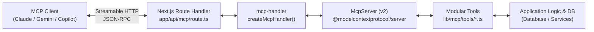

# MCP + Next.js

## Overview

Hosting a Model Context Protocol (MCP) server inside Next.js exposes application data, business logic, and database operations directly to AI clients (Claude, Gemini, Cursor, Copilot) via Web-standard Streamable HTTP. Using `mcp-handler` with `@modelcontextprotocol/server` (v2.x) eliminates standalone server infrastructure by embedding the MCP server directly into standard App Router Route Handlers.

**Core principle:** Treat the MCP server as a standard Next.js Route Handler adapter. Keep tools modular by domain in `lib/mcp/tools/`, validate arguments with Standard Schema / Zod v4, and serve stateless Streamable HTTP at `/api/mcp`.

---

## When to Use

- Building or turning a Next.js web application into an MCP server accessible by AI assistants.
- Exposing internal application data (e.g. portfolio items, CRM records, analytics, CMS blogs) as AI-queryable tools.
- Replacing legacy stdio-only MCP bridges with remote, Web-standard Streamable HTTP endpoints.
- Securing remote MCP tools with Bearer token authentication and RFC 9728 challenges.
- Writing unit and route handler integration tests for MCP tools using Vitest.

## Not For

- Stdio-only desktop tools with no web application (use a standalone Node/Python CLI).
- Pure WebSocket bidirectional push streams where the client does not speak MCP (use WebSockets or Server-Sent Events directly).

---

## Quick Start

### 1. Install Dependencies
```bash
yarn add mcp-handler@^2 @modelcontextprotocol/server@^2 zod@^4
```

### 2. Create Route Handler
```typescript
// app/api/mcp/route.ts
import { createMcpHandler } from "mcp-handler";
import { z } from "zod";

const handler = createMcpHandler(
  (server) => {
    server.registerTool(
      "echo",
      {
        title: "Echo Tool",
        description: "Echoes the provided message back.",
        inputSchema: z.object({
          message: z.string(),
        }),
      },
      async ({ message }) => ({
        content: [{ type: "text", text: `Echo: ${message}` }],
      }),
    );
  },
  {
    serverInfo: {
      name: "my-nextjs-mcp",
      version: "1.0.0",
    },
  },
);

export { handler as GET, handler as POST };
```

---

## Core Architecture



### Recommended Directory Structure

```text
app/
└── api/
    └── mcp/
        └── route.ts            # Route handler (GET & POST)
lib/
└── mcp/
    ├── helpers.ts              # formatToolResponse helper
    ├── register-tools.ts       # Tool aggregation registry
    ├── server.ts               # createMcpHandler configuration
    └── tools/                  # Domain-specific tool modules
        ├── about.ts
        ├── projects.ts
        └── skills.ts
```

---

## Quick Reference

| Task | Pattern | Detailed Guide |
| :--- | :--- | :--- |
| **Tool Registration** | `server.registerTool("name", { inputSchema: z.object({...}) }, handler)` | [Tools & Resources](references/tools-and-resources.md) |
| **No-arg Tools** | Pass `inputSchema: z.object({})` | [Tools & Resources](references/tools-and-resources.md) |
| **Auth Context Extraction** | `getMcpUserId(ctx)` inspecting `ctx.authInfo?.userId`, `ctx.http?.authInfo?.userId` | [Tools & Resources](references/tools-and-resources.md) |
| **Server Action Reuse** | `runWithMcpClient(client, () => baseHandler(req))` via `AsyncLocalStorage` | [Tools & Resources](references/tools-and-resources.md) |
| **Resources** | `server.registerResource("name", "uri://...", meta, handler)` | [Tools & Resources](references/tools-and-resources.md) |
| **Better Auth Route Guard** | `requireMcpAuth(auth, handler, { resource })` for both GET & POST | [Auth & Security](references/authentication-and-security.md) |
| **Dual-Mode / Custom Auth** | `withMcpAuth(handler, verifyMcpToken, { required: false })` | [Auth & Security](references/authentication-and-security.md) |
| **Universal OAuth 2.1** | Better Auth MCP plugin, CIMD, RFC 8414 Section 3, and Supabase GoTrue | [OAuth 2.1 & OIDC](references/oauth-and-oidc.md) |
| **Protocol Compatibility** | `createMcpHandler(..., { legacy: "stateless" })` for 2024-11-05 clients | [Client Config](references/client-configuration.md) |
| **CORS & Probes** | Export `OPTIONS` (204 CORS) and `HEAD` (200 probe) in `route.ts` | [Auth & Security](references/authentication-and-security.md) |
| **Claude Desktop** | `npx -y mcp-remote http://localhost:3000/api/mcp` | [Client Config](references/client-configuration.md) |
| **Gemini Connected Apps** | Discover via `/.well-known/oauth-protected-resource/api/mcp` + `offline_access` | [Client Config](references/client-configuration.md) |
| **VS Code Copilot** | Add `"type": "http"` entry in `.vscode/mcp.json` | [Client Config](references/client-configuration.md) |
| **Testing Route** | Send `POST` with `Accept: application/json, text/event-stream` and `protocolVersion` | [Testing & Debugging](references/testing-and-debugging.md) |

---

## Common Pitfalls & Mistakes

### 1. HTTP 400 Bad Request on Client Initialize (`legacy: "reject"`)
- **Symptom**: AI clients (Gemini, Claude, ChatGPT) fail connecting with HTTP 400: *"Unsupported protocol version: 2024-11-05"*.
- **Cause**: Setting `{ legacy: "reject" }` enforces modern 2026-07-28 `_meta` envelopes, rejecting standard `2024-11-05` traffic.
- **Fix**: Use `{ legacy: "stateless" }` in `createMcpHandler` options.

### 2. HTTP 308 Permanent Redirect on Discovery Endpoints
- **Symptom**: Gemini or `mcp-remote` discovery handshakes fail immediately.
- **Cause**: Trailing slash in `BETTER_AUTH_URL` created double slashes (`...//api/mcp`) in `resource_metadata`. Vercel returns HTTP 308 redirects which AI clients reject.
- **Fix**: Sanitize base URLs using `getSiteUrl()` to strip trailing slashes.

### 3. HTTP 404 on RFC 8414 Section 3 Path Insertion Discovery
- **Symptom**: Google Gemini fails account linking during discovery with 404 errors.
- **Cause**: When authorization server issuer has a path (`/api/auth`), clients query `/.well-known/oauth-authorization-server/api/auth` (RFC 8414 Section 3).
- **Fix**: Create `app/.well-known/oauth-authorization-server/[[...path]]/route.ts` proxying requests to the auth handler.

### 4. `406 Not Acceptable` Error
- **Symptom**: Client requests to `/api/mcp` fail with HTTP 406.
- **Cause**: The MCP Streamable HTTP specification mandates that the client `Accept` header contains both `application/json` and `text/event-stream`.
- **Fix**: In tests and client configurations, specify `Accept: application/json, text/event-stream`. In route handlers, normalize `Accept` if client passes `*/*`.

### 5. `415 Unsupported Media Type` on Probes
- **Symptom**: Automated client health probes or gateway requests fail with HTTP 415.
- **Cause**: `@modelcontextprotocol/server` strictly validates `Content-Type: application/json` on incoming POST requests.
- **Fix**: In `app/api/mcp/route.ts`, normalize incoming headers before calling `mcpHandler` if `content-type` is omitted or empty.

### 6. Missing `offline_access` Causes Gemini Account Linking Failure
- **Symptom**: Google Gemini reports: *"Account linking is required to use this custom app. Please try again."*
- **Cause**: Gemini mandates a `refresh_token` in the OAuth token response. If the OAuth server is not asked for `offline_access`, it returns only an access token.
- **Fix**: Advertise `"offline_access"` in `scopes_supported` in RFC 9728 (`/.well-known/oauth-protected-resource`) and RFC 8414 metadata.

### 7. Missing GET Protection Returns 405 Instead of 401 Challenge
- **Symptom**: Clients sending initial GET or HEAD probes fail to trigger the browser OAuth login.
- **Cause**: Only `POST` was wrapped with `requireMcpAuth`, leaving `GET` returning raw 405 Method Not Allowed.
- **Fix**: Route both `GET` and `POST` through `requireMcpAuth`.

### 8. Silent Auth Downgrade on Invalid Bearer Tokens
- **Symptom**: Calling tools with an expired or forged token runs as Guest instead of returning 401.
- **Cause**: In `withMcpAuth` with `{ required: false }`, returning `undefined` from `verifyToken` treats the request as unauthenticated.
- **Fix**: If an `Authorization: Bearer <token>` header is present but the token is invalid, throw `new OAuthError(OAuthErrorCode.InvalidToken, "...")`.

### 9. Server Component SSR Crash from `"use client"` Helpers (`buttonVariants`)
- **Symptom**: Next.js throws `Attempted to call buttonVariants() from the server but buttonVariants is on the client` during SSR.
- **Cause**: Pure functions exported from files with `"use client"` cannot be invoked during Server Component rendering.
- **Fix**: Extract pure CVA helper functions to a separate directive-free `.ts` file (`components/ui/button-variants.ts`).

### 10. Arcjet WAF Bot Detection Blocking MCP Clients
- **Symptom**: MCP clients receive HTTP 403 Forbidden on `/api/mcp`.
- **Cause**: Automated CLI clients (`curl`, `mcp-remote`, Claude, Gemini) trigger bot heuristics in WAF middleware (`detectBot`).
- **Fix**: Bypass `detectBot` for `/api/mcp` and `/.well-known/*` while keeping WAF `shield` active.

---

## Detailed References

- [Tools, Resources, and Prompts Guide](references/tools-and-resources.md) — API contracts, Zod schemas, user context extraction, and `AsyncLocalStorage` Server Action reuse.
- [Authentication and Security Guide](references/authentication-and-security.md) — Better Auth `requireMcpAuth`, unified GET/POST protection, and dual-mode auth.
- [OAuth 2.1 and OpenID Connect Guide](references/oauth-and-oidc.md) — Native Better Auth OAuth 2.1 provider, RFC 8414 Section 3 discovery, URL normalization, CIMD, and consent UI.
- [Client Configuration Guide](references/client-configuration.md) — Protocol compatibility (`legacy: "stateless"`), Ngrok tunneling, Google Gemini, Claude, and VS Code Copilot.
- [Testing and Debugging Guide](references/testing-and-debugging.md) — Vitest test recipes for tools, route handlers, probes, discovery endpoints, and curl inspection.
