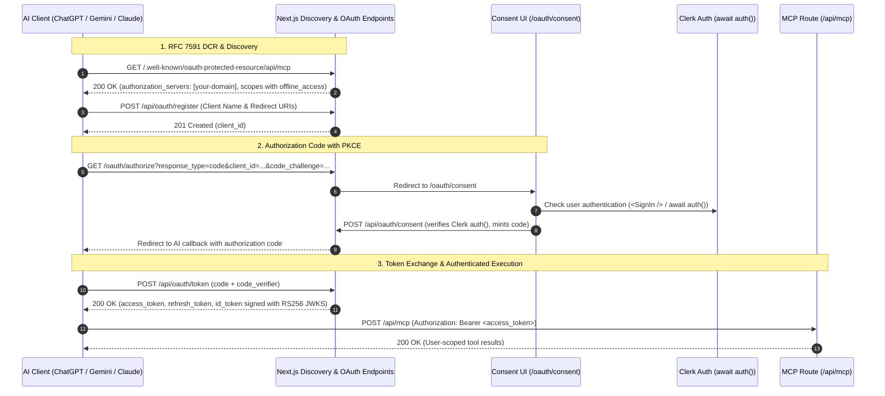

# Universal MCP OAuth 2.1 & OpenID Connect Guide

This guide details how to implement zero-configuration **OAuth 2.1 authentication with Dynamic Client Registration (RFC 7591)**, **Client ID Metadata Documents (CIMD)**, and **OpenID Connect (OIDC)** discovery for Next.js MCP servers.

Three architecture options are supported:
- **Option 1: Better Auth (Native)** — Fully integrated, TypeScript-first OAuth 2.1 server with Drizzle/Prisma schemas, CIMD profile support, and `@better-auth/mcp`.
- **Option 2: Supabase GoTrue** — External headless OAuth 2.1 server using Supabase Auth.
- **Option 3: Universal OAuth 2.1 Server with Clerk** — In-application OAuth 2.1 server bridging Clerk user sessions with RFC 7591 Dynamic Client Registration, RFC 7636 PKCE S256, and custom consent UI for modern AI clients (ChatGPT, Gemini, Claude).

---

## 1. Architecture Overview

Modern AI clients (Google Gemini, Claude Desktop/Web, Cursor, VS Code Copilot, ChatGPT) implement different revisions of the MCP authorization specification (`2024-11-05`, `2025-03-26`, and `2026-07-28`).

```mermaid
sequenceDiagram
    autonumber
    participant Client as MCP Client (Gemini / Claude / Cursor / ChatGPT)
    participant Next as Next.js App (your-domain.com)
    participant Auth as OAuth 2.1 Provider (Better Auth / GoTrue)
    participant DB as Database (PostgreSQL / Drizzle)

    Note over Client,Auth: 1. Discovery & Registration (RFC 9728 / RFC 8414 / RFC 7591 / CIMD)
    Client->>Next: GET /.well-known/oauth-protected-resource(/api/mcp)
    Next-->>Client: 200 OK (authorization_servers, scopes_supported with offline_access)
    Client->>Next: GET /.well-known/oauth-authorization-server (or /api/auth path)
    Next-->>Client: 200 OK (endpoints, registration_endpoint, jwks_uri)
    Client->>Next: POST /api/auth/oauth2/register (DCR or CIMD fetch)
    Next->>Auth: Register client metadata
    Next-->>Client: 201 Created (client_id, redirect_uris)

    Note over Client,Auth: 2. Authorization Code + PKCE & Consent Screen
    Client->>Auth: Browser Redirect -> /api/auth/oauth2/authorize
    Auth->>Next: Redirect -> /oauth/consent?id=<consent_id>
    Next->>Auth: authClient.oauth2.getConsent({ id })
    Next->>Next: Render consent card; user clicks "Allow Access"
    Next->>Auth: authClient.oauth2.consent({ accept: true, scope })
    Auth-->>Client: Browser Redirect -> <callback>?code=...&state=...

    Note over Client,Auth: 3. Token Exchange & ID Token Verification
    Client->>Next: POST /api/auth/oauth2/token (code + code_verifier)
    Next->>Auth: Validate PKCE & issue tokens
    Auth-->>Client: 200 OK (access_token, refresh_token, id_token signed with asymmetric key)

    Note over Client,Next: 4. Authenticated MCP Tool Invocation
    Client->>Next: POST /api/mcp (Authorization: Bearer <access_token>)
    Next->>Auth: requireMcpAuth verifies JWT signature against /api/auth/jwks
    Next->>DB: Execute tool queries scoped by tokenClaims.sub
    Next-->>Client: 200 OK (User-scoped tool results)
```

---

## 2. Option 1: Native Better Auth OAuth 2.1 & MCP Provider

Better Auth provides native plugins to turn your Next.js application into a fully compliant OAuth 2.1 Authorization Server and protected resource host.

### Required Packages
```bash
npm install better-auth @better-auth/mcp @better-auth/cimd @better-auth/oauth-provider @modelcontextprotocol/server
```

### Server Configuration (`lib/auth/auth.ts`)
```typescript
import { betterAuth } from "better-auth";
import { jwt } from "better-auth/plugins";
import { mcp } from "@better-auth/mcp";
import { cimd } from "@better-auth/cimd";
import { fetchClientMetadataResource } from "@better-auth/cimd/node";
import { getSiteUrl, getMcpResourceUrl } from "@/lib/auth/auth-url";

export const auth = betterAuth({
  baseURL: getSiteUrl(),
  plugins: [
    jwt(), // Required for asymmetric RS256/ES256 JWKS signing
    mcp({
      loginPage: "/auth/login",
      consentPage: "/oauth/consent",
      resource: getMcpResourceUrl(),
      allowDynamicClientRegistration: true,
      allowUnauthenticatedClientRegistration: true,
      // offline_access is mandatory for Gemini refresh tokens
      scopes: ["openid", "profile", "email", "offline_access"],
    }),
    cimd({
      fetchClientMetadataResource,
      metadataProfile: "mcp-2026-07-28", // Pins MCP draft CIMD profile
    }),
  ],
  // database adapter (e.g. drizzleAdapter)...
});
```

### Client Configuration (`lib/auth/auth-client.ts`)
```typescript
import { createAuthClient } from "better-auth/react";
import { oauthProviderClient } from "@better-auth/oauth-provider/client";

export const authClient = createAuthClient({
  plugins: [
    oauthProviderClient(),
  ],
});
```

### Database Tables (Drizzle ORM)
Better Auth OAuth Provider requires:
- `jwks`: Key store for asymmetric token signing.
- `oauth_client`: Registered clients (supports RFC 7591 dynamic client registration).
- `oauth_access_token` & `oauth_refresh_token`: Stored token grants.
- `oauth_consent`: User consent decisions per client and scope set.
- `oauth_resource` & `oauth_client_resource`: Protected resource bindings.

Run `npx @better-auth/cli generate` or sync schemas to create PostgreSQL migration tables.

---

## 3. Option 2: Supabase OAuth 2.1 Server Configuration

Supabase includes a native, headless OAuth 2.1 server in GoTrue.

### `supabase/config.toml`
```toml
[auth.oauth_server]
enabled = true
authorization_url_path = "/oauth/consent"
allow_dynamic_registration = true
```

In Supabase Cloud Dashboard:
- Navigate to **Authentication > OAuth Server**.
- Enable **OAuth Server** and **Dynamic Client Registration**.
- Set **Authorization URL Path** to `/oauth/consent`.

---

## 3. The GoTrue Asymmetric Key (ES256/RS256) Mandate

> [!CAUTION]
> **HTTP 500 `Error generating ID token` in GoTrue**:
> When clients like Google Gemini or Claude request the `openid` scope, GoTrue is required to mint and sign an OIDC `id_token`. GoTrue source code explicitly enforces that ID tokens **must** be signed with asymmetric keys (`ES256` or `RS256`).
> If your Supabase project uses the legacy symmetric `HS256` shared secret, token exchange fails with internal error `HS256 is not supported for ID token signing` and returns HTTP 500.

### Resolution
1. Open Supabase Dashboard: **Project Settings > JWT Signing Keys**.
2. Click **Migrate JWT secret** (creates a standby `ES256` key pair).
3. Click **Rotate keys** to promote `ES256` to the active signing key.
4. Verify by curling the JWKS endpoint:
   ```bash
   curl https://<project-ref>.supabase.co/auth/v1/.well-known/jwks.json
   ```
   Must return an array containing the public key `keys: [{ "kty": "EC", "crv": "P-256", "alg": "ES256", ... }]`.

---

## 4. Metadata & Discovery Route Handlers & URL Normalization

Modern AI clients query multiple discovery specifications:
- **RFC 9728**: Protected resource metadata (`/.well-known/oauth-protected-resource`)
- **RFC 8414 Section 3**: Authorization server metadata (`/.well-known/oauth-authorization-server/api/auth`)
- **Root OIDC / RFC 8414**: Root fallback queries (`/.well-known/openid-configuration` and `/.well-known/oauth-authorization-server`)

### A. Centralized URL Normalization (`lib/auth/auth-url.ts`)

> [!CAUTION]
> **Vercel HTTP 308 Redirect Discovery Failure**:
> When `BETTER_AUTH_URL` or environment variables contain a trailing slash (`https://example.com/`), string concatenation yields double slashes (`https://example.com//api/mcp`).
> When `@better-auth/oauth-provider` generates `WWW-Authenticate: Bearer resource_metadata="..."`, it advertises the double-slash URL. Vercel issues an **HTTP 308 Permanent Redirect**.
> Google Gemini, Claude `mcp-remote`, and ChatGPT reject redirects on metadata endpoints and abort the connection. Always strip trailing slashes:

```typescript
// lib/auth/auth-url.ts
export function getSiteUrl(): string {
  return (process.env.BETTER_AUTH_URL || process.env.NEXT_PUBLIC_SITE_URL || "http://localhost:3000").replace(/\/+$/, "");
}

export function getMcpResourceUrl(): string {
  return `${getSiteUrl()}/api/mcp`;
}

export function sanitizeUrl(url: string): string {
  return url.replace(/([^:]\/)\/+/g, "$1").replace(/\/+$/, "");
}
```

### B. RFC 9728 Protected Resource Metadata Handler
```typescript
// app/.well-known/oauth-protected-resource/[[...resource]]/route.ts
import { NextResponse } from "next/server";
import { getSiteUrl, getMcpResourceUrl } from "@/lib/auth/auth-url";

export const dynamic = "force-dynamic";

const CORS_HEADERS = {
  "Access-Control-Allow-Origin": "*",
  "Access-Control-Allow-Methods": "GET, OPTIONS",
  "Access-Control-Allow-Headers": "Authorization, Content-Type, Accept",
};

export async function OPTIONS() {
  return new Response(null, { status: 204, headers: CORS_HEADERS });
}

export async function GET(req: Request) {
  const url = new URL(req.url);
  const siteUrl = getSiteUrl();

  let resource = getMcpResourceUrl();
  const pathname = url.pathname.replace(/^\/\.well-known\/oauth-protected-resource\/?/, "");
  if (pathname) {
    resource = `${siteUrl}/${pathname.replace(/^\/+/, "")}`;
  }

  const metadata = {
    resource,
    authorization_servers: [`${siteUrl}/api/auth`],
    // offline_access is MANDATORY for Google Gemini to issue a refresh_token
    scopes_supported: ["openid", "profile", "email", "offline_access"],
    bearer_methods_supported: ["header"],
  };

  return NextResponse.json(metadata, {
    headers: {
      ...CORS_HEADERS,
      "Cache-Control": "public, max-age=3600",
      "Content-Type": "application/json",
    },
  });
}
```

### C. RFC 8414 Section 3 Path Insertion Proxy
When an authorization server URL has a path component (e.g. `https://host/api/auth`), **RFC 8414 Section 3** requires clients to insert `/.well-known/oauth-authorization-server` between host and path:
`/.well-known/oauth-authorization-server/api/auth`

Clients also query the root fallback `/.well-known/oauth-authorization-server`. Forward both to Better Auth:

```typescript
// app/.well-known/oauth-authorization-server/[[...path]]/route.ts
import { auth } from "@/lib/auth/auth";
import { getSiteUrl } from "@/lib/auth/auth-url";

export const dynamic = "force-dynamic";

const CORS_HEADERS = {
  "Access-Control-Allow-Origin": "*",
  "Access-Control-Allow-Methods": "GET, OPTIONS",
  "Access-Control-Allow-Headers": "Authorization, Content-Type, Accept",
};

function withCors(res: Response): Response {
  const headers = new Headers(res.headers);
  for (const [key, value] of Object.entries(CORS_HEADERS)) {
    if (!headers.has(key)) headers.set(key, value);
  }
  return new Response(res.status === 204 || res.status === 304 ? null : res.body, {
    status: res.status,
    statusText: res.statusText,
    headers,
  });
}

export async function OPTIONS() {
  return new Response(null, { status: 204, headers: CORS_HEADERS });
}

export async function GET(req: Request) {
  const url = new URL(req.url);
  const siteUrl = getSiteUrl();

  const targetUrl = url.pathname.endsWith("/api/auth")
    ? req.url
    : `${siteUrl}/.well-known/oauth-authorization-server/api/auth${url.search}`;

  const res = await auth.handler(new Request(targetUrl, req));
  return withCors(res);
}
```

### D. Root OpenID Configuration Forwarder
Forward root `/.well-known/openid-configuration` queries to Better Auth's handler:

```typescript
// app/.well-known/openid-configuration/route.ts
import { auth } from "@/lib/auth/auth";
import { getSiteUrl } from "@/lib/auth/auth-url";

export const dynamic = "force-dynamic";

const CORS_HEADERS = {
  "Access-Control-Allow-Origin": "*",
  "Access-Control-Allow-Methods": "GET, OPTIONS",
  "Access-Control-Allow-Headers": "Authorization, Content-Type, Accept",
};

function withCors(res: Response): Response {
  const headers = new Headers(res.headers);
  for (const [key, value] of Object.entries(CORS_HEADERS)) {
    if (!headers.has(key)) headers.set(key, value);
  }
  return new Response(res.status === 204 || res.status === 304 ? null : res.body, {
    status: res.status,
    statusText: res.statusText,
    headers,
  });
}

export async function OPTIONS() {
  return new Response(null, { status: 204, headers: CORS_HEADERS });
}

export async function GET(req: Request) {
  const url = new URL(req.url);
  const siteUrl = getSiteUrl();
  const targetUrl = `${siteUrl}/api/auth/.well-known/openid-configuration${url.search}`;
  const res = await auth.handler(new Request(targetUrl, req));
  return withCors(res);
}
```

---

## 5. Dynamic Client Registration (RFC 7591) & CIMD

Automated MCP clients register dynamically or identify via Client ID Metadata Documents (CIMD):
- In **Better Auth**, enabling `allowDynamicClientRegistration: true` and the `cimd()` plugin automatically handles both RFC 7591 `POST /api/auth/oauth2/register` and URL-based client identities.
- In **Supabase GoTrue**, forward `POST /api/oauth/register` to GoTrue DCR or the Supabase Admin API.

---

## 6. Next.js OAuth 2.1 Consent UI (`/oauth/consent`)

When an AI client requests access, the OAuth provider redirects the user to the consent screen (`/oauth/consent`).

### Better Auth Consent Screen (`app/oauth/consent/page.tsx`)

> [!IMPORTANT]
> **Consent Response Shape**: `authClient.oauth2.consent()` returns `{ redirect: boolean, url: string }` (`OAuthRedirectResult`). Read `res.data?.url` for the redirection destination.
> **Suspense Boundary**: In Next.js App Router, wrap components reading `useSearchParams()` in `<Suspense>` to prevent build-time prerender bailouts.

```tsx
// app/oauth/consent/page.tsx
"use client";

import { Suspense, useEffect, useState } from "react";
import { useSearchParams, redirect } from "next/navigation";
import { authClient } from "@/lib/auth/auth-client";

function ConsentContent() {
  const searchParams = useSearchParams();
  const consentId = searchParams.get("id");
  const session = authClient.useSession();
  const [details, setDetails] = useState<any>(null);
  const [isLoading, setIsLoading] = useState(false);

  useEffect(() => {
    if (!session.isPending && !session.data) {
      redirect(`/auth/login?redirect=${encodeURIComponent(`/oauth/consent?${searchParams.toString()}`)}`);
    }
  }, [session.isPending, session.data, searchParams]);

  useEffect(() => {
    async function load() {
      if (consentId) {
        const res = await authClient.oauth2.getConsent({ query: { id: consentId } });
        if (res.data) setDetails(res.data);
      }
    }
    if (session.data) load();
  }, [consentId, session.data?.user?.id]);

  const handleDecision = async (accept: boolean) => {
    setIsLoading(true);
    try {
      const res = await authClient.oauth2.consent({
        accept,
        scope: details?.scopes?.join(" "),
      });
      if (res.data?.url) {
        window.location.href = res.data.url;
      }
    } finally {
      setIsLoading(false);
    }
  };

  return (
    <div>
      <h2>Authorise {details?.client?.name || "AI Assistant"}</h2>
      <p>Requested scopes: {details?.scopes?.join(", ")}</p>
      <button disabled={isLoading} onClick={() => handleDecision(true)}>Allow</button>
      <button disabled={isLoading} onClick={() => handleDecision(false)}>Deny</button>
    </div>
  );
}

export default function ConsentPage() {
  return (
    <Suspense fallback={<div>Loading authorization request...</div>}>
      <ConsentContent />
    </Suspense>
  );
}
```

---

## 6. Option 3: Universal OAuth 2.1 Server with Clerk

When using Clerk as your primary authentication provider, third-party AI clients (ChatGPT, Google Gemini Connected Apps, Claude Desktop) cannot connect directly to Clerk because Clerk does not expose RFC 7591 Dynamic Client Registration (DCR), PKCE token exchange endpoints, or custom third-party consent screens.

You can bridge Clerk with a lightweight, universal OAuth 2.1 and OpenID Connect layer built directly into your Next.js application:



### 1. In-Application OAuth 2.1 Engine (`lib/mcp/oauth.ts`)

```typescript
// lib/mcp/oauth.ts
import crypto from "node:crypto";

export interface AuthorizationCodePayload {
  userId: string;
  clientId: string;
  redirectUri: string;
  codeChallenge?: string;
  codeChallengeMethod?: "S256" | "plain";
  scope?: string;
  sessionId?: string;
  expiresAt: number;
}

export interface OAuthTokenPayload {
  sub: string;
  clientId: string;
  sessionId?: string;
  scope: string;
  type: "access" | "refresh";
  exp: number;
  iat: number;
}

export interface TokenPair {
  access_token: string;
  token_type: "Bearer";
  expires_in: number;
  refresh_token: string;
  id_token: string;
  scope: string;
}

interface RsaKeyStore {
  privateKey: string;
  publicKey: string;
  jwk: { kty: string; use: string; alg: string; kid: string; n?: string; e?: string };
}

let keyStore: RsaKeyStore | null = null;

export function getOrCreateRsaKeyStore(): RsaKeyStore {
  if (!keyStore) {
    const { publicKey, privateKey } = crypto.generateKeyPairSync("rsa", { modulusLength: 2048 });
    const exportedJwk = publicKey.export({ format: "jwk" });
    keyStore = {
      privateKey: privateKey.export({ format: "pem", type: "pkcs8" }) as string,
      publicKey: publicKey.export({ format: "pem", type: "spki" }) as string,
      jwk: {
        kty: exportedJwk.kty as string,
        use: "sig",
        alg: "RS256",
        kid: "mcp-oauth-key-1",
        n: exportedJwk.n,
        e: exportedJwk.e,
      },
    };
  }
  return keyStore;
}

export function getJwks() {
  return { keys: [getOrCreateRsaKeyStore().jwk] };
}

function getSecretKey(): string {
  return process.env.CLERK_SECRET_KEY || "default-secret";
}

function signPayload(payload: object): string {
  const json = JSON.stringify(payload);
  const data = Buffer.from(json).toString("base64url");
  const hmac = crypto.createHmac("sha256", getSecretKey()).update(data).digest("base64url");
  return `${data}.${hmac}`;
}

function verifyPayload<T>(token: string): T | null {
  const [data, hmac] = token.split(".");
  if (!data || !hmac) return null;
  const expectedHmac = crypto.createHmac("sha256", getSecretKey()).update(data).digest("base64url");
  if (!crypto.timingSafeEqual(Buffer.from(hmac), Buffer.from(expectedHmac))) return null;
  return JSON.parse(Buffer.from(data, "base64url").toString("utf8")) as T;
}

export function createAuthorizationCode(
  data: Omit<AuthorizationCodePayload, "expiresAt">,
  ttlSeconds = 300,
): string {
  return signPayload({ ...data, expiresAt: Math.floor(Date.now() / 1000) + ttlSeconds });
}

export function verifyAuthorizationCode(code: string): AuthorizationCodePayload | null {
  const payload = verifyPayload<AuthorizationCodePayload>(code);
  if (!payload || payload.expiresAt < Math.floor(Date.now() / 1000)) return null;
  return payload;
}

export function verifyCodeChallenge(
  codeVerifier: string,
  codeChallenge: string,
  method: "S256" | "plain" = "S256",
): boolean {
  if (method === "plain") return codeVerifier === codeChallenge;
  const hash = crypto.createHash("sha256").update(codeVerifier).digest("base64url");
  return hash === codeChallenge;
}

export function createIdToken(sub: string, clientId: string, siteUrl: string): string {
  const store = getOrCreateRsaKeyStore();
  const now = Math.floor(Date.now() / 1000);
  const header = Buffer.from(JSON.stringify({ alg: "RS256", typ: "JWT", kid: store.jwk.kid })).toString("base64url");
  const payload = Buffer.from(JSON.stringify({ iss: siteUrl, sub, aud: clientId, iat: now, exp: now + 3600 })).toString("base64url");
  const signer = crypto.createSign("RSA-SHA256").update(`${header}.${payload}`);
  const signature = signer.sign(store.privateKey, "base64url");
  return `${header}.${payload}.${signature}`;
}

export function createTokenPair(userId: string, clientId: string, scope: string, siteUrl: string, sessionId?: string): TokenPair {
  const now = Math.floor(Date.now() / 1000);
  const accessPayload: OAuthTokenPayload = { sub: userId, clientId, sessionId, scope, type: "access", iat: now, exp: now + 3600 };
  const refreshPayload: OAuthTokenPayload = { sub: userId, clientId, sessionId, scope, type: "refresh", iat: now, exp: now + 30 * 86400 };

  return {
    access_token: signPayload(accessPayload),
    token_type: "Bearer",
    expires_in: 3600,
    refresh_token: signPayload(refreshPayload),
    id_token: createIdToken(userId, clientId, siteUrl),
    scope,
  };
}

export function verifyAccessToken(token: string): OAuthTokenPayload | null {
  const payload = verifyPayload<OAuthTokenPayload>(token);
  if (!payload || payload.type !== "access" || payload.exp < Math.floor(Date.now() / 1000)) return null;
  return payload;
}

export function refreshAccessToken(refreshToken: string, siteUrl: string): TokenPair | null {
  const payload = verifyPayload<OAuthTokenPayload>(refreshToken);
  if (!payload || payload.type !== "refresh" || payload.exp < Math.floor(Date.now() / 1000)) return null;
  return createTokenPair(payload.sub, payload.clientId, payload.scope, siteUrl, payload.sessionId);
}
```

### 2. Dynamic Client Registration (RFC 7591)

ChatGPT and Google Gemini send automated DCR requests when discovering an OAuth server:

```typescript
// app/api/oauth/register/route.ts
export async function POST(req: Request) {
  const body = await req.json();
  const clientId = `mcp-client-${crypto.randomBytes(8).toString("hex")}`;
  return Response.json(
    {
      client_id: clientId,
      client_name: body.client_name || "AI Assistant",
      redirect_uris: body.redirect_uris || [],
      token_endpoint_auth_method: "none",
      grant_types: ["authorization_code", "refresh_token"],
      response_types: ["code"],
    },
    { status: 201 },
  );
}
```

### 3. Token Exchange Route (`app/api/oauth/token/route.ts`)

Handles both authorization code exchange (with PKCE verification) and refresh token grants:

```typescript
// app/api/oauth/token/route.ts
import { verifyAuthorizationCode, verifyCodeChallenge, createTokenPair, refreshAccessToken } from "@/lib/mcp/oauth";

export async function POST(req: Request) {
  const body = new URLSearchParams(await req.text());
  const grantType = body.get("grant_type");
  const siteUrl = new URL(req.url).origin;

  if (grantType === "authorization_code") {
    const code = body.get("code");
    const codeVerifier = body.get("code_verifier");
    const authData = code ? verifyAuthorizationCode(code) : null;

    if (!authData) {
      return Response.json({ error: "invalid_grant", error_description: "Invalid or expired code" }, { status: 400 });
    }

    if (authData.codeChallenge && codeVerifier) {
      if (!verifyCodeChallenge(codeVerifier, authData.codeChallenge, authData.codeChallengeMethod)) {
        return Response.json({ error: "invalid_grant", error_description: "PKCE verification failed" }, { status: 400 });
      }
    }

    const tokenPair = createTokenPair(authData.userId, authData.clientId, authData.scope || "openid profile email offline_access", siteUrl, authData.sessionId);
    return Response.json(tokenPair);
  }

  if (grantType === "refresh_token") {
    const refreshToken = body.get("refresh_token");
    const tokenPair = refreshToken ? refreshAccessToken(refreshToken, siteUrl) : null;
    if (!tokenPair) {
      return Response.json({ error: "invalid_grant", error_description: "Invalid refresh token" }, { status: 400 });
    }
    return Response.json(tokenPair);
  }

  return Response.json({ error: "unsupported_grant_type" }, { status: 400 });
}
```

### 4. Consent Card UI & Submission

Create `app/oauth/consent/page.tsx` wrapped in `<Suspense>`, prompting users to sign in with Clerk first and showing requested permissions. The submission handler calls `/api/oauth/consent` (wrapped with defensive `try/catch` around `await auth()`):

```typescript
// app/api/oauth/consent/route.ts
import { auth } from "@clerk/nextjs/server";
import { createAuthorizationCode } from "@/lib/mcp/oauth";

export async function POST(req: Request) {
  let userId: string | null = null;
  let sessionId: string | null | undefined = null;

  try {
    const authContext = await auth();
    userId = authContext.userId;
    sessionId = authContext.sessionId;
  } catch {
    return Response.json(
      { error: "unauthorized", error_description: "Unable to verify user authentication session" },
      { status: 401 },
    );
  }

  if (!userId) {
    return Response.json(
      { error: "unauthorized", error_description: "User is not authenticated" },
      { status: 401 },
    );
  }

  const { decision, client_id, redirect_uri, scope, state, code_challenge, code_challenge_method } = await req.json();
  const redirectUrl = new URL(redirect_uri);

  if (decision === "deny") {
    redirectUrl.searchParams.set("error", "access_denied");
    if (state) redirectUrl.searchParams.set("state", state);
    return Response.json({ redirect_url: redirectUrl.toString() });
  }

  const code = createAuthorizationCode({
    userId,
    clientId: client_id || "default",
    redirectUri: redirect_uri,
    codeChallenge: code_challenge,
    codeChallengeMethod: code_challenge_method,
    scope: scope || "openid profile email offline_access",
    sessionId: sessionId ?? undefined,
  });

  redirectUrl.searchParams.set("code", code);
  if (state) redirectUrl.searchParams.set("state", state);
  return Response.json({ redirect_url: redirectUrl.toString() });
}
```

---

## 7. Client Quirks & Troubleshooting

| Client / Failure | Root Cause | Fix / Configuration |
| :--- | :--- | :--- |
| **"Account linking is required" in Gemini** | Discovery metadata omitted `"offline_access"` scope, so no `refresh_token` was returned. | Add `"offline_access"` to `scopes_supported` in RFC 9728 and RFC 8414 discovery endpoints. |
| **HTTP 308 Permanent Redirect on Discovery** | Trailing slash in base URL created double slashes (`//api/mcp`). Vercel redirects, which Gemini/Claude reject. | Use `getSiteUrl()` to strip trailing slashes from base and resource URLs. |
| **HTTP 404 on Gemini Discovery** | Issuer has path (`/api/auth`). Gemini queries RFC 8414 Section 3 path `/.well-known/oauth-authorization-server/api/auth`. | Create `app/.well-known/oauth-authorization-server/[[...path]]/route.ts` proxying to auth handler. |
| **HTTP 404 on ChatGPT Discovery** | ChatGPT queries root `/.well-known/openid-configuration`. | Create `app/.well-known/openid-configuration/route.ts` returning OIDC discovery JSON. |
| **ChatGPT Prompting for Manual Client ID** | Discovery endpoints pointed directly to an IdP without RFC 7591 Dynamic Client Registration. | Implement `/api/oauth/register` endpoint returning dynamic `client_id`. |
| **Clerk `auth()` Crash on Next.js 16 (`proxy.ts` missing)** | Missing `proxy.ts` prevents Clerk header injection, throwing uncaught exception on `/api/oauth/consent`. | Create `proxy.ts` exporting `clerkMiddleware()` and wrap `await auth()` in `try/catch`. |
| **Client UI `Unexpected end of JSON input`** | Client component called `await res.json()` unguarded on a 500 error page. | Wrap `res.json()` in `try/catch` and check `res.ok` before reading JSON. |
| **HTTP 500 `Error generating ID token` in GoTrue** | Legacy Supabase uses symmetric `HS256`. OIDC requires asymmetric keys. | Migrate JWT keys to `ES256` or `RS256` in Supabase Project Settings. |
| **Claude Desktop / Claude Web** | Connects without auth by default; runs public tools cleanly. | Support `/api/mcp?auth=required` to challenge on demand. |
| **Consent Page prerender bailout build error** | `useSearchParams()` called without Suspense boundary in App Router. | Wrap search-param consuming component inside `<Suspense>`. |

