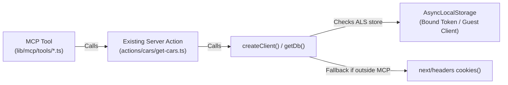

# Tools, Resources, and Prompts in MCP + Next.js

This reference provides implementation patterns and API contracts for registering tools, resources, and prompts on `@modelcontextprotocol/server` (v2.x) within Next.js applications using `mcp-handler`.

---

## 1. Defining Tools (`server.registerTool`)

Tools allow LLMs to invoke server-side operations, query databases, or execute actions.

### API Signature
```typescript
server.registerTool(
  name: string,
  config: {
    title?: string;
    description?: string;
    inputSchema: StandardSchemaV1 | ZodTypeAny;
  },
  handler: (args: InferInput<typeof inputSchema>, ctx: ServerContext) => Promise<CallToolResult>
): RegisteredTool
```

### Key Differences in MCP SDK v2 & Zod v4
1. **Full Schema Object**: In v2, `inputSchema` takes a complete Zod object schema (`z.object({ ... })`) conforming to the Standard Schema specification, rather than a raw Zod shape.
2. **Empty Arguments**: For tools requiring no input parameters, supply `z.object({})`.
3. **Execution Context**: The second parameter is `ctx: ServerContext`. If `withMcpAuth` was applied, authentication info is available at `ctx.http?.authInfo`.
4. **Return Format**: Handlers return an object with a `content` array containing items of `type: "text"` or `type: "image"`, plus an optional `isError: true` flag.

### Complete Tool Example

```typescript
// lib/mcp/tools/projects.ts
import type { McpServer, ServerContext } from "@modelcontextprotocol/server";
import { z } from "zod";
import { projectDatabaseMap } from "@/database/projects";

export function registerProjectTools(server: McpServer): void {
  // Tool with input arguments
  server.registerTool(
    "list_projects",
    {
      title: "List Portfolio Projects",
      description: "Filter and return projects by category, technology, or search term.",
      inputSchema: z.object({
        category: z.enum(["FullStack", "AI", "Backend"]).optional(),
        tech: z.string().optional(),
        limit: z.number().int().positive().optional().default(10),
      }),
    },
    async ({ category, tech, limit }, ctx: ServerContext) => {
      let projects = Object.values(projectDatabaseMap);

      if (category) {
        projects = projects.filter((p) => p.category === category);
      }
      if (tech) {
        projects = projects.filter((p) => p.skills.includes(tech));
      }

      const results = projects.slice(0, limit);

      return {
        content: [
          {
            type: "text",
            text: JSON.stringify({ total: results.length, projects: results }, null, 2),
          },
        ],
      };
    },
  );

  // Tool without arguments
  server.registerTool(
    "get_stats",
    {
      title: "Get Global Stats",
      description: "Retrieve total project and skill counts.",
      inputSchema: z.object({}),
    },
    async (_args, ctx: ServerContext) => {
      return {
        content: [
          {
            type: "text",
            text: JSON.stringify({ projectCount: Object.keys(projectDatabaseMap).length }),
          },
        ],
      };
    },
  );
}
```

---

## 2. Returning Standard Tool Responses & Handling Results

Always normalize responses to prevent client crashes:

```typescript
// lib/mcp/helpers.ts
export interface McpToolResponse {
  [key: string]: unknown;
  content: Array<{
    type: "text";
    text: string;
  }>;
  isError?: boolean;
}

export function formatToolResponse(data: unknown, isError = false): McpToolResponse {
  const text = typeof data === "string" ? data : JSON.stringify(data, null, 2);
  return {
    content: [{ type: "text", text }],
    ...(isError ? { isError: true } : {}),
  };
}

export function formatActionResult<T>(result: { success: boolean; data?: T; error?: string }): McpToolResponse {
  if (!result.success) {
    return formatToolResponse({ error: result.error ?? "Action failed" }, true);
  }
  return formatToolResponse(result.data);
}

/**
 * Robustly extracts the authenticated user ID from MCP execution context.
 * In @modelcontextprotocol/server + requireMcpAuth / withMcpAuth,
 * authInfo can be nested in ctx.authInfo, ctx.http.authInfo, or ctx.userId.
 */
export function getMcpUserId(ctx: unknown): string | undefined {
  if (!ctx || typeof ctx !== "object") return undefined;

  const context = ctx as {
    authInfo?: { userId?: string; sub?: string; clientId?: string };
    http?: { authInfo?: { userId?: string; sub?: string; clientId?: string } };
    userId?: string;
    sub?: string;
  };

  return (
    context.authInfo?.userId ||
    context.authInfo?.sub ||
    context.http?.authInfo?.userId ||
    context.http?.authInfo?.sub ||
    context.userId ||
    context.sub
  );
}
```

### Strict Tenant Isolation & Database Scoping Pattern
MCP tools must strictly isolate database queries by the authenticated user's ID (`tokenClaims.sub`). Never allow cross-tenant data access:

```typescript
// lib/mcp/tools/todos.ts
server.registerTool(
  "toggle_todo",
  {
    title: "Toggle Todo Status",
    description: "Toggle task completion for the authenticated user.",
    inputSchema: z.object({ todoId: z.string() }),
  },
  async ({ todoId }, ctx) => {
    const userId = getMcpUserId(ctx);
    if (!userId) {
      return formatToolResponse({ error: "Unauthorized: Missing user authentication." }, true);
    }

    // Always scope lookup to userId
    const [existing] = await db
      .select()
      .from(todo)
      .where(and(eq(todo.id, todoId), eq(todo.userId, userId)))
      .limit(1);

    if (!existing) {
      return formatToolResponse({ error: "Task not found or permission denied." }, true);
    }

    const [updated] = await db
      .update(todo)
      .set({ isCompleted: !existing.isCompleted })
      .where(and(eq(todo.id, todoId), eq(todo.userId, userId)))
      .returning();

    return formatToolResponse({ message: "Task updated", todo: updated });
  },
);
```

---

## 3. Server Action Reuse via `AsyncLocalStorage` (Zero-Duplication Pattern)

In Next.js applications, business logic, validation, and database operations typically live in Server Actions (`actions/*`). Duplicating this logic inside MCP tool modules creates massive technical debt.

Using Node's native `AsyncLocalStorage` (`node:async_hooks`), you can execute existing Server Actions inside MCP requests with zero modification:



### Implementation

1. **Create the Storage Context**:
```typescript
// lib/db/storage.ts
import { AsyncLocalStorage } from "node:async_hooks";
import type { DatabaseClient } from "@/lib/db/client";

const mcpStorage = new AsyncLocalStorage<DatabaseClient>();

export function runWithMcpClient<T>(client: DatabaseClient, fn: () => Promise<T>): Promise<T> {
  return mcpStorage.run(client, fn);
}

export function getMcpClient(): DatabaseClient | undefined {
  return mcpStorage.getStore();
}
```

2. **Hook Into Client Creation**:
```typescript
// lib/db/client.ts
import { getMcpClient } from "./storage";

export async function createClient() {
  // If running inside an MCP request, return the request's bound client
  const mcpClient = getMcpClient();
  if (mcpClient) return mcpClient;

  // Otherwise, use standard Next.js cookie session
  return createCookieClient();
}
```

3. **Wrap Route Handler**:
```typescript
// lib/mcp/server.ts
const scopedHandler = async (req: Request): Promise<Response> => {
  const authContext = req.auth?.extra as { client?: DatabaseClient } | undefined;
  const client = authContext?.client ?? createPublicClient();

  return runWithMcpClient(client, () => baseHandler(req));
};

export const mcpHandler = withMcpAuth(scopedHandler, verifyMcpToken, { required: false });
```

4. **Delegate Directly in Tools**:
```typescript
// lib/mcp/tools/cars.ts
server.registerTool(
  "search_cars",
  {
    description: "Search car inventory",
    inputSchema: carSearchSchema,
  },
  async (args, ctx) => {
    // Calls existing Server Action directly with zero logic duplication!
    const result = await getCars(args);
    return formatActionResult(result);
  },
);
```

## 4. Registering Resources (`server.registerResource`)

Resources provide contextual static or dynamic documents (e.g. documentation, files, schemas) that clients can read via `resources/read`.

### Static Resource
```typescript
server.registerResource(
  "portfolio_overview",
  "portfolio://overview",
  {
    title: "Portfolio Overview",
    description: "High-level summary of the developer's experience and architecture.",
    mimeType: "text/markdown",
  },
  async () => {
    return {
      contents: [
        {
          uri: "portfolio://overview",
          mimeType: "text/markdown",
          text: "# Portfolio Overview\nThis portfolio is built with Next.js 16...",
        },
      ],
    };
  },
);
```

### Dynamic Resource Templates
```typescript
import { ResourceTemplate } from "@modelcontextprotocol/server";

server.registerResource(
  "project_features",
  new ResourceTemplate("portfolio://projects/{projectKey}/features", { list: undefined }),
  {
    title: "Project Feature Specification",
    mimeType: "text/markdown",
  },
  async (uri, { projectKey }) => {
    const markdown = await loadProjectMarkdown(projectKey as string);
    return {
      contents: [
        {
          uri: uri.href,
          mimeType: "text/markdown",
          text: markdown ?? "No features found.",
        },
      ],
    };
  },
);
```

---

## 5. Registering Prompts (`server.registerPrompt`)

Prompts are predefined prompt templates that clients can surface to users.

```typescript
server.registerPrompt(
  "summarize_experience",
  {
    title: "Summarize Experience",
    description: "Generate a summary of developer experience focused on a specific domain.",
    argsSchema: z.object({
      domain: z.string().describe("Domain focus e.g. Frontend, Machine Learning"),
    }),
  },
  async ({ domain }) => {
    return {
      messages: [
        {
          role: "user",
          content: {
            type: "text",
            text: `Please analyze Maruf's professional experience and highlight his work specifically in ${domain}.`,
          },
        },
      ],
    };
  },
);
```

---

## 6. Domain-Based Modular Registration

Never define all tools in the Next.js `route.ts`. Organize by domain in `lib/mcp/tools/`:

```text
lib/mcp/
├── helpers.ts
├── register-tools.ts      # Aggregator
├── server.ts              # createMcpHandler setup
└── tools/
    ├── about.ts
    ├── blogs.ts
    ├── experience.ts
    └── projects.ts
```

In `register-tools.ts`:
```typescript
import type { McpServer } from "@modelcontextprotocol/server";
import { registerAboutTool } from "./tools/about";
import { registerProjectTools } from "./tools/projects";

export function registerAllTools(server: McpServer): void {
  registerAboutTool(server);
  registerProjectTools(server);
}
```

---

## 7. Flexible Argument Normalization for LLM Inputs

LLMs often supply parameters formatted as conversational or display titles (e.g., `skill: "Spring Boot"`, `"React.js"`, `"Next JS"`) rather than internal database keys or kebab-case slugs (e.g., `"spring-boot"`, `"react-js"`, `"next-js"`).

Direct strict comparisons (`item.key === input`) frequently result in false-negative empty sets (`{ total: 0 }`).

### Best Practice: Key Resolver Pattern

Create a utility to resolve incoming natural-language strings to canonical keys before filtering:

```typescript
// lib/utils/resolve-key.ts
export function resolveItemKey(query: string, knownItems: Array<{ id: string; name: string }>): string | undefined {
  const clean = query.trim().toLowerCase();

  // 1. Direct slug or ID match
  const exact = knownItems.find(
    (i) => i.id.toLowerCase() === clean || i.name.toLowerCase() === clean
  );
  if (exact) return exact.id;

  // 2. Normalized alphanumeric match (ignores spaces, dots, dashes)
  const stripped = clean.replace(/[^a-z0-9]/g, "");
  const normalized = knownItems.find(
    (i) => i.id.replace(/[^a-z0-9]/g, "").toLowerCase() === stripped ||
           i.name.replace(/[^a-z0-9]/g, "").toLowerCase() === stripped
  );
  if (normalized) return normalized.id;

  // 3. Substring match for longer queries (min 3 chars to avoid false positives)
  if (clean.length >= 3) {
    const sub = knownItems.find((i) => i.name.toLowerCase().includes(clean));
    if (sub) return sub.id;
  }

  return undefined;
}
```

In your tool handler, resolve before filtering:
```typescript
async ({ skill }) => {
  const resolvedKey = skill ? resolveItemKey(skill, databaseSkills) : undefined;
  const filtered = resolvedKey
    ? allProjects.filter((p) => p.skillKeys.includes(resolvedKey))
    : allProjects;

  return formatToolResponse({ total: filtered.length, items: filtered });
}
```

---

## 8. Server Branding and Icons (SEP-973)

Clients like Google Gemini (Connected / Custom Apps), Claude Desktop, and VS Code Copilot render brand icons for connected MCP servers based on the **SEP-973** metadata standard in `serverInfo` during the `initialize` handshake.

### Metadata Schema
In `serverInfo`, provide `title`, `description`, `websiteUrl`, and an `icons` array:

```typescript
// lib/mcp/server.ts
import { createMcpHandler } from "mcp-handler";

const siteUrl = process.env.NEXT_PUBLIC_SITE_URL || "https://example.com";

export const mcpHandler = createMcpHandler(
  (server) => {
    registerAllTools(server);
  },
  {
    serverInfo: {
      name: "my-app-mcp",
      title: "My Application MCP",
      version: "1.0.0",
      description: "App MCP server providing query tools and resources.",
      websiteUrl: siteUrl,
      icons: [
        {
          src: `${siteUrl}/favicon.svg`,
          mimeType: "image/svg+xml",
          sizes: ["any"],
        },
        {
          src: `${siteUrl}/icon.png`,
          mimeType: "image/png",
          sizes: ["192x192"],
        },
        // Embedded Data URI ensures offline and proxy-resilient icon delivery
        {
          src: "data:image/svg+xml;base64,...",
          mimeType: "image/svg+xml",
          sizes: ["any"],
        },
      ],
    } as unknown as { name: string; version: string },
  },
);
```


