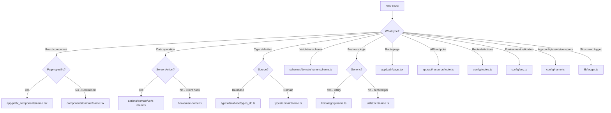
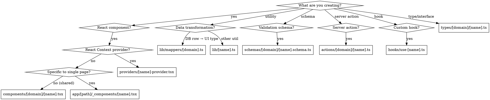

# Structuring Next.js Projects

## Overview

**Domain-first organization with strict conventions:** One export per file, absolute imports only, no barrel exports, kebab-case naming. Each concern (types, actions, components, schemas) lives in its own top-level folder with domain subfolders. Folders like `enums/` or `enum/` are also permitted for enums.

**Core principle:** Predictable structure beats convenience. Explicit imports beat clever re-exports.

## When to Use

Use this skill when:
- Creating new files in a Next.js App Router project
- Deciding where to place types, actions, components, or schemas
- Structuring imports and exports
- Organizing by feature/domain
- Setting up test structure
- Migrating from Pages Router or unstructured projects

### Required Tools & Libraries (Every Next.js Project)
Every Next.js project following these conventions must configure and include the following baseline tools and libraries:
1. **Next.js App Router (`next`)**: Core framework utilizing `app/` directory routing, Turbopack, and React Server Components (RSC).
2. **TypeScript (`typescript`)**: Configured with strict mode enabled (`"strict": true` in `tsconfig.json`) and `@/*` absolute path alias.
3. **Biome (`@biomejs/biome`)**: Required by default for linting, code formatting, and import sorting via `biome.json` (replaces legacy ESLint and Prettier).
4. **Tailwind CSS (`tailwindcss`, `postcss`, `autoprefixer`)**: Required utility-first styling engine across components, layouts, and data tables.
5. **Class Utilities (`clsx`, `tailwind-merge`)**: Required conditional class concatenation and conflict merging helper (`cn()` in `lib/utils.ts`).
6. **Zod (`zod`)**: Required schema validation engine for central environment validation (`config/env.ts`), domain validation schemas (`schemas/`), and Server Action inputs.
7. **Nuqs (`nuqs`)**: Required type-safe URL query parameter state manager. Wrap root layout/providers with `<NuqsAdapter>` and enforce `clearOnDefault: true`.
8. **LogTape (`@logtape/logtape`)**: Required structured telemetry logger configured in `lib/logger.ts` for non-blocking sinks and log level control (replaces raw `console.log`).
9. **Vitest & React Testing Library (`vitest`, `@testing-library/react`, `@testing-library/jest-dom`)**: Required unit/integration testing suite located under the project root `__tests__/` directory (`vitest.config.ts`).
10. **Docker & Multi-Stage Containers (`docker/`)**: Required containerization assets (`docker/next/Dockerfile` multi-stage build, `docker/docker-compose.yml`).
11. **GitHub Actions CI/CD (`.github/workflows/merge.yml`)**: Required PR validation pipeline running Biome checks, Turbopack build, test coverage, and Docker compose smoke tests across latest 2 Node LTS versions (`24.x` and `26.x`).

### Default Recommended Tools & Libraries (When Needed)
These tools are not mandatory for every project, but serve as default recommendations whenever a project requires their respective capabilities:
- **Shadcn UI (with Base UI primitives):** Default React components and accessible headless primitives (located under `components/ui/`).
- **Zustand:** Default client-side dedicated state management solution (located under `stores/` or `hooks/`) when local React state or Context is insufficient.
- **BlockNote:** Default interactive block-based rich text / markdown editor (dynamically imported with `ssr: false` under `components/[domain]/`).
- **Drizzle, TypeORM, or MongoDB:** Default database persistence solutions depending on use case:
  - **Drizzle ORM:** Default for SQL/PostgreSQL projects requiring type-safe schema-first queries and lightweight migrations (`drizzle/` or `db/`).
  - **TypeORM:** Default enterprise Data Mapper ORM supporting SQL and document databases (`database/data-source.ts`).
  - **MongoDB:** Default document database (via Mongoose or TypeORM Mongo driver).
- **mcp-handler:** Default framework when exposing or creating an MCP (Model Context Protocol) server from a Next.js App Router application (`app/api/mcp/route.ts` with Streamable HTTP).

**Related skills:**
- `centralised-routes` — Routes must be centralised under a `./config` folder (e.g., `config/routes.ts`). See `centralised-routes` skill for full details.
- `typescript-environment-variables` — Environment variables and validation must be centralised under `./config` (e.g., `config/env.ts`). See `typescript-environment-variables` skill for full details.
- `logtape-nextjs` — Structured telemetry and logging setup (`lib/logger.ts`). See `logtape-nextjs` skill for full details.
- `migrating-eslint-prettier-to-biome` — Biome is used by default for linting and formatting (replaces ESLint/Prettier). See `migrating-eslint-prettier-to-biome` skill for full details.
- `drizzle-nextjs` — Drizzle ORM setup, schema definitions, and migrations. See `drizzle-nextjs` skill for full details.
- `typeorm-nextjs` — TypeORM DataSource singleton and entity conventions. See `typeorm-nextjs` skill for full details.
- `blocknote-nextjs` — BlockNote dynamic import (`ssr: false`) and custom editor setups. See `blocknote-nextjs` skill for full details.
- `mcp-nextjs` — Exposing MCP servers in Next.js using `mcp-handler` with Streamable HTTP. See `mcp-nextjs` skill for full details.

## Critical Rules

### NO BARREL EXPORTS

```typescript
// ❌ NEVER create index.ts files
// types/comment/index.ts
export * from './comment';
export * from './comment-with-author';

// ✅ ALWAYS import directly
import type { Comment } from '@/types/comment/comment';
import type { CommentWithAuthor } from '@/types/comment/comment-with-author';
```

**Why:** Tree-shaking, explicit dependencies, monorepo compatibility, no circular dependency issues.

### ABSOLUTE IMPORTS ONLY

```typescript
// ❌ NEVER use relative imports (even within same folder)
import type { Comment } from './comment';
import { getComments } from '../actions/get-comments';

// ✅ ALWAYS use @/* alias
import type { Comment } from '@/types/comment/comment';
import { getComments } from '@/actions/comment/get-comments';
```

**Why:** Consistency, refactoring safety, clear boundaries.

### DOMAIN ORGANIZATION REQUIRED

```
// ❌ NEVER flat structure
types/
  comment.ts
  comment-with-author.ts
  song.ts
  album.ts

// ✅ ALWAYS domain subfolders
types/
  comment/
    comment.ts
    comment-with-author.ts
  song/
    song.ts
    song-with-album.ts
  album/
    album.ts
    album-with-artists.ts
```

**Why:** Scales to large codebases, clear ownership, easier navigation.

### TYPESCRIPT STRICT MODE REQUIRED

```typescript
// ❌ NEVER use `any` type
export async function getComments(songId: any): any { ... }
export function processData(data: any) { ... }

// ✅ ALWAYS use explicit types
export async function getComments(songId: string): Promise<Comment[]> { ... }
export function processData(data: unknown): ProcessedData { ... }
```

**Why:** Type safety, catch errors at compile time, better IDE support. Project MUST have `"strict": true` in tsconfig.json.

### ONE EXPORT PER FILE

Each file for **actions, types, interfaces, enums, components, pages, and hooks** must only have **one export**.
- **Internal helpers allowed:** Multiple functions, types, interfaces, or constants can live in the same file as long as they are NOT exported.
- **Allowed exceptions:** Infrastructure or utility files (e.g., `lib/logger.ts`, client initializers, or configuration registries) are allowed to have multiple exports.

```typescript
// ❌ NEVER export multiple items from one file
// types/comment/comment.ts
export interface Comment { ... }
export interface CommentWithAuthor { ... }

// ✅ Multiple internal functions/types are allowed as long as they are NOT exported
// actions/comment/get-comments.ts
type QueryFilter = { songId: string };      // Internal helper type (unexported)
function validateFilter(f: unknown) { ... } // Internal helper function (unexported)

export default async function getComments() { ... } // Single export
```

### REQUIRED ROOT APP FILES & DYNAMIC ROUTE NOT-FOUND

`not-found.tsx`, `loading.tsx`, and `error.tsx` **must exist** in the root of the `./app` directory.

- **Root requirements:** Every project must include `app/not-found.tsx`, `app/loading.tsx`, and `app/error.tsx` alongside `app/layout.tsx` and `app/page.tsx` for consistent global error boundaries, suspense loading, and 404 handling.
- **Dynamic routes:** For dynamic routes (e.g., `app/songs/[id]/`), include a route-level `not-found.tsx` to handle when the specific entity or record does not exist (triggered via `notFound()` from `next/navigation`). This provides clear contextual feedback that the specific item was not found.

### USE CORRECT APP NAME & METADATA (NO GENERIC "NEXT APP")

Always configure the actual, descriptive project name in metadata, UI headings, browser titles, and configurations.

```typescript
// ❌ NEVER use default/boilerplate names like "Create Next App" or "Next App"
export const metadata: Metadata = {
  title: "Create Next App",
  description: "Generated by create next app",
};

// ✅ ALWAYS use the specific project name, centralised via config/site.ts
import { SITE_CONFIG } from "@/config/site";

export const metadata: Metadata = {
  title: {
    default: SITE_CONFIG.name,
    template: `%s | ${SITE_CONFIG.name}`,
  },
  description: SITE_CONFIG.description,
};
```

**Why:** Generic placeholder titles ("Create Next App", "Next App") degrade user experience, harm SEO, look unprofessional, and show inattentiveness to project branding. Centralise the real app name in `config/site.ts`.

## Quick Reference



### Directory Structure

| Folder | Purpose | Example |
|---|---|---|
| `actions/[domain]/` | Server Actions only | `actions/comment/get-comments.ts` |
| `types/[domain]/` | TypeScript types/interfaces | `types/comment/comment-with-author.ts` |
| `enums/` or `enum/` | TypeScript enums (allowed folder) | `enums/car/car-status.ts`, `enum/role.ts` |
| `components/[domain]/` | Shared React components (centralised) | `components/comment/comment-list.tsx` |
| `app/path/_components/` | Page-specific components ONLY | `app/songs/[id]/_components/song-details.tsx` |
| `schemas/[domain]/` | Zod validation schemas | `schemas/comment/create-comment.schema.ts` |
| `config/` | Centralised routes, env, assets, app configurations & constants | `config/routes.ts`, `config/env.ts`, `config/prompts.ts`, `config/languages.ts` |
| `hooks/` | Custom React hooks (flat) | `hooks/use-player.ts` |
| `stores/` | Dedicated client state stores (Zustand) | `stores/player-store.ts` |
| `lib/` | Business logic, utilities, domain errors, logging | `lib/mappers/comment.ts`, `lib/errors.ts`, `lib/logger.ts` |
| `utils/` | Infrastructure clients | `utils/supabase/server.ts` |
| `providers/` | React Context providers | `providers/modal-provider.tsx` |
| `app/` | Routing + special files ONLY (must include root `not-found.tsx`, `loading.tsx`, `error.tsx`) | `app/songs/[id]/page.tsx`, `app/not-found.tsx` |
| `docker/` | Docker & container configurations for Next.js app and stack services | `docker/docker-compose.yml`, `docker/next/Dockerfile`, `docker/postgres/` |
| `__tests__/[category]/` | Tests (always at project root, mirrors structure) | `__tests__/actions/getComments.test.ts` |

### File Naming

| Type | Pattern | Example |
|---|---|---|
| Components | kebab-case → PascalCase export | `comment-form.tsx` → `CommentForm` |
| Actions | kebab-case, verb-noun | `get-comments.ts`, `delete-comment.ts` |
| Types | kebab-case, descriptive | `comment-with-author.ts`, `song.ts` |
| Enums | kebab-case, descriptive | `car-status.ts`, `role.ts` |
| Schemas | kebab-case + `.schema.ts` | `create-comment.schema.ts` |
| Hooks | kebab-case, `use-` prefix | `use-favourite.ts` |
| Stores | kebab-case, `[name]-store.ts` | `player-store.ts` |
| Tests | camelCase + `.test.ts` | `getComments.test.ts` |

### Exports Per File

| File Type | Export Pattern | Example |
|---|---|---|
| Server Action | Single default export | `export default getComments;` |
| Component | Single default or named export | `export default CommentList;` or `export const CommentList` |
| Page | Single default export | `export default function SongPage()` |
| Type / Interface | Single named export | `export type Comment = {...}` or `export interface Comment {...}` |
| Enum | Single named export | `export enum CarStatus { ... }` |
| Schema | Named export (schema + type) | `export const createCommentSchema = z.object(...)` |
| Hook | Single default export | `export default usePlayer;` |
| Store (Zustand) | Single default export | `export default usePlayerStore;` |
| Utility / Logger | Named export(s) (allowed exception) | `export function formatDuration()`, `export function getLogger()` |

> **Rule:** Each file for actions, types, interfaces, enums, components, pages, and hooks must only have **one export**. Multiple internal functions, types, or helpers can exist in the file as long as they are NOT exported. Infrastructure/utility files (like loggers) are allowed to have multiple exports.

### Import Order

```typescript
// 1. React/Next.js
import { useState } from 'react';
import { revalidatePath } from 'next/cache';

// 2. External packages
import { z } from 'zod';

// 3. Local - order: actions → hooks → types → components
import { getComments } from '@/actions/comment/get-comments';
import usePlayer from '@/hooks/use-player';
import type { CommentWithAuthor } from '@/types/comment/comment-with-author';
import { CommentList } from '@/components/comment/comment-list';
```

### Client vs Server Components

Add `"use client"` if component uses: state, effects, event handlers, browser APIs, or context. Otherwise, components default to Server Components.

### Key Architectural Patterns

- **Server Actions:** Optional; if used, kebab-case verb-noun under `actions/[domain]/` with Zod validation and single default export. See [Comments Feature Example](references/examples/comments-feature.md#4-server-action-get-comments).
- **Styling (Tailwind CSS):** Default utility-first styling system across components, layouts, and data tables.
- **UI Primitives & Components (Shadcn UI with Base UI):** Place shared primitives in `components/ui/` built with Base UI headless primitives and styled with Tailwind CSS.
- **Dedicated Client State (Zustand):** If a project needs dedicated client state management beyond React state/context, default to Zustand (`stores/[name]-store.ts` or `hooks/use-[name]-store.ts`). See [Recommended Tools](references/examples/recommended-tools.md#1-dedicated-state-management-with-zustand-storesplayer-storets).
- **Interactive Markdown Editing (BlockNote):** When rich text or interactive block-based markdown editing is required, default to BlockNote. Always dynamically import editor components with `ssr: false` to avoid SSR hydration issues. See [Recommended Tools](references/examples/recommended-tools.md#2-interactive-markdown-editor-with-blocknote-componentsnotesnote-editortsx).
- **Database & ORM Strategy (Drizzle, TypeORM, MongoDB):** Default database persistence solutions depending on domain requirements:
  - **Drizzle ORM:** Default for relational SQL (PostgreSQL, MySQL, SQLite) with type-safe schema declarations (`drizzle/` or `db/`) and code-first migrations via `drizzle-kit`.
  - **TypeORM:** Default for enterprise Data Mapper patterns and multi-database support with singleton DataSource (`database/data-source.ts`).
  - **MongoDB:** Default for document-oriented storage (via Mongoose or TypeORM MongoDB driver).
  See [Recommended Tools](references/examples/recommended-tools.md#3-database-layer-examples-drizzle-orm--typeorm).
- **Model Context Protocol (mcp-handler):** Default when creating or exposing an MCP server directly from the Next.js app (`app/api/mcp/route.ts`), serving stateless Streamable HTTP. See [Recommended Tools](references/examples/recommended-tools.md#4-nextjs-mcp-server-route-handler-appapimcproutets).
- **URL State Management (Nuqs):** Use `nuqs` for query parameter state. Wrap root with `<NuqsAdapter>` in `providers/providers.tsx`. Always configure `clearOnDefault: true` so default parameters never appear in the URL. Encapsulate multi-param filters in custom hooks under `hooks/`. See [URL State Management Example](references/examples/url-state-nuqs.md).
- **Docker & Containerization:** Centralise all Docker configs under `docker/` (`docker/next/Dockerfile` multi-stage build, `docker/docker-compose.yml` with context `..`, and subdirectories for services like `postgres`). See [Docker Reference](references/directory-structure/testing-and-devops.md#docker) and [Docker Containerization Example](references/examples/docker-containerization.md).
- **CI/CD Pipeline (GitHub Actions):** Enforce `.github/workflows/merge.yml` on PRs targeting `main` covering linting (`biome ci .`), building (`next build --turbopack`), testing with coverage (`yarn test:coverage`), and Docker compose spin-up, tested across the latest 2 Node LTS versions (`['24.x', '26.x']`). See [CI/CD Pipeline Example](references/examples/ci-cd-pipeline.md).
- **Data Table UI & UX Standards:** Apply minimal tabs, prominent search, tinted header rows, accent sort controls, light row dividers, right-aligned numbers, abbreviated month dates (`14 Oct 2026`), bold primary identifiers, semantic status chips, icon row actions, and full-row selection tinting. See [Data Table UI Guide](references/data-table-ui.md).

## Detailed References

Comprehensive guidelines and examples are organized in dedicated reference documents under `references/`:

| Topic | Reference Document | Modular Sub-References |
|---|---|---|
| **Directory Structure** | [Directory Structure Overview](references/directory-structure.md) | [Tooling & Libraries](references/directory-structure/tooling-and-libraries.md) · [Domain Layers](references/directory-structure/domain-layers.md) · [Infrastructure & Config](references/directory-structure/infrastructure-and-config.md) · [App Routing](references/directory-structure/app-routing.md) · [Testing & DevOps](references/directory-structure/testing-and-devops.md) |
| **File Conventions** | [File Conventions Overview](references/file-conventions.md) | [Naming Rules](references/file-conventions/naming-conventions.md) · [Export Rules](references/file-conventions/export-rules.md) · [Import Rules](references/file-conventions/import-rules.md) · [Components & Actions](references/file-conventions/components-and-actions.md) · [TypeScript & Edge Cases](references/file-conventions/typescript-and-edge-cases.md) |
| **Worked Examples** | [Worked Examples Overview](references/examples.md) | [Comments Feature](references/examples/comments-feature.md) · [Utilities & Constants](references/examples/utilities-and-constants.md) · [Type Composition](references/examples/type-composition.md) · [Test Structure](references/examples/test-structure.md) · [URL State (Nuqs)](references/examples/url-state-nuqs.md) · [Docker](references/examples/docker-containerization.md) · [CI/CD Pipeline](references/examples/ci-cd-pipeline.md) · [Recommended Tools](references/examples/recommended-tools.md) |
| **Data Table UI & UX** | [Data Table UI Guide](references/data-table-ui.md) | Navigation tabs, search field, header tint, sort indicators, subtle dividers, alignment, chips, and actions |

## Common Mistakes

| Mistake | Why It's Wrong | Fix |
|---|---|---|
| Creating `index.ts` barrel exports | Breaks tree-shaking, adds indirection | Import directly from files |
| Relative imports (`./comment`) | Inconsistent, breaks on refactor | Use `@/types/comment/comment` |
| Flat structure (`types/comment.ts`) | Doesn't scale | Use `types/comment/comment.ts` |
| Multiple exports per file | Unclear ownership | One export per file |
| PascalCase file names | Convention mismatch | Use kebab-case |
| Business logic in `app/` folder | Routing folder, not logic | Move to `lib/` or `utils/` |
| Shared components in `app/` | Violates separation, hard to reuse | Only page-specific in `_components/`; centralise shared in `./components` |
| Wrong test naming (kebab-case) | Convention violation | Use camelCase: `getComments.test.ts` |
| Nesting `__tests__/` in subdirectories | Inconsistent test discovery and structure | Always place `__tests__/` at project root |
| Hardcoding/scattering raw route strings | Hard to maintain and refactor | Centralise routes under `./config` (e.g. `config/routes.ts`) |
| Scattering env vars or putting `env.ts` in `lib/` | Inconsistent validation and configuration | Centralise in `./config` (e.g. `config/env.ts`) |
| Hardcoding asset paths or scattering app constants | Difficult maintenance and asset updates | Centralise in `./config` (e.g. `config/assets.ts`, `config/constants.ts`) |
| Scattering raw `console.log` calls | Unstructured, noisy terminal output | Use structured logger in `lib/logger.ts` (see `logtape-nextjs`) |
| Forgetting `"use client"` | Server component can't use hooks | Add directive at top |
| Absolute imports without alias | Breaks on path changes | Always use `@/*` |
| Missing root `not-found.tsx`, `loading.tsx`, or `error.tsx` | Inconsistent fallback UI, uncaught errors, or missing loading states | Root of `./app` MUST contain `not-found.tsx`, `loading.tsx`, and `error.tsx` |
| Omitting `not-found.tsx` in dynamic routes | Generic or unhelpful 404 when specific resource is not found | Add route-level `not-found.tsx` in dynamic route (e.g. `app/songs/[id]/not-found.tsx`) |
| Leaving default values in query parameters or manual URL concatenation | Clutters URL, causes synchronization bugs and broken back navigation | Use `nuqs` for URL param state with `clearOnDefault: true` |
| Using generic placeholder names like "Next App" or "Create Next App" | Degrades UX and SEO, lacks brand identity | Use actual project name centralised in `config/site.ts` |
| Scattering Dockerfiles or dumping Docker files at root | Clutters project root and complicates multi-container orchestration | Place all Docker configs under `docker/` (`docker/next/Dockerfile`, `docker/docker-compose.yml`) |
| Skipping CI/CD pipeline or testing on single non-LTS Node version | Allows regressions in linting, builds, container startup, or newer Node runtimes | Configure `.github/workflows/merge.yml` covering lint, build, test, Docker with matrix on latest 2 Node LTS versions (24, 26) |
| Cluttered table UI (heavy tabs, dark dividers, left-aligned numbers, plain text statuses) | High cognitive load, hard to scan or compare data | Follow [data-table-ui.md](references/data-table-ui.md) (tinted headers, right-aligned numbers, semantic chips, icon actions) |

## Decision Flowchart



## Real-World Impact

**Before structure:**
- Agent created 12 `index.ts` barrel files
- Mixed relative/absolute imports
- Flat type organization (80+ files in one folder)
- Components in `app/` folder

**After structure:**
- Zero barrel exports
- 100% absolute imports
- Clear domain boundaries
- Navigable with jump-to-definition
