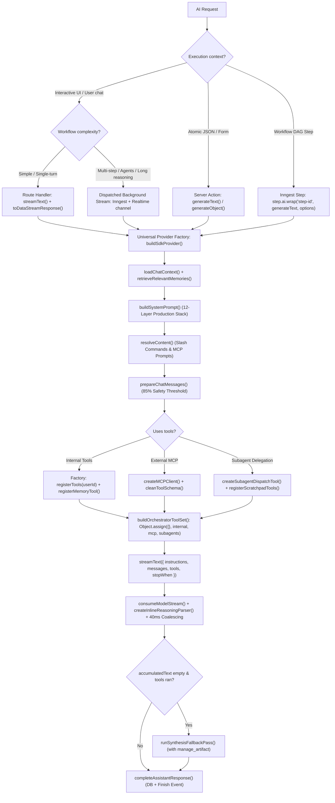

# Vercel AI SDK + Next.js

The Vercel AI SDK is a unified TypeScript toolkit for building AI applications across LLM providers. In Next.js App Router projects, it powers edge/server streaming endpoints, durable background streaming workflows, subagent orchestration (`ToolLoopAgent`), long-term memory, real-time context token budgeting, 12-layer system prompt composition, slash command / MCP prompt resolution, internal agentic tools, dynamic tools via the Model Context Protocol (MCP), deep reasoning/thinking extraction, and dual-path Retrieval-Augmented Generation (RAG) with Qdrant hybrid search.

This skill provides reference patterns and production standards for the Vercel AI SDK Core (`ai`), model providers (`@ai-sdk/openai`, `@ai-sdk/anthropic`, `@ai-sdk/google`, `@openrouter/ai-sdk-provider`), subagent delegation, internal tool architecture, Model Context Protocol (`@ai-sdk/mcp`), React hooks (`@ai-sdk/react`), Inngest background streaming, vector embeddings, Qdrant hybrid search, and Vitest test mocking.

---

## Skill Map

| File | Covers |
|---|---|
| [core-api.md](core-api.md) | `generateText`, `streamText`, `generateObject`, `streamObject`, `embed`, `embedMany`, parameters, `isStepCount`, return payloads |
| [subagents-and-orchestration.md](subagents-and-orchestration.md) | Hierarchical 2-layer multi-agent architecture (depth limit \(d = 1\)), `ToolLoopAgent`, generator streaming (`async function*`), `toUIMessageStream`, context protection (`toModelOutput`), shared PostgreSQL scratchpad, and guaranteed synthesis fallback |
| [rag-and-knowledgebase.md](rag-and-knowledgebase.md) | Dual-path RAG, recursive semantic chunking, dynamic embedding models, Qdrant collection partitioning, parallel vector & FTS hybrid retrieval, Reciprocal Rank Fusion (RRF), durable Inngest ingestion |
| [reasoning-and-thinking.md](reasoning-and-thinking.md) | Reasoning effort formats (OpenAI, OpenRouter, Anthropic), normalizing fetch wrapper, stateful inline parser (`<think>`), code fence tracking, delta coalescing |
| [messaging-and-context.md](messaging-and-context.md) | Multimodal assembly, system prompt rules (`instructions`), 12-layer prompt composition, long-term memory, `save_memory` tool, client/server context budgeting, past tool reconstruction, slash command / MCP prompt resolution |
| [providers-and-credentials.md](providers-and-credentials.md) | Universal OpenAI-compatible factory, dynamic provider factories (`createOpenAI`, etc.), multi-tenant credential decryption, keyless providers |
| [internal-tools-architecture.md](internal-tools-architecture.md) | Context-closing tool factories, `toModelOutput` token optimization, streaming generator tools (`async function*`), dynamic gating, turn scratchpad tools, `search_knowledge_base` |
| [mcp-tools-and-transports.md](mcp-tools-and-transports.md) | `@ai-sdk/mcp`, HTTP transports, SSRF-safe redirect fetch, tool timeouts, schema cleaning (`propertyNames`), tool name sanitisation, connection cleanup |
| [mcp-authentication.md](mcp-authentication.md) | MCP authentication types (`none`, `headers`, `oauth`), AES-256-GCM encrypted headers, OAuth 2.1 PKCE (`OAuthClientProvider`), CSRF state, and token lifecycle |
| [inngest-and-background-jobs.md](inngest-and-background-jobs.md) | Durable chat streaming functions, Inngest Realtime channels, fallback synthesis pass, clean user aborts, `step.ai.wrap()` DAG memoization, durable KB ingestion & reindexing |
| [nextjs-streaming-and-routes.md](nextjs-streaming-and-routes.md) | App Router route handlers, `toDataStreamResponse()`, dispatched background streaming, cancellation endpoints, Server Actions, route config |
| [structured-outputs-and-tools.md](structured-outputs-and-tools.md) | Zod schema validation, output modes, `tool()` definitions, combining with MCP tools, multi-step execution (`stopWhen: isStepCount`) |
| [client-hooks.md](client-hooks.md) | `@ai-sdk/react` hooks (`useChat`, `useCompletion`), custom realtime stream consumer hooks (`useRealtime`), reasoning timelines, context usage pill, prompt selection |
| [telemetry-and-testing.md](telemetry-and-testing.md) | OpenTelemetry instrumentation, Sentry/Inngest tracing, Vitest unit mocks for `ai` and providers |

---

## Architecture Decision Flow



---

## Quick Reference

| Operation | Primary Function | Typical Return | Common Use Case |
|---|---|---|---|
| Single Completion | `generateText({ model, prompt, instructions })` | `{ text, steps, usage }` | Backend evaluations, summary nodes, batch jobs |
| Realtime Chat Stream | `streamText({ model, messages, instructions })` | `StreamTextResult` + `.toDataStreamResponse()` | Interactive chatbot, conversational UI |
| Universal Provider | `buildSdkProvider({ providerName, baseUrl, apiKey })` | OpenAI-compatible provider | Support OpenRouter, Ollama, Groq, DeepSeek, Azure |
| 12-Layer System Prompt | `buildSystemPrompt(global, project, assistant, opts)` | `string` | Compose user identity, memories, canvas, KB, skills, and orchestrator directives |
| Subagent Worker Agent | `new ToolLoopAgent({ model, instructions, tools, stopWhen })` | Autonomous agent instance | Execute isolated subtask with step bounding and tool scoping |
| Subagent Dispatch Tool | `createSubagentDispatchTool(params)` | `{ delegate_task: tool(...) }` | Streams UI deltas via generator, returns bounded summary via `toModelOutput` |
| Turn Scratchpad Tools | `registerScratchpadTools({ chatId, messageId, workerRole })` | `{ scratchpad_write, scratchpad_read, scratchpad_list }` | Ephemeral blackboard for large data/outlines without context bloat |
| Subagent Output Bounding | `sanitizeSubagentOutput(output, maxChars)` | Sanitized string (< 8k chars) | Extract status/summary and bound token size fed to parent model |
| Subagent Outcome Resolution | `resolveSubagentOutcome(state, outputText)` | `{ label, isError }` | Map worker statuses to timeline badges (Delegating, Blocked, Concerns, Completed) |
| Long-Term Memory Tool | `registerMemoryTool(userId, selectedTools)` | `{ save_memory: tool(...) }` | Model-driven fact persistence with case-insensitive deduplication |
| Client Context Budget | `calculateContextUsage(params)` | `ContextUsageResult` | Real-time token breakdown (system, tools, skills, thread, draft) with warnings |
| Slash Prompt Resolver | `resolveContent(input, promptIds, meta)` | `{ fullContent: string }` | Multi-prompt composition & MCP prompt resolution preserving untemplated user text |
| Sliding Window Pruning | `prepareChatMessages({ history, maxContextTokens })` | `ModelMessage[]` | Prune oldest turns to stay within 85% context window safety threshold |
| Reasoning Normalizer | `createReasoningNormalizingFetch({ format, effort })` | Custom `fetch` function | Normalize OpenAI, Anthropic, OpenRouter reasoning parameters and SSE deltas |
| Inline Reasoning Parser | `createInlineReasoningParser()` | State machine (`push`, `flush`) | Extract `<think>` tags safely across chunk boundaries and code fences |
| Delta Coalescing | `DELTA_COALESCE_INTERVAL_MS = 40` | Coalesced emissions | Buffer high-speed token deltas to prevent UI and WebSocket saturation |
| Multimodal Assembly | `assembleModelMessages(history)` | `ModelMessage[]` | Convert history, documents, images, and tool records to AI SDK format |
| Fallback Synthesis | `runSynthesisFallbackPass({ finalMessages, completedTools })` | `{ text, reasoning }` | Recover final text answer when model concludes tool calls without text |
| Background Stream | `inngest.realtime.publish(channel.stream, event)` | Realtime event emission | Stream tokens, reasoning, and tool states from background jobs |
| Step Limiter | `stopWhen: isStepCount(maxSteps)` | Step stopping condition | Bound multi-step tool execution in `streamText` / `generateText` |
| Token Transform | `toModelOutput: ({ output }) => ...` | `{ type: "text", value }` | Keeping heavy UI artifacts out of conversational LLM context |
| MCP Client | `createMCPClient({ transport })` | MCP client instance | Connect to remote tool/prompt servers over HTTP |
| Durable Inngest Step | `step.ai.wrap('id', generateText, opts)` | `{ steps, text, usage }` | Workflow DAGs, retry-safe background tasks |
| Hybrid Vector + FTS | `hybridSearch(kbIds, query, userId, topK)` | `ChunkResult[]` | Parallel vector + keyword retrieval merged with RRF (k=60) |
| Query Embedding | `embedQuery(text, userId)` | `number[]` | Dynamic provider resolution with model prefixing (`query:`) |
| Passage Batch Embed | `embedDocuments(chunks, userId)` | `number[][]` | Batch embedding with task prefixes (`passage:`) & size limits |
| KB Search Tool | `registerKnowledgebaseTool(...)` | `{ search_knowledge_base: tool(...) }` | Gated agentic retrieval tool for domain context |
| Qdrant Partitioning | `ensureQdrantCollection(dim)` | `string` | Auto-creates `kb_chunks_{dim}` with Cosine, keyword & text indexes |
| Pre-Flight Capability Guard | `validateModelCapabilities(params)` | `void` (throws) | Pre-execution validation of tool calling (`capTools`) and vision (`capVision`) |
| Realtime Subscription Token | `getClientSubscriptionToken(inngest, { channel, topics })` | `string` | Scoped JWT generation via Server Action for Inngest Realtime subscription |
| Durable Stream Hook | `useStreamResponse(chatId, options)` | `{ isStreaming, content, stopStream }` | Client hook combining Inngest Realtime, watchdog, mount rejoin, and DB sync |
| FullStream Vitest Mock | `mockStreamText({ fullStream: async function* })` | Mock return value | Mocking real-time model deltas in Vitest unit and integration suites |

---

## Core Architectural Patterns

### 1. Universal Provider Factory with Reasoning Normalization

Never maintain separate provider implementations for OpenAI-compatible endpoints. Inject a normalizing `fetch` wrapper to handle vendor-specific reasoning formats and incoming SSE deltas:

```typescript
import { createOpenAI } from "@ai-sdk/openai";
import { createReasoningNormalizingFetch } from "./reasoning-stream-parser";

export function buildSdkProvider(config: ProviderConfig) {
  const customFetch = createReasoningNormalizingFetch({
    reasoningFormat: config.reasoningFormat ?? "raw",
    reasoningEffort: config.reasoningEffort,
  });

  return createOpenAI({
    baseURL: config.baseUrl,
    apiKey: config.apiKey,
    fetch: customFetch,
  });
}
```

---

### 2. Multimodal History & Assistant Tool Message Reconstruction

Convert database records into valid AI SDK v7 `ModelMessage[]`, restoring tool call parts and tool result messages with output truncation:

```typescript
export function assembleModelMessages(messages: HistoryMessage[]): ModelMessage[] {
  return messages.flatMap((m) => {
    if (m.role === "system") return []; // Pass via instructions

    if (m.role === "user" && m.attachments?.length) {
      const parts: any[] = [
        ...(m.content ? [{ type: "text" as const, text: m.content }] : []),
        ...m.attachments.map((a) => ({
          type: "file" as const,
          data: { type: "url" as const, url: a.url! },
          mediaType: a.mimeType ?? "image/jpeg",
        })),
      ];
      return [{ role: "user", content: parts } as ModelMessage];
    }

    // Reconstruct assistant tool calls and tool responses
    if (m.role === "assistant" && m.metadata) {
      const meta = JSON.parse(m.metadata);
      if (meta.toolCalls?.length) {
        return [
          {
            role: "assistant",
            content: [
              ...(m.content ? [{ type: "text" as const, text: String(m.content) }] : []),
              ...meta.toolCalls.map((tc: any) => ({
                type: "tool-call" as const,
                toolCallId: tc.toolCallId,
                toolName: tc.toolName,
                input: tc.args,
              })),
            ],
          } as ModelMessage,
          {
            role: "tool",
            content: meta.toolCalls.map((tc: any) => ({
              type: "tool-result" as const,
              toolCallId: tc.toolCallId,
              toolName: tc.toolName,
              output: { type: "text" as const, value: JSON.stringify(tc.result) },
            })),
          } as ModelMessage,
        ];
      }
    }

    return [{ role: m.role as any, content: m.content as any }];
  });
}
```

---

### 3. Stateful Inline Reasoning Parsing & 40ms Coalescing

When reasoning is streamed inline (`<think>...</think>`), parse tags across chunk boundaries without misinterpreting tags in markdown code fences, and coalesce deltas to prevent UI jank:

```typescript
const inlineParser = createInlineReasoningParser();

for await (const chunk of fullStream) {
  if (abortSignal.aborted) break;

  if (chunk.type === "text-delta") {
    const parts = inlineParser.push(chunk.text);
    for (const part of parts) {
      if (part.type === "reasoning") {
        accumulatedReasoning += part.text;
        bufferedReasoning += part.text;
        if (Date.now() - lastReasoningFlush >= 40) await flushReasoning();
      } else {
        accumulatedText += part.text;
        bufferedText += part.text;
        if (Date.now() - lastTextFlush >= 40) await flushText();
      }
    }
  } else if (chunk.type === "reasoning-delta") {
    accumulatedReasoning += chunk.text;
    bufferedReasoning += chunk.text;
    if (Date.now() - lastReasoningFlush >= 40) await flushReasoning();
  }
}
```

---

### 4. Background Chat Generation with Fallback Synthesis

Dispatch chat requests as durable Inngest background functions. If tools execute but the model produces no text, automatically execute a fallback synthesis pass:

```typescript
export const generateChatResponse = inngest.createFunction(
  {
    id: "generate-chat-response",
    retries: 0,
    concurrency: { key: "event.data.chatId", limit: 1 },
    triggers: [{ event: "chat/response.generate" }],
  },
  async ({ event }) => {
    const { chatId, finalMessages, tools, systemPrompt } = await loadContext(event.data);

    const result = streamText({
      model: provider.chat(modelId),
      instructions: systemPrompt,
      messages: finalMessages,
      tools,
      stopWhen: isStepCount(10),
    });

    const state = await consumeModelStream(result.fullStream, ...);

    // Guaranteed recovery when model calls tools but omits final answer
    if (!state.accumulatedText.trim() && state.completedTools.length > 0) {
      const synthState = await runSynthesisFallbackPass({
        finalMessages,
        completedTools: state.completedTools,
        systemPrompt,
      });
      state.accumulatedText += synthState.text;
    }

    await persistAssistantResponse({ chatId, ...state });
  },
);
```

---

### 5. Production 12-Layer System Prompt & Tool-Driven Memory

Combine user identity, long-term PostgreSQL memories, active canvas state, and dynamic tools into a strict layered architecture:

```typescript
// Compose system prompt with 12 distinct layers separated by '---'
const systemPrompt = buildSystemPrompt(
  userSettings?.globalSystemPrompt,
  ctx.projectRow?.globalPrompt,
  ctx.assistantRow?.prompt,
  {
    userContext: { name: userName, email: userEmail },
    userMemories: ctx.userMemories, // Ambient memories from retrieveRelevantMemories()
    canvasArtifacts: extractThreadCanvasArtifacts(thread), // Live canvas state
    hasKnowledgeBase: isToolCallingModel && hasKbTool,
    attachmentNames: fileAttachments.map((a) => a.name),
    selectedSkills: ctx.selectedSkills,
    availableSkills: ctx.availableSkills, // Progressive disclosure catalog
    supportsTools: isToolCallingModel,
    isSubagentDelegationEnabled,
  },
);

// Register context-closing memory tool so the model can persist facts during execution
const memoryTools = registerMemoryTool(userId, selectedTools);

// Prepend slash command and MCP prompts while keeping untemplated text in metadata
const { fullContent } = await resolveContent(userPrompt, selectedPromptIds, metadata);
```

---

### 6. Dual-Path RAG: Qdrant Hybrid Search & Reciprocal Rank Fusion (RRF)

Execute dense semantic vector search and sparse keyword full-text search in parallel over dimensionality-partitioned collections (`kb_chunks_${dimensions}`), then combine ranked candidates using Reciprocal Rank Fusion:

```typescript
export async function hybridSearch(
  kbIds: string[],
  query: string,
  userId: string,
  topK = 5,
): Promise<ChunkResult[]> {
  const normalizedQuery = query.trim();
  if (!normalizedQuery || kbIds.length === 0) return [];

  // 1. Embed query with task prefix handling
  const embedding = await embedQuery(normalizedQuery, userId);

  // 2. Parallel semantic vector search and payload keyword text search in Qdrant
  const [vectorRows, ftsRows] = await Promise.all([
    searchSemanticVectors(embedding.length, embedding, kbIds, 20).catch(() => []),
    searchKeywordChunks(embedding.length, normalizedQuery, kbIds, 20).catch(() => []),
  ]);

  // 3. Reciprocal Rank Fusion (RRF k = 60)
  return applyRRF(vectorRows, ftsRows, topK);
}
```

---

### 7. Hierarchical 2-Layer Subagent Delegation & Generator Streaming

Enforce a strict depth limit (\(d = 1\)) and prevent canvas tampering by stripping `delegate_task` and `manage_artifact` from subagents. Stream intermediate worker updates to the UI using an `async function*` generator with a 150ms throttle, while feeding back a sanitized summary to the orchestrator via `toModelOutput`:

```typescript
export function createSubagentDispatchTool({
  defaultModel,
  customWorkerModel,
  availableTools,
  maxSteps = 10,
  scratchpadContext,
}: CreateSubagentParams) {
  return tool({
    description: "Delegates an isolated, complex task to a specialized worker subagent.",
    inputSchema: z.object({
      role: z.enum(["researcher", "planner", "reviewer", "worker"]),
      taskBrief: z.string().describe("Complete, self-contained requirements"),
      inputData: z.string().optional().describe("Optional context pointers or scratchpad references"),
    }),
    execute: async function* ({ role, taskBrief, inputData }, { abortSignal }) {
      const selectedModel = customWorkerModel ?? defaultModel;
      const workerTools = getSubagentTools(availableTools); // Strips delegate_task & manage_artifact
      const runId = crypto.randomUUID();

      const workerAgent = new ToolLoopAgent({
        model: selectedModel,
        instructions: constructSubagentPrompt({ agentRole: role, runId }),
        tools: scratchpadContext
          ? { ...workerTools, ...registerScratchpadTools({ ...scratchpadContext, workerRole: role }) }
          : workerTools,
        stopWhen: isStepCount(maxSteps),
      });

      const streamResult = await workerAgent.stream({
        prompt: `TASK BRIEF:\n${taskBrief}\n\nINPUT DATA:\n${inputData ?? "None"}`,
        abortSignal,
      });

      let lastYieldTime = -Infinity;
      let lastChunk: any = null;
      let hasPendingUnyieldedChunk = false;

      // 150ms throttled UI chunk streaming
      for await (const uiChunk of readUIMessageStream({
        stream: toUIMessageStream({ stream: streamResult.stream }),
      })) {
        lastChunk = uiChunk;
        const now = Date.now();
        if (now - lastYieldTime >= 150) {
          lastYieldTime = now;
          hasPendingUnyieldedChunk = false;
          yield uiChunk;
        } else {
          hasPendingUnyieldedChunk = true;
        }
      }

      if (hasPendingUnyieldedChunk && lastChunk) yield lastChunk;
    },
    toModelOutput: ({ output }: { output: any }) => ({
      type: "text",
      value: sanitizeSubagentOutput(output, 8000), // Bound to 8k chars (~2k tokens)
    }),
  });
}
```

---

## Common Mistakes & Traps

| Symptom | Root Cause | Fix |
|---|---|---|
| Uncontrolled subagent recursion exhausts token limit / steps | Worker subagent calls `delegate_task` recursively | Filter `delegate_task` out of worker tools in `getSubagentTools` (strict \(d = 1\)) |
| Subagent corrupts or mutates user canvas unexpectedly | Worker agent called `manage_artifact` with incomplete draft | Strip `manage_artifact` from worker tools; mandate orchestrator creates user-facing artifacts |
| Orchestrator context overflow after subagent completes | Subagent dumps 20,000-token research log into model context | Bound output with `sanitizeSubagentOutput` (8,000 chars) via `toModelOutput` and persist full data to scratchpad |
| High-frequency subagent deltas freeze client UI | Worker stream emits 100+ raw micro-chunks/sec into WebSocket | Throttle generator yields in `execute` to 150ms with guaranteed trailing flush |
| Orchestrator finishes with empty response after subagent runs | Model treats subagent execution as the answer and emits no text | Run fallback synthesis pass (`runSynthesisFallbackPass`) prompting orchestrator to synthesize and create artifacts |
| Worker subagent output cannot be parsed deterministically | Freeform worker response lacks standard status demarcation | Enforce strict status reporting prefixes (`STATUS: DONE`, `STATUS: BLOCKED`, etc.) in worker system instructions |
| Scratchpad write throws FK violation during real-time streaming | `messageId` constrained by database FK to `chat_message` before row is inserted | Omit DB-level FK on `messageId` in `subagent_scratchpad` schema; rely on chat cascade deletion and cleanup routines |
| Qdrant error: `Wrong vector dimension: expected X, got Y` | Embedding model changed without collection dimension partitioning | Partition Qdrant collections by dimension (`kb_chunks_${dimensions}`) and reindex when model changes |
| Task-specific embedding models return irrelevant chunks | Model requires prefixing (e.g. `query: ` / `passage: `) | Check model in `PREFIXED_EMBEDDING_MODELS` and apply task prefixes before calling `embed()` / `embedMany()` |
| LLM query crashes with `KnowledgebaseNotReadyError` | Knowledge base search tool registered before indexing finished | Gate tool registration on `kbIsReady === true` and status === `'ready'` |
| Exact product numbers or codes return zero search hits | Dense vector search alone misses exact terms and acronyms | Add full-text payload index on `content` in Qdrant and merge results using Reciprocal Rank Fusion (RRF) |
| Ingestion of large documents times out or crashes memory | Unbounded single API call with all document chunks | Chunk document recursively (e.g. 1000 chars, 200 overlap) and batch `embedMany` in slices of 50 |
| `InvalidPromptError: messages must not contain system messages` | Passed `{ role: "system" }` inside `messages: []` | Pass system prompt via `instructions: string` (or `system: string`) option in `streamText` / `generateText` |
| Untemplated user prompt overwritten with raw template text in UI | Prompt resolution mutated message content directly | Store `promptIds` and untemplated user text in `metadata.userContent` so UI displays prompt chips instead of raw injected template text |
| Redundant duplicate memories accumulate across sessions | Saving memory content verbatim without checking existing records | Apply case-insensitive query (`lower(content) = lower(trimmed)`) and update `updatedAt` timestamp on duplicate hits |
| Context overflow occurs despite message turn limit | Naive turn slicing ignored heavy tool schemas, active skills, and unbounded tool output payloads | Calculate full token breakdown with `calculateContextUsage` and enforce 85% context limit via turn-by-turn pruning (`trimToTokenBudget`) |
| Model makes hallucinations about or overwrites live canvas edits | System prompt omitted current canvas state or used stale database snapshot | Inject live canvas artifacts as code fences under `## Active Canvas` and mandate `manage_artifact` for updates |
| Assistant finishes tool calls with blank text response | Model exhausted steps or stopped after tool execution without synthesizing | Detect `!accumulatedText && completedTools.length > 0` and execute a fallback synthesis pass (`runSynthesisFallbackPass`) |
| `<think>` tags inside code examples get parsed as reasoning | Naive regex or substring match ignoring markdown syntax | Use stateful parser tracking `inCodeFence` (triple backticks) to ignore tags within code blocks |
| User cancels generation and all thinking progress is lost | Open reasoning buffer discarded on abort | State machine `flush()` on abort signal to emit and persist partial reasoning |
| WebSocket/SSE connection disconnects or UI freezes during fast generation | Unthrottled micro-deltas (80-120/sec) flooding event loop | Buffer and coalesce deltas with `DELTA_COALESCE_INTERVAL_MS = 40` |
| Multi-turn conversation runs out of context tokens rapidly | Internal tools return large raw objects (canvas data, spreadsheets, HTML) into model context | Use `toModelOutput` to return a concise 1-line text confirmation while storing full payload in tool result |
| Model tool calls fail with "not found" on valid identifiers | Model wrapped string arguments in extraneous quotes or brackets (`"[my-slug]"`) | Apply defensive argument sanitisation: `val.replace(/^["'[\]`]+|["'[\]`]+$/g, "").trim()` |
| Tool execution cannot access user ID or throws Unauthorized | Tool `execute` attempted to read HTTP session headers inside async worker | Use factory closure (`registerTool(userId)`) to bind user and database context |
| LLM API rejects tool definition with schema validation error | Remote MCP server schema contains `propertyNames` | Recursively strip `propertyNames` from JSON Schema via `cleanToolSchema()` |
| LLM provider rejects tool name (e.g. OpenAI regex failure) | Tool name contains dots, spaces, or exceeds 64 chars | Sanitise tool names with `^[a-zA-Z0-9_-]{1,64}$` and numeric collision suffixes |
| Dangling socket/HTTP connections accumulate on server | MCP client instances not closed after inference finishes | Return `cleanup` callback calling `client.close()` and trigger in `finally` or `onFinish` |
| SSRF vulnerability on remote MCP redirects | Custom fetch followed 302 redirects to internal/loopback IPs | Validate IP against blocked ranges on **every redirect hop** in `safeMcpFetch` |
| Long-running generation fails after 15–30s on deployment | Route handler exceeded hosting provider serverless HTTP timeout | Dispatch generation to durable Inngest background function and stream over Inngest Realtime |

---

## References

- [core-api.md](core-api.md) — Detailed function signatures, `isStepCount`, parameters, and return payloads
- [subagents-and-orchestration.md](subagents-and-orchestration.md) — Hierarchical 2-layer multi-agent architecture (depth limit \(d = 1\)), `ToolLoopAgent`, generator streaming (`async function*`), `toUIMessageStream`, context protection (`toModelOutput`), shared PostgreSQL scratchpad, and guaranteed synthesis fallback
- [rag-and-knowledgebase.md](rag-and-knowledgebase.md) — Dual-path RAG, recursive semantic chunking, Qdrant collection partitioning, hybrid vector + keyword search, RRF fusion, and durable Inngest pipelines
- [reasoning-and-thinking.md](reasoning-and-thinking.md) — Multi-provider reasoning formats, normalizing fetch, inline parser, and delta coalescing
- [messaging-and-context.md](messaging-and-context.md) — Multimodal assembly, 12-layer system prompts, memory architecture, context budgeting, and slash prompts
- [providers-and-credentials.md](providers-and-credentials.md) — Universal OpenAI provider factory, encrypted credentials, and keyless models
- [internal-tools-architecture.md](internal-tools-architecture.md) — Context-closing factories, `toModelOutput`, subagent streaming generators, turn scratchpads
- [mcp-tools-and-transports.md](mcp-tools-and-transports.md) — MCP HTTP clients, SSRF-safe redirects, schema sanitisation, and cleanup
- [mcp-authentication.md](mcp-authentication.md) — Auth types (`none`, `headers`, `oauth` 2.1 PKCE) and credential lifecycle
- [inngest-and-background-jobs.md](inngest-and-background-jobs.md) — Background streaming functions, Realtime channels, fallback synthesis, and DAG execution
- [nextjs-streaming-and-routes.md](nextjs-streaming-and-routes.md) — Route handlers, background stream dispatch, stop endpoints, and Server Actions
- [structured-outputs-and-tools.md](structured-outputs-and-tools.md) — Zod schemas, structured generation, internal tools, and MCP merging
- [client-hooks.md](client-hooks.md) — `useChat`, custom realtime stream consumers, reasoning timelines, context usage pill, and prompt selection
- [telemetry-and-testing.md](telemetry-and-testing.md) — Observability configuration and Vitest unit testing
