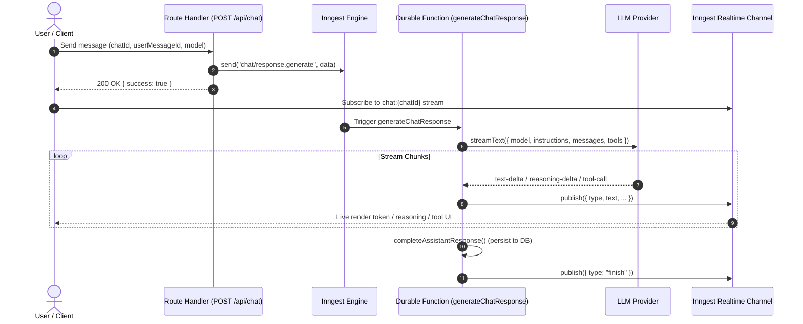

# Durable AI Execution with Inngest

Background AI workflows (workflow DAGs, automated data processing, and production chat generation) often take many seconds to minutes and interact with third-party rate limits. Inngest combined with the Vercel AI SDK provides durable, memoized step execution and realtime background streaming.

---

## 1. Why Background Chat Streaming Beats Route Handlers

Direct Next.js route handlers (`toDataStreamResponse()`) break down in complex agentic workflows:
- Vercel functions time out after 15–60 seconds (unless on enterprise plans).
- Mobile browser sleeps, network hiccups, or page navigation immediately terminate the streaming connection.
- Multi-step tool runs (subagents, web scraping, code execution) exceed HTTP connection limits.

By dispatching chat generation to an Inngest background function and streaming events via **Inngest Realtime**, generation is decoupled from the user's browser session:



---

## 2. Inngest Durable Chat Streaming Function

```typescript
import { streamText, isStepCount } from "ai";
import { inngest } from "@/lib/inngest/client";
import { chatChannel } from "@/lib/inngest/chat-channel";
import { chatAbortRegistry } from "@/lib/chat/chat-abort-registry";

export const generateChatResponse = inngest.createFunction(
  {
    id: "generate-chat-response",
    retries: 0,
    concurrency: {
      key: "event.data.chatId",
      limit: 1, // Prevent overlapping generations in the same conversation
    },
    triggers: [{ event: "chat/response.generate" }],
    cancelOn: [
      {
        event: "chat/response.cancel",
        if: "async.data.chatId == event.data.chatId && async.data.userId == event.data.userId",
      },
    ],
  },
  async ({ event }) => {
    const { chatId, userId, userMessageId, model, reasoningEffort } = event.data;

    // 1. Register local abort controller for instant in-process cancellation
    const { controller: abortController, release: releaseAbortController } =
      chatAbortRegistry.register(chatId);

    const channel = chatChannel({ chatId });
    const assistantMessageId = crypto.randomUUID();

    const emit = async (data: any) => {
      if (abortController.signal.aborted) return;
      await inngest.realtime.publish(channel.stream, data);
    };

    let mcpCleanup = async () => {};
    const accumulator = { text: "", reasoning: "", completedTools: [] as any[] };

    try {
      await emit({ type: "start", messageId: assistantMessageId });

      // 2. Load context, tools, and assemble messages
      const { resolved, finalMessages, tools, systemPrompt, toolSourceMap, cleanup } =
        await setupChatResources({ userId, chatId, userMessageId, model });
      mcpCleanup = cleanup;

      // 3. Initiate AI SDK streamText
      const result = streamText({
        model: resolved.sdkProvider.chat(resolved.modelId),
        headers: reasoningEffort ? { "x-reasoning-effort": reasoningEffort } : undefined,
        abortSignal: abortController.signal,
        instructions: systemPrompt,
        messages: finalMessages,
        tools,
        stopWhen: isStepCount(10), // Bounded tool steps
      });

      // 4. Consume full stream with delta coalescing and inline reasoning parsing
      const streamState = await consumeModelStream(
        result.fullStream,
        abortController.signal,
        emit,
        toolSourceMap,
        accumulator.completedTools,
      );
      accumulator.text = streamState.accumulatedText;
      accumulator.reasoning = streamState.accumulatedReasoning;

      // 5. Fallback synthesis pass: if tools ran but model emitted no text
      if (needsFallbackSynthesis(abortController.signal.aborted, accumulator.text, accumulator.completedTools.length)) {
        const synthState = await runSynthesisFallbackPass({
          finalMessages,
          completedTools: accumulator.completedTools,
          resolved,
          systemPrompt,
          emit,
        });
        accumulator.text += synthState.text;
        accumulator.reasoning += synthState.reasoning;
      }

      // 6. Handle clean cancellation or persist final response
      if (abortController.signal.aborted) {
        await persistAbortedAssistantResponse({ chatId, assistantMessageId, ...accumulator });
        return;
      }

      await completeAssistantResponse({
        chatId,
        assistantMessageId,
        userMessageId,
        accumulatedText: accumulator.text,
        accumulatedReasoning: accumulator.reasoning,
        completedTools: accumulator.completedTools,
        safeFinishReason: Promise.resolve(result.finishReason).catch(() => "stop"),
        safeUsage: Promise.resolve(result.usage).catch(() => undefined),
        emit,
      });
    } catch (err) {
      if (isAbortError(err, abortController.signal)) {
        await persistAbortedAssistantResponse({ chatId, assistantMessageId, ...accumulator });
      } else {
        await emit({ type: "error", message: (err as Error).message });
        throw err;
      }
    } finally {
      releaseAbortController();
      await mcpCleanup();
    }
  },
);
```

### 2.1 Pre-Flight Capability Guards & Step Budgeting

Before invoking `streamText`, always validate that model hardware traits match the turn's payload. This prevents cryptic upstream 400 Bad Request API errors from LLM providers:

```typescript
// lib/inngest/chat-response/chat-execution-config.ts
export function validateModelCapabilities(params: {
  isToolCallingModel: boolean;
  hasExternalMcpTools: boolean;
  selectedTools?: string[];
  thread: any[];
  capVision?: boolean;
}): void {
  const { isToolCallingModel, hasExternalMcpTools, selectedTools, thread, capVision } = params;

  const requestedTools =
    hasExternalMcpTools ||
    Boolean(
      selectedTools?.some(
        (id: string) =>
          !id.startsWith("internal:tool:") &&
          id !== "search_knowledge_base" &&
          id !== "get_file_url" &&
          id !== "load_skill",
      ),
    );

  if (!isToolCallingModel && requestedTools) {
    throw new ToolsNotSupportedError("Active model does not support tool or function calling.");
  }

  // Inspect thread attachments for image parts
  const hasImages = thread.some((m) => m.attachments?.some((a: any) => a.type === "image"));
  if (hasImages && !capVision) {
    throw new VisionNotSupportedError("Active model does not support vision or image inputs.");
  }
}

// Dynamically expand step budget when multi-agent delegation is enabled
export function resolveOrchestratorMaxSteps(isSubagentDelegationEnabled: boolean): number {
  return isSubagentDelegationEnabled ? Math.max(CHAT_MAX_STEPS * 2, 20) : CHAT_MAX_STEPS;
}
```

---

## 3. Fallback Synthesis Pass Pattern

> [!WARNING]
> **Empty Responses After Tool Execution**: Models frequently run multiple tools, reach `maxSteps` or finish their tool execution loop, and conclude the stream **without generating any final user text**.

To guarantee a coherent response to the user, evaluate if fallback synthesis is needed:

```typescript
export function needsFallbackSynthesis(
  aborted: boolean,
  accumulatedText: string,
  completedToolsCount: number,
): boolean {
  return !aborted && accumulatedText.trim().length === 0 && completedToolsCount > 0;
}

export async function runSynthesisFallbackPass(params: {
  finalMessages: ModelMessage[];
  completedTools: CompletedToolRecord[];
  resolved: any;
  systemPrompt: string;
  hasArtifactTool?: boolean;
  artifactTools?: Record<string, any>;
  emit: (event: any) => Promise<void>;
}): Promise<{ text: string; reasoning: string }> {
  const { finalMessages, completedTools, resolved, systemPrompt, hasArtifactTool, artifactTools, emit } = params;

  // Append prior tool calls, tool results, and an explicit synthesis prompt
  const synthesisMessages: ModelMessage[] = [
    ...finalMessages,
    {
      role: "assistant",
      content: completedTools.map((tc) => ({
        type: "tool-call" as const,
        toolCallId: tc.toolCallId,
        toolName: tc.toolName,
        input: tc.args,
      })),
    },
    {
      role: "tool",
      content: completedTools.map((tc) => ({
        type: "tool-result" as const,
        toolCallId: tc.toolCallId,
        toolName: tc.toolName,
        output: {
          type: "text" as const,
          value: typeof tc.result === "string" ? tc.result : JSON.stringify(tc.result ?? "Task completed"),
        },
      })),
    },
    {
      role: "user",
      content:
        "Synthesize all the research and findings above into a comprehensive, high-quality final response for the user. " +
        (hasArtifactTool
          ? "If the user requested a document, report, table, code, or canvas artifact, you MUST call manage_artifact now to create it."
          : ""),
    },
  ];

  const synthResult = streamText({
    model: resolved.sdkProvider.chat(resolved.modelId),
    instructions: systemPrompt,
    messages: synthesisMessages,
    tools: hasArtifactTool ? artifactTools : undefined,
    stopWhen: isStepCount(3),
  });

  return consumeModelStream(synthResult.fullStream, new AbortController().signal, emit, {}, []);
}
```

---

## 4. Why `step.ai.wrap()` is Essential in Workflow DAGs

Inside multi-step Inngest workflow DAGs (distinct from interactive chat streaming), raw `generateText()` calls must be wrapped with `step.ai.wrap`:
1. Any subsequent step failure causes the entire function to re-execute from the beginning.
2. The LLM call is re-issued, incurring duplicate token costs.
3. The response might differ due to LLM non-determinism, violating idempotent workflow guarantees.

`step.ai.wrap()` captures the inference request, provisions AI telemetry, and memoizes the returned result. On function replay or retry, the stored response is returned instantly without calling the LLM provider.

```typescript
import { generateText } from "ai";
import { createOpenAI } from "@ai-sdk/openai";

// Inside an Inngest step:
const { steps } = await step.ai.wrap("openai-generate-summary", generateText, {
  model: openai("gpt-4o"),
  instructions: "You are a concise document summarizer.",
  prompt: documentText,
  telemetry: {
    isEnabled: true,
    recordInputs: true,
    recordOutputs: true,
  },
});

const summary = steps[0]?.content[0]?.type === "text" ? steps[0].content[0].text : "";
```

---

## 5. Cancelling In-Flight Executions

Provide two-tier cancellation:
1. **In-Process Abort Controller Registry**: Immediate local cancellation of the active `ReadableStream` / `fetch`.
2. **Inngest Event Cancellation (`chat/response.cancel`)**: Cross-process event matching to kill the job even if it has rescheduled or is queued.

```typescript
// app/api/chat/stop/route.ts
export async function POST(req: Request) {
  const { chatId } = await req.json();
  const session = await auth.api.getSession({ headers: await headers() });
  if (!session) return new Response("Unauthorized", { status: 401 });

  // 1. Abort local in-flight stream immediately
  chatAbortRegistry.abort(chatId);

  // 2. Publish Inngest cancel event to cancel background execution across workers
  await inngest.send({
    name: "chat/response.cancel",
    data: { chatId, userId: session.user.id },
  });

  return Response.json({ success: true });
}
```

---

## 6. Durable Knowledge Base Ingestion & Reindexing

Document extraction, chunking, and batch vector embedding (`embedMany`) are computationally heavy and vulnerable to rate limits and large payloads. Wrap ingestion in durable Inngest functions with singleton concurrency, cancellation hooks, and non-retriable error normalization:

```typescript
// lib/inngest/functions/kb-ingest.ts
import { inngest } from "@/lib/inngest/client";
import { NonRetriableError } from "inngest";
import { ingestDocument } from "@/lib/rag/ingest";

export const ingestKbDocumentFunction = inngest.createFunction(
  {
    id: "ingest-kb-document",
    singleton: { key: "event.data.documentId", mode: "skip" },
    retries: 2,
    cancelOn: [
      {
        event: "knowledgebase/document.cancel",
        if: "async.data.documentId == event.data.documentId",
      },
      {
        event: "knowledgebase/reindex.cancel",
        if: "async.data.kbId == event.data.kbId",
      },
    ],
    triggers: [{ event: "knowledgebase/document.ingest" }],
  },
  async ({ event, step }) => {
    const { documentId, userId } = event.data;

    await step.run("ingest-document-pipeline", async () => {
      try {
        await ingestDocument(documentId, userId);
      } catch (err: any) {
        // Halt retries immediately for deterministic non-recoverable failures
        const nonRetriableCodes = [
          "NOT_FOUND",
          "RAG_EXTRACTION_EMPTY",
          "PROVIDER_NOT_CONFIGURED",
          "INVALID_API_KEY",
        ];
        if (nonRetriableCodes.includes(err.code)) {
          throw new NonRetriableError(err.message, { cause: err });
        }
        throw err;
      }
    });

    return { success: true, documentId };
  },
);
```
