# RAG & Knowledge Base Architecture

Retrieval-Augmented Generation (RAG) grounds language models in domain-specific context, enterprise documents, and user knowledge bases. In Next.js App Router applications using the Vercel AI SDK, production RAG requires a dual-path architecture:
1. **Durable Background Ingestion Pipeline**: Decoupled document extraction, recursive semantic chunking, dynamic multi-provider embedding generation (`embedMany`), and upsert into Qdrant vector storage.
2. **Agentic Hybrid Retrieval at Runtime**: Model-invoked tool calling (`search_knowledge_base`), parallel vector similarity search + payload full-text keyword search, Reciprocal Rank Fusion (RRF), and context synthesis.

---

## 1. End-to-End Architecture

```mermaid
flowchart TD
    subgraph Ingestion["1. Durable Ingestion Pipeline (Inngest Worker)"]
        File["Document Upload (PDF, DOCX, TXT, MD)"] --> Extract["extractTextFromBuffer() + Character Limit Guard"]
        Extract --> Chunk["chunkText() via Recursive Separators (1000 chars, 200 overlap)"]
        Chunk --> ResolveEmb["resolveEmbeddingProvider(userId)"]
        ResolveEmb --> PrefixCheck{"Requires task prefix?"}
        PrefixCheck -->|"Yes (e.g. Nemotron)"| AddPassagePrefix["Prepend 'passage: ' to each chunk"]
        PrefixCheck -->|"No"| RawPassage["Raw chunk text"]
        AddPassagePrefix --> BatchEmbed["Batch embedMany({ values: batch, model }) (50 items/batch)"]
        RawPassage --> BatchEmbed
        BatchEmbed --> QdrantUpsert["upsertChunkPoints(): Qdrant collection kb_chunks_{dim}"]
        QdrantUpsert --> MarkReady["Mark document 'ready' & update tokenCount in Postgres"]
    end

    subgraph Retrieval["2. Agentic Hybrid Retrieval (Chat Runtime)"]
        UserMsg["User sends query in chat"] --> CheckKB{"KB attached & ready?"}
        CheckKB -->|"Yes"| RegTool["registerKnowledgebaseTool(): search_knowledge_base"]
        CheckKB -->|"No"| SkipTool["Proceed without KB tool"]
        RegTool --> LLMCall["streamText({ instructions: [Layer 7: KB Directive], tools })"]
        LLMCall --> ModelDecides{"Model calls search_knowledge_base(query)?"}
        ModelDecides -->|"Yes"| ExecSearch["hybridSearch(kbIds, query, userId, topK)"]
        ModelDecides -->|"No / Common knowledge"| DirectAnswer["Generate direct answer"]
        
        ExecSearch --> EmbedQuery["embedQuery(query, userId) via embed() with 'query: ' prefix"]
        EmbedQuery --> ParallelSearch["Promise.all() in Qdrant"]
        ParallelSearch --> VecSearch["searchSemanticVectors(): Cosine distance filter kbId"]
        ParallelSearch --> TextSearch["searchKeywordChunks(): Full-text index filter kbId"]
        VecSearch --> RRF["applyRRF(vectorRows, ftsRows, topK=5)"]
        TextSearch --> RRF
        RRF --> FormatRes["Return structured chunks with relevanceScore"]
        FormatRes --> LLMCall
    end
```



---

## 2. Dynamic Embedding Providers & Task Prefixes

Never hardcode embedding models or API keys. Resolve per-user credentials dynamically from database settings, dynamically invoke `sdkProvider.embeddingModel(modelId)`, format model-specific prefixes, and chunk batch requests to honor provider limits:

```typescript
import { embed, embedMany } from "ai";
import { resolveEmbeddingProvider } from "@/lib/providers/resolve-embedding-provider";
import { PREFIXED_EMBEDDING_MODELS } from "@/lib/rag/prefixed-embedding-models";

/**
 * Models that require a task-specific prefix (e.g., 'query: ' or 'passage: ')
 * before generating embeddings.
 */
export const PREFIXED_EMBEDDING_MODELS = new Set([
  "nvidia/llama-nemotron-embed-vl-1b-v2:free",
]);

/**
 * Embed a search query with task-specific prefix handling.
 */
export async function embedQuery(text: string, userId: string): Promise<number[]> {
  const resolved = await resolveEmbeddingProvider(userId);
  const embeddingModel = resolved.sdkProvider.embeddingModel(resolved.modelId);

  // Apply model-specific task prefix for query retrieval
  const value = PREFIXED_EMBEDDING_MODELS.has(resolved.modelId)
    ? `query: ${text}`
    : text;

  const { embedding } = await embed({
    model: embeddingModel,
    value,
  });

  return embedding;
}

/**
 * Batch embed document passages in bounded chunks.
 */
export async function embedDocuments(
  texts: string[],
  userId: string,
  batchSize = 50,
): Promise<number[][]> {
  if (texts.length === 0) return [];

  const resolved = await resolveEmbeddingProvider(userId);
  const embeddingModel = resolved.sdkProvider.embeddingModel(resolved.modelId);

  const values = PREFIXED_EMBEDDING_MODELS.has(resolved.modelId)
    ? texts.map((t) => `passage: ${t}`)
    : texts;

  const embeddings: number[][] = [];
  for (let i = 0; i < values.length; i += batchSize) {
    const batch = values.slice(i, i + batchSize);
    const result = await embedMany({
      model: embeddingModel,
      values: batch,
    });
    embeddings.push(...result.embeddings);
  }

  return embeddings;
}
```

---

## 3. Extraction & Recursive Semantic Chunking

Split documents using hierarchical separators (`\n\n` paragraphs $\to$ `\n` lines $\to$ `. ` sentences $\to$ ` ` words) to preserve coherent semantic boundaries with overlapping contexts:

```typescript
export const CHUNK_CONSTANTS = {
  DEFAULT_CHARS: 1000,
  DEFAULT_OVERLAP: 200,
  SEPARATORS: ["\n\n", "\n", ". ", " ", ""],
  RRF_K: 60,
};

/**
 * Recursive character splitter preserving natural paragraph and sentence boundaries.
 */
export function splitRecursive(
  text: string,
  separators: string[],
  chunkSize: number,
  overlap: number,
): string[] {
  const finalChunks: string[] = [];
  let separator = separators[separators.length - 1];
  let newSeparators: string[] = [];

  for (let i = 0; i < separators.length; i++) {
    const s = separators[i];
    if (s === "" || text.includes(s)) {
      separator = s;
      newSeparators = separators.slice(i + 1);
      break;
    }
  }

  const splits = separator ? text.split(separator) : Array.from(text);
  let currentDoc: string[] = [];
  let currentLength = 0;

  for (const piece of splits) {
    const pieceLen = piece.length;
    if (currentLength + pieceLen + (currentDoc.length > 0 ? separator.length : 0) > chunkSize) {
      if (currentDoc.length > 0) {
        const doc = currentDoc.join(separator).trim();
        if (doc) finalChunks.push(doc);

        // Keep trailing chunks to satisfy overlap window
        while (
          currentLength > overlap ||
          (currentLength + pieceLen > chunkSize && currentLength > 0)
        ) {
          const popped = currentDoc.shift();
          if (!popped) break;
          currentLength -= popped.length + (currentDoc.length > 0 ? separator.length : 0);
        }
      }
    }
    currentDoc.push(piece);
    currentLength += pieceLen + (currentDoc.length > 1 ? separator.length : 0);
  }

  if (currentDoc.length > 0) {
    const doc = currentDoc.join(separator).trim();
    if (doc) finalChunks.push(doc);
  }

  return finalChunks;
}
```

---

## 4. Qdrant Vector Storage Architecture

Store points partitioned by embedding vector dimensionality (`kb_chunks_${dimensions}`) to support arbitrary user embedding models without collection collision. Store denormalized document and KB metadata in payloads for single-hop search without relational DB joins:

```typescript
import { QdrantClient } from "@qdrant/js-client-rest";

export type QdrantChunkPayload = {
  content: string;
  kbId: string;
  documentId: string;
  chunkIndex: number;
  tokenCount: number;
  documentName: string;
  kbName: string;
  s3Key: string;
};

const qdrant = new QdrantClient({
  url: process.env.QDRANT_URL,
  apiKey: process.env.QDRANT_API_KEY || undefined,
});

const verifiedCollections = new Set<string>();

/**
 * Ensures collection exists with Cosine vector metric and both keyword + text payload indexes.
 */
export async function ensureQdrantCollection(dimensions: number): Promise<string> {
  const collectionName = `kb_chunks_${dimensions}`;
  if (verifiedCollections.has(collectionName)) return collectionName;

  const existsRes = await qdrant.collectionExists(collectionName);
  const exists = typeof existsRes === "boolean" ? existsRes : existsRes?.exists;

  if (!exists) {
    await qdrant.createCollection(collectionName, {
      vectors: { size: dimensions, distance: "Cosine" },
    });

    // Keyword index for multi-KB scoping
    await qdrant.createPayloadIndex(collectionName, {
      field_name: "kbId",
      field_schema: "keyword",
    });

    // Keyword index for document deletion
    await qdrant.createPayloadIndex(collectionName, {
      field_name: "documentId",
      field_schema: "keyword",
    });

    // Full-text index for keyword search
    await qdrant.createPayloadIndex(collectionName, {
      field_name: "content",
      field_schema: "text",
    });
  }

  verifiedCollections.add(collectionName);
  return collectionName;
}

/**
 * Upsert points with vector and denormalized metadata.
 */
export async function upsertChunkPoints(
  dimensions: number,
  points: Array<{ id: string; vector: number[]; payload: QdrantChunkPayload }>,
): Promise<void> {
  if (points.length === 0) return;
  const collection = await ensureQdrantCollection(dimensions);
  await qdrant.upsert(collection, { wait: true, points });
}
```

---

## 5. Hybrid Retrieval & Reciprocal Rank Fusion (RRF)

Vector search alone misses exact terms (SKUs, IDs, error codes), while keyword search alone misses conceptual synonyms. Execute both queries in parallel and merge with Reciprocal Rank Fusion ($k=60$):

$$RRF(d) = \sum_{m \in \{vec, kw\}} \frac{1}{60 + rank_m(d) + 1}$$

```typescript
import { embedQuery } from "./embed-query";
import { searchSemanticVectors, searchKeywordChunks } from "./qdrant-client";

export function applyRRF(
  vectorRows: ScoredChunk[],
  ftsRows: ScoredChunk[],
  topK: number,
  k = 60,
): ChunkResult[] {
  const scoreMap = new Map<string, { chunk: ScoredChunk; score: number }>();

  vectorRows.forEach((chunk, idx) => {
    scoreMap.set(chunk.id, {
      chunk,
      score: 1 / (k + idx + 1),
    });
  });

  ftsRows.forEach((chunk, idx) => {
    const rrfScore = 1 / (k + idx + 1);
    const existing = scoreMap.get(chunk.id);
    if (existing) {
      existing.score += rrfScore;
    } else {
      scoreMap.set(chunk.id, { chunk, score: rrfScore });
    }
  });

  return Array.from(scoreMap.values())
    .sort((a, b) => b.score - a.score)
    .slice(0, topK)
    .map(({ chunk, score }) => ({ ...chunk, score }));
}

/**
 * Production Hybrid Search: Validates readiness, embeds query once, runs parallel searches, and fuses.
 */
export async function hybridSearch(
  kbIds: string[],
  query: string,
  userId: string,
  topK = 5,
): Promise<ChunkResult[]> {
  const normalizedQuery = query.trim();
  if (!normalizedQuery || kbIds.length === 0) return [];

  // 1. Verify all target KBs are ready
  await verifyKnowledgebasesReady(kbIds, userId);

  // 2. Embed query
  const embedding = await embedQuery(normalizedQuery, userId);

  // 3. Parallel semantic + keyword queries in Qdrant
  const [vectorRows, ftsRows] = await Promise.all([
    searchSemanticVectors(embedding.length, embedding, kbIds, 20).catch(() => []),
    searchKeywordChunks(embedding.length, normalizedQuery, kbIds, 20).catch(() => []),
  ]);

  // 4. Reciprocal Rank Fusion
  return applyRRF(vectorRows, ftsRows, topK);
}
```

---

## 6. Agentic Knowledge Base Tool Registration

Register `search_knowledge_base` with strict gating. When attached, inject Layer 7 directives instructing the model to check knowledge bases before answering:

```typescript
import { tool } from "ai";
import { z } from "zod";
import { hybridSearch } from "@/lib/rag/hybrid-search";

export const searchKnowledgeBaseSchema = z.object({
  query: z
    .string()
    .min(1, "Search query is required")
    .describe("Specific keyword or semantic query to search in knowledge bases."),
});

export function registerKnowledgebaseTool(
  targetKbIds: string[],
  kbIsReady: boolean,
  userId: string,
  selectedTools?: string[],
): Record<string, any> {
  const isGated =
    targetKbIds.length > 0 &&
    kbIsReady &&
    (selectedTools === undefined ||
      selectedTools.includes("search_knowledge_base"));

  if (!isGated) return {};

  return {
    search_knowledge_base: tool({
      description:
        "Search attached knowledge bases for domain documentation, technical specs, user policies, and data.",
      inputSchema: searchKnowledgeBaseSchema,
      execute: async ({ query }) => {
        const normalized = (query || "").trim();
        if (!normalized) {
          return {
            success: false,
            error: "Missing mandatory 'query' parameter.",
          };
        }

        const results = await hybridSearch(targetKbIds, normalized, userId, 5);

        if (results.length === 0) {
          return {
            success: true,
            results: [],
            resultCount: 0,
            message: `No results found for '${normalized}'. Try broader search terms.`,
          };
        }

        return {
          success: true,
          results: results.map((r) => ({
            content: r.content,
            relevanceScore: Number(r.score.toFixed(4)),
            documentId: r.documentId,
            documentName: r.documentName,
            kbName: r.kbName,
          })),
          resultCount: results.length,
        };
      },
    }),
  };
}
```

---

## 7. Durable Ingestion & Reindexing with Inngest

Background jobs ensure that large PDF or multi-document ingestion never blocks web workers or times out:

```typescript
import { inngest } from "@/lib/inngest/client";
import { NonRetriableError } from "inngest";
import { ingestDocumentPipeline } from "@/lib/rag/ingest-pipeline";

export const ingestKbDocumentFunction = inngest.createFunction(
  {
    id: "ingest-kb-document",
    singleton: { key: "event.data.documentId", mode: "skip" },
    retries: 2,
    cancelOn: [
      {
        event: "knowledgebase/document.cancel",
        if: "async.data.documentId == event.data.documentId",
      },
      {
        event: "knowledgebase/reindex.cancel",
        if: "async.data.kbId == event.data.kbId",
      },
    ],
    triggers: [{ event: "knowledgebase/document.ingest" }],
  },
  async ({ event, step }) => {
    const { documentId, userId } = event.data;

    await step.run("ingest-document-pipeline", async () => {
      try {
        await ingestDocument(documentId, userId);
      } catch (err: any) {
        if (
          err.code === "NOT_FOUND" ||
          err.code === "RAG_EXTRACTION_EMPTY" ||
          err.code === "PROVIDER_NOT_CONFIGURED" ||
          err.code === "INVALID_API_KEY"
        ) {
          throw new NonRetriableError(err.message, { cause: err });
        }
        throw err;
      }
    });

    return { success: true, documentId };
  },
);
```

---

## 8. Common Mistakes & Production Traps

| Symptom | Root Cause | Fix |
|---|---|---|
| Qdrant error: `Wrong vector dimension: expected X, got Y` | User changed embedding model between document ingestion and query search | Partition Qdrant collections by dimension (`kb_chunks_${dimensions}`); trigger KB reindex on embedding model change |
| Semantic search returns irrelevant passages for task-specific models | Model requires retrieval prefixes (e.g. `query: ` / `passage: `) | Track models in `PREFIXED_EMBEDDING_MODELS` and apply prefixes before `embed()` / `embedMany()` |
| LLM searches knowledge base and crashes with `KnowledgebaseNotReadyError` | `search_knowledge_base` registered before document indexing completed | Gate tool registration on `kbIsReady === true` and status === `'ready'` |
| Exact product numbers or codes return zero hits | Using pure dense vector search without keyword full-text indexing | Create text payload index on `content` in Qdrant; fuse vector and keyword results via Reciprocal Rank Fusion (RRF) |
| Ingestion of 500-page document exhausts memory or hits API rate limits | Passing all chunks in a single `embedMany` call | Slice chunks into batches of 50 (`EMBEDDING_BATCH_SIZE = 50`) and concatenate results in order |
| Document deleted from UI but chunks still appear in search results | Deleting database record without purging Qdrant points | Execute `deletePointsByDocumentId(documentId)` with `must: [{ key: 'documentId', match: { value: documentId } }]` filter |
| Empty search query passed by model causes unhandled exception | Model invoked `search_knowledge_base({ query: "" })` | Defensively trim query and return friendly error JSON instead of throwing uncaught exception |
| Ingestion persists orphaned chunks when user deletes KB during processing | Race condition between background worker and user deletion | Check database existence before point upsert (`db.select({ id }).from(kbDocument)...`) |
