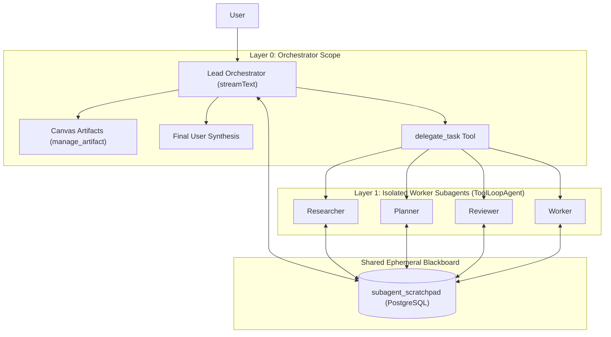

# Subagents & Multi-Agent Orchestration

This reference documents the production architecture for hierarchical multi-agent delegation in the Vercel AI SDK (`ai`) and Next.js App Router. It covers the 2-layer architectural boundary, `ToolLoopAgent` execution, generator-based streaming (`execute: async function*`), context protection via `toModelOutput`, the ephemeral shared blackboard (scratchpad), and guaranteed synthesis fallback.

---

## 1. Architectural Topology & 2-Layer Boundary

Uncontrolled multi-agent networks suffer from non-deterministic recursion, cascading token exhaustion, and split-brain user communication. A robust multi-agent architecture enforces a strict **2-layer hierarchy (depth limit \(d = 1\))**:



### Architectural Invariants

1. **Depth Limit \(d = 1\)**: Worker subagents CANNOT spawn further subagents. `delegate_task` is stripped from worker tool sets.
2. **Canvas / UI Protection**: Worker subagents CANNOT mutate user artifacts or canvas state directly. `manage_artifact` is stripped from worker tool sets. Only the Lead Orchestrator interacts with the user's canvas.
3. **Skill Mutation Protection**: Worker subagents cannot create or mutate user skills (`create_skill`, `update_skill` are excluded).
4. **Isolated Memory**: Workers execute with freshly scoped conversation history (task brief + input pointers) rather than inheriting the entire bloated chat thread.
5. **Decoupled Persistence**: Intermediate artifacts, extensive code drafts, and research logs are saved to an ephemeral database scratchpad rather than dumped into the LLM context.

---

## 2. Tool Scoping & Architectural Boundary (`getSubagentTools`)

To enforce the 2-layer boundary, filter orchestrator tools before passing them to worker instances:

```typescript
// lib/subagents/get-subagent-tools.ts
import { INTERNAL_TOOL_IDS } from "@/config/tools";

/**
 * Filters tools to enforce the 2-layer architectural boundary:
 * 1. `delegate_task` is strictly omitted to prevent subagents from calling subagents (depth limit d=1).
 * 2. `manage_artifact` is strictly omitted to protect the user canvas from partial worker drafts.
 * 3. Skill authoring/mutation tools are strictly omitted to prevent subagents from mutating user skills.
 */
export function getSubagentTools(
  availableTools: Record<string, any>,
): Record<string, any> {
  const forbidden = new Set([
    "delegate_task",
    "manage_artifact",
    INTERNAL_TOOL_IDS.MANAGE_ARTIFACT,
    "create_skill",
    "update_skill",
    "write_skill_file",
    "delete_skill_file",
    INTERNAL_TOOL_IDS.MANAGE_SKILL,
  ]);

  const sanitized: Record<string, any> = {};
  for (const [name, toolInstance] of Object.entries(availableTools)) {
    if (!forbidden.has(name)) {
      sanitized[name] = toolInstance;
    }
  }
  return sanitized;
}
```

---

## 3. Worker Execution with `ToolLoopAgent` & Generator Streaming

Subagent delegation is implemented as an internal tool (`delegate_task`) whose `execute` function is an **`async function*` generator**. This enables real-time streaming of worker intermediate steps, reasoning, and tool calls to the client UI using `readUIMessageStream` and `toUIMessageStream`.

```typescript
// lib/subagents/create-subagent-dispatch-tool.ts
import {
  isStepCount,
  readUIMessageStream,
  ToolLoopAgent,
  tool,
  toUIMessageStream,
} from "ai";
import { z } from "zod";
import { getLogger } from "@/lib/logger";
import { constructSubagentPrompt } from "./construct-subagent-prompt";
import { getSubagentTools } from "./get-subagent-tools";
import { registerScratchpadTools } from "./register-subagent-tools";
import { sanitizeSubagentOutput } from "./subagent-dispatch-tool";
import { SUBAGENT_ROLES } from "./subagent-role";

const log = getLogger(["subagents", "dispatch"]);

interface CreateSubagentDispatchToolParams {
  defaultModel: any;
  customWorkerModel?: any;
  availableTools: Record<string, any>;
  maxSteps?: number;
  scratchpadContext?: { chatId: string; messageId: string };
}

export function createSubagentDispatchTool(
  params: CreateSubagentDispatchToolParams,
) {
  const {
    defaultModel,
    customWorkerModel,
    availableTools,
    maxSteps = 10,
    scratchpadContext,
  } = params;

  return tool({
    description:
      "Delegates an isolated, complex, or context-heavy task to a specialized worker subagent. " +
      "Use this for deep document analysis, comprehensive planning, code review, or multi-step exploration. " +
      "The subagent operates in an isolated context and has access to scratchpad tools to persist notes. " +
      "Do NOT use this for trivial single-turn questions.",
    inputSchema: z.object({
      role: z
        .enum(SUBAGENT_ROLES)
        .describe(
          "Specialised role for the subagent: 'researcher', 'planner', 'reviewer', or 'worker'.",
        ),
      taskBrief: z
        .string()
        .describe(
          "Complete, self-contained requirements and instructions for the task.",
        ),
      inputData: z
        .string()
        .optional()
        .describe(
          "Optional context pointers, specific queries, or references to scratchpad files.",
        ),
    }),
    execute: async function* ({ role, taskBrief, inputData }, { abortSignal }) {
      // Allow heterogeneous model allocation (e.g. fast/cheap worker model)
      const selectedModel = customWorkerModel ?? defaultModel;
      const baseWorkerTools = getSubagentTools(availableTools);
      const workerTools = scratchpadContext
        ? {
            ...baseWorkerTools,
            ...registerScratchpadTools({
              chatId: scratchpadContext.chatId,
              messageId: scratchpadContext.messageId,
              workerRole: role,
            }),
          }
        : baseWorkerTools;

      const runId = crypto.randomUUID();
      const parentInvocationId = crypto.randomUUID();

      log.info("Dispatching subagent (role: {role}, runId: {runId})", {
        role,
        runId,
      });

      try {
        const workerAgent = new ToolLoopAgent({
          model: selectedModel,
          instructions: constructSubagentPrompt({
            isSubagent: true,
            agentRole: role,
            parentInvocationId,
            runId,
            allocatedModel:
              typeof selectedModel === "object" && selectedModel?.modelId
                ? selectedModel.modelId
                : "worker-model",
          }),
          tools: workerTools,
          stopWhen: isStepCount(maxSteps),
        });

        const streamResult = await workerAgent.stream({
          prompt: `TASK BRIEF:\n${taskBrief}\n\nINPUT DATA:\n${inputData ?? "None provided."}`,
          abortSignal,
        });

        let lastYieldTime = -Infinity;
        let lastChunk: any = null;
        let hasPendingUnyieldedChunk = false;

        // Stream each incremental UI message chunk to frontend, throttled to 150ms
        for await (const uiChunk of readUIMessageStream({
          stream: toUIMessageStream({ stream: streamResult.stream }),
        })) {
          lastChunk = uiChunk;
          const now = Date.now();
          if (now - lastYieldTime >= 150) {
            lastYieldTime = now;
            hasPendingUnyieldedChunk = false;
            yield uiChunk;
          } else {
            hasPendingUnyieldedChunk = true;
          }
        }

        if (hasPendingUnyieldedChunk && lastChunk) {
          yield lastChunk;
        }
      } catch (err) {
        log.error("Subagent execution failed (role: {role}, runId: {runId})", {
          role,
          runId,
          error: err instanceof Error ? err.message : String(err),
        });
        const errorMessage =
          err instanceof Error ? err.message : "Subagent worker failed";
        yield {
          id: runId,
          role: "assistant",
          parts: [
            {
              type: "text",
              text: `STATUS: BLOCKED - Worker execution failed: ${errorMessage}`,
            },
          ],
        } as any;
      }
    },
    // The orchestrator context receives a token-bounded, sanitized summary
    toModelOutput: ({ output }: { output: any }) => {
      return {
        type: "text",
        value: sanitizeSubagentOutput(output),
      };
    },
  });
}
```

---

## 4. Context Window Protection & Output Sanitization

If a worker generates 20,000 tokens of research logs, passing that output verbatim into the orchestrator's context window causes context overflow. The `toModelOutput` transformer sanitizes and bounds the returned payload:

```typescript
// lib/subagents/subagent-dispatch-tool.ts

/**
 * Extracts a concise text summary from a subagent's execution output.
 * Handles strings, UIMessage objects, structured results, and text parts.
 */
function extractSubagentSummary(output: unknown): string {
  if (typeof output === "string") return output;
  if (!output || typeof output !== "object") {
    return "Subagent finished with no text output.";
  }
  const r = output as Record<string, unknown>;
  if (typeof r.summary === "string" && r.summary.trim()) return r.summary;
  if (typeof r.value === "string" && r.value.trim()) return r.value;
  if (typeof r.text === "string" && r.text.trim()) return r.text;

  if (Array.isArray(r.parts)) {
    const textParts = (r.parts as Array<{ type?: string; text?: string }>)
      .filter((p) => p?.type === "text" && typeof p?.text === "string" && p.text.trim())
      .map((p) => p.text as string);

    if (textParts.length > 0) {
      const lastText = textParts[textParts.length - 1];
      if (lastText && (lastText.includes("STATUS:") || textParts.length === 1)) {
        return lastText;
      }
      return textParts.join("\n\n");
    }
  }

  return "Subagent finished with no text output.";
}

/**
 * Bounds subagent output to avoid context window bloat (default: 8,000 chars / ~2,000 tokens).
 */
export function sanitizeSubagentOutput(output: unknown, maxChars = 8000): string {
  const text = extractSubagentSummary(output);
  if (text.length > maxChars) {
    return (
      text.slice(0, maxChars) +
      "\n\n[... Output truncated to 8,000 characters for context efficiency. Full details are stored in the scratchpad.]"
    );
  }
  return text;
}
```

---

## 5. Ephemeral Shared Blackboard (Database Scratchpad)

The scratchpad is a shared workspace where agents persist large tables, outlines, draft documents, and analysis notes during a single turn.

### Database Schema (Drizzle PostgreSQL)

```typescript
// drizzle/schemas/subagent-schema.ts
import {
  index,
  integer,
  pgTable,
  text,
  timestamp,
  uniqueIndex,
} from "drizzle-orm/pg-core";
import { chat } from "@/drizzle/schemas/chat-schema";

export const subagentScratchpad = pgTable(
  "subagent_scratchpad",
  {
    id: text("id")
      .primaryKey()
      .$defaultFn(() => crypto.randomUUID()),
    chatId: text("chat_id")
      .notNull()
      .references(() => chat.id, { onDelete: "cascade" }),
    // Note: messageId omits a database-level FK constraint so that workers
    // can write intermediate files in real time before the assistant message row is inserted.
    messageId: text("message_id").notNull(),
    filePath: text("file_path").notNull(),
    content: text("content").notNull(),
    writtenByRole: text("written_by_role").notNull(),
    version: integer("version").default(1).notNull(),
    createdAt: timestamp("created_at").defaultNow().notNull(),
    updatedAt: timestamp("updated_at")
      .defaultNow()
      .$onUpdate(() => new Date())
      .notNull(),
  },
  (table) => [
    uniqueIndex("subagent_scratchpad_msg_filepath_idx").on(
      table.messageId,
      table.filePath,
    ),
    index("subagent_scratchpad_chat_msg_idx").on(table.chatId, table.messageId),
  ],
);
```

### Scratchpad Tools (`registerScratchpadTools`)

```typescript
// lib/subagents/register-subagent-tools.ts
import { tool } from "ai";
import { z } from "zod";
import { upsertScratchpadFile, readScratchpadFile, listScratchpadFiles } from "./scratchpad-service";

export interface ScratchpadToolContext {
  chatId: string;
  messageId: string;
  workerRole: string;
}

export function registerScratchpadTools(context: ScratchpadToolContext) {
  const { chatId, messageId, workerRole } = context;

  return {
    scratchpad_write: tool({
      description:
        "Writes or updates an intermediate file in the shared scratchpad. " +
        "Use this to persist structured data, findings, outlines, or draft code for review, " +
        "peer cross-referencing, or user inspection without bloating conversational context. " +
        "DO NOT use this for trivial chat responses.",
      inputSchema: z.object({
        filePath: z.string().describe("Relative path (e.g. 'notes/findings.md', 'specs/plan.json')"),
        content: z.string().max(2_000_000, "Content cannot exceed 2MB"),
      }),
      execute: async ({ filePath, content }) => {
        const result = await upsertScratchpadFile({
          chatId,
          messageId,
          filePath,
          content,
          writtenByRole: workerRole,
        });
        return {
          success: true,
          filePath: result.filePath,
          version: result.version,
          message: `Successfully saved "${result.filePath}" (v${result.version}).`,
        };
      },
    }),

    scratchpad_read: tool({
      description:
        "Reads a file from the shared scratchpad for this conversation turn. " +
        "Use this to access notes, specifications, or outputs written by earlier steps or peer subagents.",
      inputSchema: z.object({
        filePath: z.string().describe("Path of the file to read"),
        startLine: z.number().int().min(1).optional(),
        lineCount: z.number().int().min(1).max(500).optional(),
      }),
      execute: async ({ filePath, startLine, lineCount }) => {
        const file = await readScratchpadFile(messageId, filePath);
        if (!file) return { success: false, error: `File "${filePath}" not found.` };

        let content = file.content;
        const allLines = content.split("\n");
        const totalLines = allLines.length;

        if (startLine !== undefined) {
          const startIdx = Math.max(0, startLine - 1);
          const count = lineCount ?? 200;
          content = allLines.slice(startIdx, startIdx + count).join("\n");
        } else if (content.length > 15000) {
          content =
            content.slice(0, 15000) +
            `\n\n[... File truncated at 15,000 characters. Total lines: ${totalLines}. Specify startLine and lineCount to read specific sections.]`;
        }

        return {
          success: true,
          filePath: file.filePath,
          content,
          totalLines,
          writtenByRole: file.writtenByRole,
          version: file.version,
        };
      },
    }),

    scratchpad_list: tool({
      description: "Lists all intermediate files currently stored in the shared scratchpad for this turn.",
      inputSchema: z.object({}),
      execute: async () => {
        const files = await listScratchpadFiles(messageId);
        return {
          success: true,
          files: files.map((f) => ({
            filePath: f.filePath,
            version: f.version,
            writtenByRole: f.writtenByRole,
            sizeBytes: Buffer.byteLength(f.content, "utf-8"),
            updatedAt: f.updatedAt,
          })),
        };
      },
    }),
  };
}
```

---

## 6. Worker Identity & Reporting Contract

Every subagent prompt enforces an explicit reporting contract:

```typescript
// lib/subagents/construct-subagent-prompt.ts
export function constructSubagentPrompt(metadata: {
  agentRole: string;
  runId: string;
}): string {
  return `
[SYSTEM IDENTITY: ISOLATED WORKER SUBAGENT]
Role: ${metadata.agentRole.toUpperCase()}
Execution Mode: Layer 1 Worker
Topological Constraints:
1. You are operating as an isolated subagent under an orchestrating agent.
2. You cannot spawn subordinate agents (depth limit d=1).
3. You cannot manipulate the user's canvas or create artifacts directly.
4. Use scratchpad_write to store intermediate findings, extensive document extracts, structured outlines, or tables for peer access and user inspection.
5. Conclude your work with a clear, self-contained summary adhering to your reporting contract.

REPORTING CONTRACT:
Provide your final text response starting with one of these exact status indicators:
- STATUS: DONE - when the task is completely finished.
- STATUS: DONE_WITH_CONCERNS - when completed, but ambiguities or risks were identified.
- STATUS: NEEDS_CONTEXT - when vital information is missing and could not be found with tools.
- STATUS: BLOCKED - when contradictions or tool errors prevent completion.

Follow the status with a concise summary (under 500 words) of your conclusions and any scratchpad file paths created.
`.trim();
}
```

---

## 7. Orchestrator Directives & Guaranteed Synthesis Fallback

The Lead Orchestrator prompt enforces responsibilities that subagents cannot perform:
1. Synthesizing all findings into a comprehensive final answer for the user.
2. Calling `manage_artifact` to render canvas artifacts requested by the user.

### Orchestrator Directives (Layer 12 System Prompt)

```markdown
## Orchestrator Directives & Subagent Delegation
You are operating as the Lead Orchestrator. You have access to the `delegate_task` tool to assign isolated, context-heavy subtasks to specialized worker subagents.
- **Final Response & Synthesis**: Worker subagents run in isolated sandboxes and CANNOT talk directly to the user or produce user-facing artifacts. You are strictly responsible for reviewing their outputs and synthesizing a complete, high-quality, comprehensive final answer for the user.
- **Artifacts & Canvas**: If the user requested a document, report, table, code, or canvas artifact, you MUST call `manage_artifact` yourself to generate it. Subagents do not have access to `manage_artifact`.
- **Step Budgeting**: Budget your execution turns. Do not chain endless subagent calls without reserving turns to create requested artifacts and write your final response.
```

### Synthesis Fallback Pass

If the orchestrator exhausts its steps on subagent calls or terminates without producing final text, `runSynthesisFallbackPass` recovers the answer:

```typescript
// lib/inngest/chat-response/chat-synthesis-pass.ts
export function needsFallbackSynthesis(
  aborted: boolean,
  accumulatedText: string,
  completedToolsCount: number,
): boolean {
  return !aborted && accumulatedText.trim().length === 0 && completedToolsCount > 0;
}

export async function runSynthesisFallbackPass(params: SynthesisFallbackParams) {
  const synthesisMessages: ModelMessage[] = [
    ...params.finalMessages,
    {
      role: "assistant",
      content: params.completedTools.map((tc) => ({
        type: "tool-call" as const,
        toolCallId: tc.toolCallId,
        toolName: tc.toolName,
        input: tc.args,
      })),
    },
    {
      role: "tool",
      content: params.completedTools.map((tc) => ({
        type: "tool-result" as const,
        toolCallId: tc.toolCallId,
        toolName: tc.toolName,
        output: {
          type: "text" as const,
          value: typeof tc.result === "string" ? tc.result : JSON.stringify(tc.result),
        },
      })),
    },
    {
      role: "user",
      content:
        "Synthesize all the research and findings above into a comprehensive, high-quality final response for the user. " +
        (params.hasArtifactTool
          ? "If the user requested a document, report, table, code, or canvas artifact, you MUST call manage_artifact now to create it."
          : ""),
    },
  ];

  const synthResult = streamText({
    model: params.model,
    instructions: params.systemPrompt,
    messages: synthesisMessages,
    tools: params.hasArtifactTool ? params.artifactTools : undefined,
    stopWhen: isStepCount(3),
  });

  return consumeModelStream(synthResult.fullStream, ...);
}
```

---

## 8. Telemetry, Outcome Resolution & Trace UI

Client UI displays each subagent execution as an interactive trace step in the response timeline:

```typescript
// lib/chat/resolve-subagent-outcome.ts
export function resolveSubagentOutcome(
  state: "running" | "done" | "error",
  outputText: string,
): { label: string; isError: boolean } {
  if (state === "running") {
    return { label: "Delegating...", isError: false };
  }
  if (state === "error" || outputText.includes("STATUS: BLOCKED")) {
    return { label: "Blocked", isError: true };
  }
  if (outputText.includes("STATUS: DONE_WITH_CONCERNS")) {
    return { label: "Concerns", isError: false };
  }
  if (outputText.includes("STATUS: NEEDS_CONTEXT")) {
    return { label: "Needs Context", isError: false };
  }
  return { label: "Completed", isError: false };
}
```

### Trace Step Component UI Pattern

The trace step card provides:
1. **Role Badges**: Visual coding by role (`Researcher` = blue, `Planner` = amber, `Reviewer` = purple, `Worker` = green).
2. **Outcome Pill**: Real-time status reflecting `resolveSubagentOutcome`.
3. **Scratchpad Button**: Directly launches `ScratchpadViewerModal` to browse generated blackboard files.
4. **Collapsible Content**: Formatted markdown rendering of the worker's prompt and output.

---

## 9. Common Mistakes & Pitfalls

| Mistake | Why It Fails | Correction |
|---|---|---|
| **Subagents calling subagents** | Unbounded recursion exhausts API rate limits and execution steps | Filter `delegate_task` out of worker tools in `getSubagentTools` (strict \(d=1\)) |
| **Subagent emits partial artifact to canvas** | Worker modifies user canvas without orchestrator synthesis, corrupting state | Strip `manage_artifact` from subagents; mandate orchestrator calls it after review |
| **Worker output dumps 30k tokens into orchestrator** | Exceeds context window on subsequent orchestrator turns | Bound output in `toModelOutput` via `sanitizeSubagentOutput` (default 8k chars) and store full data in scratchpad |
| **High-frequency worker deltas freeze browser UI** | Worker stream emits 80–120 token deltas/sec directly into WebSocket | Throttle generator yields in `execute` to 150ms with guaranteed trailing flush |
| **Orchestrator stops after subagent call with empty text** | Model considers tool run its response and outputs no final text | Implement `needsFallbackSynthesis` + `runSynthesisFallbackPass` in background executor |
| **Scratchpad write fails with FK error** | `messageId` constrained by foreign key to `chat_message` before row exists | Omit FK constraint on `subagent_scratchpad.messageId`; rely on chat cascade deletion and cleanup routines |
| **Worker misses required report format** | Freeform output makes automated parsing unreliable | Mandate explicit prefixes (`STATUS: DONE`, `STATUS: BLOCKED`, etc.) in worker system instructions |
