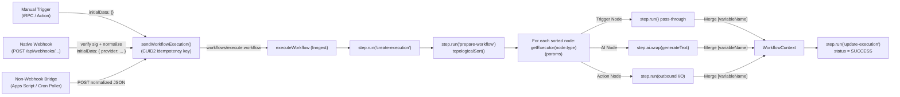

# Workflow Automations (DAG Engine, Triggers & Node Executors)

Build n8n-style, user-defined AI workflow automations in Next.js App Router using **Inngest** for durable DAG orchestration and the **Vercel AI SDK** (`ai`) for memoized LLM execution.

This module covers the backend execution engine, topological sorting, the `NodeExecutor` contract, trigger theory (manual, native webhooks, and non-webhook bridges), AI nodes, and outbound action nodes.

---

## 1. Architecture Overview

Every workflow is a **Directed Acyclic Graph (DAG)** of typed nodes and directed connections persisted in PostgreSQL. Regardless of how a workflow is triggered, all triggers converge on a single canonical Inngest event (`workflows/execute.workflow`) with an optional `initialData` payload.



---

## 2. Durable DAG Execution Engine

### 2.1 Topological Sorting (With Isolated Nodes & Cycle Detection)

Sort nodes by their directed connections before executing. Two invariants are critical:
1. **Include isolated nodes**: Graph libraries like `toposort` only see nodes present in the edge list. Add self-edges `[node.id, node.id]` for any node with no connections so standalone nodes are not silently dropped.
2. **Fail fast on cycles**: Throw `NonRetriableError` if a cycle is detected so Inngest does not waste retries on an invalid graph.

```typescript
import type { Connection, Node } from "@prisma/client";
import { NonRetriableError } from "inngest";
import toposort from "toposort";

export function topologicalSort(nodes: Node[], connections: Connection[]): Node[] {
  if (connections.length === 0) return nodes;

  const edges: [string, string][] = connections.map((c) => [c.fromNodeId, c.toNodeId]);
  const connectedIds = new Set(connections.flatMap((c) => [c.fromNodeId, c.toNodeId]));

  // Ensure disconnected nodes are preserved in the sorted output
  for (const node of nodes) {
    if (!connectedIds.has(node.id)) {
      edges.push([node.id, node.id]);
    }
  }

  let sortedIds: string[];
  try {
    sortedIds = [...new Set(toposort(edges))];
  } catch (error) {
    if (error instanceof Error && error.message.includes("Cyclic")) {
      throw new NonRetriableError("Workflow contains a cycle");
    }
    throw error;
  }

  const nodeMap = new Map(nodes.map((n) => [n.id, n]));
  return sortedIds.map((id) => nodeMap.get(id)).filter((n): n is Node => n !== undefined);
}
```

### 2.2 The `executeWorkflow` Inngest Function

Keep the orchestrator **flat**: never wrap `executor(...)` inside `step.run()`. Pass `step` directly into each executor so AI nodes can call `step.ai.wrap()` and action nodes can own their own `step.run()` checkpoints (Inngest forbids nested `step.*` calls).

```typescript
import { ExecutionStatus, type NodeType } from "@prisma/client";
import { NonRetriableError } from "inngest";
import { inngest } from "@/inngest/client";
import { getExecutor } from "@/features/executions/lib/executor-registry";
import { topologicalSort } from "@/inngest/utils";
import prisma from "@/lib/db";

export const executeWorkflow = inngest.createFunction(
  {
    id: "execute-workflow",
    retries: process.env.NODE_ENV === "production" ? 3 : 0,
    triggers: [{ event: "workflows/execute.workflow" }],
    onFailure: async ({ event }) => {
      await prisma.execution.update({
        where: { inngestEventId: event.data.event.id },
        data: {
          status: ExecutionStatus.FAILED,
          error: event.data.error.message,
          errorStack: event.data.error.stack,
        },
      });
    },
  },
  async ({ event, step }) => {
    const inngestEventId = event.id;
    const workflowId = event.data.workflowId;

    if (!inngestEventId || !workflowId) {
      throw new NonRetriableError("Event ID or workflow ID is missing");
    }

    await step.run("create-execution", () =>
      prisma.execution.create({ data: { workflowId, inngestEventId } }),
    );

    const { sortedNodes, userId } = await step.run("prepare-workflow", async () => {
      const workflow = await prisma.workflow.findUniqueOrThrow({
        where: { id: workflowId },
        include: { nodes: true, connections: true },
      });
      return {
        sortedNodes: topologicalSort(workflow.nodes, workflow.connections),
        userId: workflow.userId,
      };
    });

    // Seed shared context with trigger payload (or empty object for manual runs)
    let context: Record<string, unknown> = event.data.initialData ?? {};

    for (const node of sortedNodes) {
      const executor = getExecutor(node.type as NodeType);
      context = await executor({
        data: node.data as Record<string, unknown>,
        nodeId: node.id,
        userId,
        inngestEventId,
        context,
        step,
      });
    }

    await step.run("update-execution", () =>
      prisma.execution.update({
        where: { inngestEventId, workflowId },
        data: { status: ExecutionStatus.SUCCESS, completedAt: new Date(), output: context },
      }),
    );

    return { workflowId, result: context };
  },
);
```

---

## 3. `NodeExecutor` Contract, Registry & `WorkflowContext`

### 3.1 Uniform Executor Interface & Registry

Decouple the orchestrator from node implementations using a single contract and a dispatch registry:

```typescript
import type { GetStepTools } from "inngest";
import type { inngest } from "@/inngest/client";

export type StepTools = GetStepTools<typeof inngest>;
export type WorkflowContext = Record<string, unknown>;

export interface NodeExecutorParams<TData = Record<string, unknown>> {
  data: TData;            // Node-specific config persisted in DB
  nodeId: string;         // Stable DB ID — use for deterministic step IDs
  userId: string;         // Workflow owner ID — use for credential lookup
  inngestEventId: string; // Event ID — use for outbound Idempotency-Key headers
  context: WorkflowContext;
  step: StepTools;        // Inngest step primitives (step.run, step.ai.wrap)
}

export type NodeExecutor<TData = Record<string, unknown>> = (
  params: NodeExecutorParams<TData>,
) => Promise<WorkflowContext>;
```

Register every `NodeType` in a central lookup table (`executorRegistry[type]`). Adding a new integration means implementing `NodeExecutor<MyNodeData>` and adding one entry to the registry — the orchestrator loop never changes.

### 3.2 `WorkflowContext` & Variable Templating

`WorkflowContext` is a JSON-serializable dictionary accumulating outputs across the DAG. Each node writes its output under a user-defined `variableName` (validated as a JS identifier `/^[A-Za-z_$][A-Za-z0-9_$]*/`):

```typescript
return {
  ...context,
  [data.variableName]: { text: generatedText },
};
```

Downstream nodes reference upstream outputs in prompts, URLs, headers, or JSON bodies using **Handlebars**:

```typescript
import Handlebars from "handlebars";
import { NonRetriableError } from "inngest";

Handlebars.registerHelper("json", (ctx) => new Handlebars.SafeString(JSON.stringify(ctx)));

export function compileTemplate(template: string, context: WorkflowContext): string {
  try {
    // noEscape: true prevents HTML-encoding URLs, quotes, and JSON payloads
    return Handlebars.compile(template, { noEscape: true })(context);
  } catch (err) {
    throw new NonRetriableError(`Invalid template: ${(err as Error).message}`);
  }
}
```

- Scalar/nested access: `{{analysis.text}}`, `{{webhook.eventType}}`, `{{httpNode.httpResponse.data.id}}`
- Structured object injection into AI prompts: `{{json webhook.raw}}`

---

## 4. Trigger Theory (Manual, Native Webhooks & Non-Webhook Bridges)

All triggers share the same architectural goal: **authenticate/verify the caller, normalize the incoming payload into a namespaced `initialData` object, and dispatch `workflows/execute.workflow` with an idempotency key.**

```typescript
import { createId } from "@paralleldrive/cuid2";
import { inngest } from "@/inngest/client";

export async function sendWorkflowExecution(data: {
  workflowId: string;
  initialData?: Record<string, unknown>;
  idempotencyKey?: string;
}) {
  return inngest.send({
    name: "workflows/execute.workflow",
    data: { workflowId: data.workflowId, initialData: data.initialData },
    id: data.idempotencyKey ?? createId(), // Pass provider delivery ID for webhook deduplication
  });
}
```

### 4.1 Manual Triggers

- **When to use**: Ad-hoc runs from the editor UI or on-demand API calls.
- **How it works**: A protected tRPC mutation or Server Action verifies session ownership (`workflow.userId === session.user.id`) and calls `sendWorkflowExecution({ workflowId })` with empty `initialData` (`{}`).
- **UI gating**: Only enable manual execution when the workflow graph contains a manual trigger node, preventing accidental runs of webhook-dependent workflows with missing `initialData`.

### 4.2 Native External Webhooks (e.g., Payment, Git, SaaS Providers)

- **When to use**: Third-party services that natively `POST` JSON events to a callback URL.
- **Route design**: Expose a Next.js Route Handler such as `POST /api/webhooks/<provider>?workflowId=<id>` (or dynamic `[workflowId]`).
- **Four rules for production webhook routes**:
  1. **Read raw body first (`await req.text()`)** before parsing JSON if verifying cryptographic signatures (`HMAC-SHA256`, `Stripe-Signature`, etc.) using timing-safe comparison.
  2. **Normalize into a dedicated namespace**: Extract only the stable fields downstream templates need and nest them under a provider key (`initialData: { [providerNamespace]: normalizedPayload }`) so trigger fields never collide with node `variableName` keys.
  3. **Deduplicate deliveries**: Pass the provider's unique event/delivery ID as Inngest's `id` (`wh:${workflowId}:${deliveryId}`) so duplicate webhook deliveries are ignored within Inngest's deduplication window.
  4. **Acknowledge fast**: Enqueue to Inngest and immediately return `200`/`202`. Never execute AI or HTTP nodes inline inside the webhook HTTP handler.

### 4.3 Non-Webhook Services (Bridge Script vs. Durable Poller)

Many services (e.g., form builders, spreadsheets, legacy APIs) do not support native outbound webhooks. Handle them with one of two patterns:

| Pattern | Mechanism | Best For |
|---|---|---|
| **Event Bridge Script (Push)** | Generate a small, copyable platform script (e.g., Google Apps Script `onFormSubmit`) pre-populated with the user's `POST /api/webhooks/<provider>?workflowId=<id>` URL and an optional shared secret header. | Platforms with user-installable event triggers (Forms, Sheets, Airtable scripts). Zero polling cost, instant execution. |
| **Durable Cron Poller (Pull)** | An Inngest `cron` function polls external APIs in `step.run(\`poll-${node.id}\`, ...)`, persists a cursor/watermark in the node's config, and fans out `step.sendEvent(...)` with deterministic IDs (`poll:${workflowId}:${item.id}`). | Read-only APIs without webhooks or scripting (RSS, IMAP, Notion DBs). |

### 4.4 Pass-Through Trigger Executors

Because `initialData` is already seeded into `WorkflowContext` at dispatch time, trigger node executors in the DAG are **pass-through** checkpoints:

```typescript
export const triggerExecutor: NodeExecutor = async ({ nodeId, context, step }) => {
  return step.run(`trigger-${nodeId}`, async () => context);
};
```

---

## 5. AI Node Executors (Vercel AI SDK + `step.ai.wrap`)

AI nodes combine **per-user encrypted credentials**, **Handlebars prompt compilation**, and **`step.ai.wrap()`** for durable memoization:

1. **Validate upfront**: Throw `NonRetriableError` if `variableName`, `credentialId`, or `userPrompt` is missing.
2. **Compile prompts**: Render `systemPrompt` and `userPrompt` against `WorkflowContext` before calling the LLM.
3. **Fetch & decrypt credentials inside `step.run()`**: Never pass API keys in Inngest event payloads. Load the `Credential` scoped to `userId` inside a durable step and decrypt at runtime.
4. **Wrap `generateText` with `step.ai.wrap()`**: Use a deterministic step ID (`ai-${nodeId}`) so retries after downstream failures replay the memoized LLM response without re-billing tokens.

```typescript
import { generateText } from "ai";
import { NonRetriableError } from "inngest";
import { decrypt } from "@/lib/encryption";
import prisma from "@/lib/db";

export const aiNodeExecutor: NodeExecutor<AiNodeData> = async ({
  data,
  nodeId,
  userId,
  context,
  step,
}) => {
  if (!data.variableName || !data.credentialId || !data.userPrompt) {
    throw new NonRetriableError("AI node: missing variableName, credentialId, or userPrompt");
  }

  const systemPrompt = data.systemPrompt
    ? compileTemplate(data.systemPrompt, context)
    : "You are a helpful assistant.";
  const userPrompt = compileTemplate(data.userPrompt, context);

  const credential = await step.run(`get-cred-${nodeId}`, () =>
    prisma.credential.findUnique({ where: { id: data.credentialId, userId } }),
  );
  if (!credential) throw new NonRetriableError("AI node: credential not found");

  const apiKey = decrypt(credential.value);
  // Use universal OpenAI-compatible factory or native @ai-sdk/* factories (see providers-and-credentials.md)
  const provider = buildSdkProvider({ ...data, apiKey });

  const result = await step.ai.wrap(`ai-generate-${nodeId}`, generateText, {
    model: provider.chat(data.modelId),
    instructions: systemPrompt,
    prompt: userPrompt,
    telemetry: { isEnabled: true, recordInputs: true, recordOutputs: true },
  });

  const text =
    result.text ||
    result.steps?.flatMap((s) => s.content).findLast((p) => p.type === "text")?.text ||
    "";

  return {
    ...context,
    [data.variableName]: { text },
  };
};
```

---

## 6. Outbound Action Node Theory (HTTP, Messaging & Notifications)

Every outbound integration node (generic HTTP requests, chat/messaging webhooks, email, ticket creation) follows the **exact same 5-step execution theory**:

1. **Validate configuration early**: Check required fields (`variableName`, target URL/webhook, method/content) and throw `NonRetriableError` on missing or malformed config.
2. **Compile templates against `WorkflowContext`**: Resolve dynamic URLs, headers, JSON payloads, or message bodies with Handlebars before performing I/O.
3. **Protect outbound I/O**:
   - Guard user-supplied URLs against SSRF (reject loopback/private IP ranges).
   - Enforce request timeouts (`AbortSignal.timeout(15_000)`).
   - Attach idempotency keys (e.g., `${inngestEventId}:${nodeId}`) when calling mutating external APIs.
4. **Execute inside `step.run(\`action-${nodeId}\`, ...)`**: Memoize the external side effect so a downstream failure never re-sends notifications or duplicates API mutations. Classify `4xx` responses (except `408`/`429`) as `NonRetriableError`, while letting `429`/`5xx`/network errors throw normally for Inngest retry.
5. **Return normalized output under `[data.variableName]`**: Merge a consistent shape (e.g. `{ httpResponse: { status, statusText, data } }` or `{ messageContent }`) into `WorkflowContext` for downstream nodes.

---

## 7. Common Mistakes & Traps

| Symptom | Root Cause | Fix |
|---|---|---|
| `step.ai.wrap` fails with nested step error | Orchestrator wrapped `executor()` inside `step.run()` | Keep the orchestrator loop flat; pass `step` into each `NodeExecutor` |
| Disconnected workflow nodes silently skipped | `toposort(edges)` only includes nodes referenced in `connections` | Add self-edges `[node.id, node.id]` for any node with zero connections |
| Duplicate LLM charges or double notifications on retry | External HTTP/AI call ran outside `step.run` / `step.ai.wrap`, or step IDs weren't deterministic | Wrap every AI call in `step.ai.wrap(\`ai-${nodeId}\`, ...)` and every outbound I/O in `step.run(\`action-${nodeId}\`, ...)` |
| Inngest retries forever on missing API key or bad template | Threw generic `Error` instead of `NonRetriableError` | Throw `NonRetriableError` for cycles, missing credentials, template syntax errors, and non-429/408 `4xx` responses |
| API keys exposed in Inngest dashboard/event logs | Decrypted credentials passed in `inngest.send()` payload | Pass only `workflowId` and `userId`; fetch and decrypt credentials inside `step.run()` |
| Webhook endpoint times out or triggers duplicate runs | Workflow executed inline in Route Handler, or no event `id` deduplication | Verify signature, dispatch to Inngest with `id: deliveryId`, and return `200`/`202` immediately |
