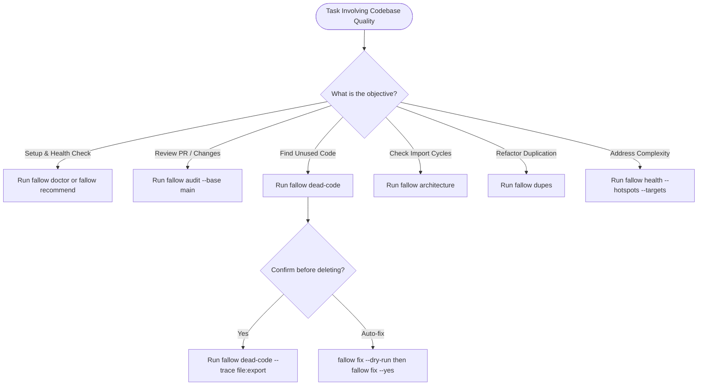

# Fallow: Codebase Intelligence & Quality Analysis

## Overview
Fallow is a high-performance, Rust-native static analysis engine that builds a whole-project dependency graph of TypeScript and JavaScript repositories to detect dead code, module cycles, architecture boundary violations, structural duplication, and complexity hotspots.

## When to Use
- **Dead Code Detection**: Unused files, exports, types, enum/class members, and unreferenced packages.
- **Architectural Integrity**: Circular imports (`circular-dependencies`), re-export cycles, and package cycles.
- **Architecture Boundaries**: Enforcing layered, hexagonal, or feature isolation rules (`fallow architecture`, `fallow guard`).
- **Code Duplication**: Finding syntactic or semantic duplicate clones across files (`fallow dupes`).
- **Complexity Hotspots**: Measuring cyclomatic/cognitive complexity, CRAP scores, and refactoring targets (`fallow health`).
- **Pre-Commit & CI Gates**: Auditing changeset impact before merging (`fallow audit --base main`).
- **Safe Cleanup**: Auto-fixing safe unused exports and dependencies (`fallow fix`).

## When NOT to Use
- **Runtime Debugging**: Fallow performs static analysis, not runtime execution or stack trace debugging.
- **Compiler Type Checking**: Use `tsc --noEmit` for TypeScript type validity.
- **Linting & Formatting**: Use Biome or ESLint/Prettier for code style.
- **Non-JS/TS Projects**: Fallow is built specifically for JavaScript and TypeScript ecosystems.

---

## Workflow Decision Flowchart

---

## Quick Reference: Intent to Command

| Intent | Recommended Command |
|---|---|
| Verify installation and readiness | `fallow doctor` |
| Full codebase health & dead code overview | `fallow --summary` |
| Find unused files, exports, and dependencies | `fallow dead-code` |
| Verify an export is truly unused before deleting | `fallow dead-code --trace <file>:<export>` |
| Trace how module A reaches module B | `fallow trace --path <from> <to>` |
| Audit changeset before committing or opening PR | `fallow audit --base <ref>` |
| Check architecture boundaries before editing | `fallow guard <files>` |
| Check circular dependencies after editing | `fallow architecture` |
| Find structural and semantic duplication | `fallow dupes` |
| Prioritize refactoring targets and complexity hotspots | `fallow health --hotspots --targets` |
| Safe auto-fix of unused exports | `fallow fix --dry-run` then `fallow fix --yes` |
| Wire agent harness and MCP server | `fallow agent install` |

---

## Core Agent Rules

1. **Always Use Machine-Readable Output**: Run with `--format json --quiet` in automated scripts or agent pipelines. Parse stdout as JSON; keep stderr separate for warnings and diagnostics.
2. **Interpret Exit Codes Accurately**:
   - `0`: Clean run, zero error-severity findings.
   - `1`: Successful analysis run, but findings at or above `error` severity were detected.
   - `2`: Tool failure, configuration error, or parse failure.
3. **Never Run `fallow watch`**: Watch mode is interactive and never exits.
4. **Always `--dry-run` Before `fallow fix`**: Preview deletions with `fallow fix --dry-run`, then apply with `fallow fix --yes` (`--yes` is mandatory in non-TTY environments).
5. **Zero-Config by Default**: Do not create a config file unless you specifically need custom entries, ignored paths, component library exemptions, or modified rule severities.

---

## Detailed References

For deep dives, configuration schemas, and specialized setups, refer to the accompanying reference files:

- [Installation & Setup](references/installation-and-setup.md): Global install, devDependencies, `fallow doctor`, and git hooks.
- [Configuration Guide](references/configuration-guide.md): `.fallowrc.json` format, schema properties, auto-plugins, and component exemptions.
- [Analysis Commands](references/analysis-commands.md): Full CLI flags, trace tools, output formats, and filtering.
- [Architecture & Boundaries](references/architecture-and-boundaries.md): Zone definitions, access rules, forbidden callees, and cycle resolution.
- [Baselines & CI Integration](references/baselines-and-ci.md): Regression baselines, shrink-only baselines, and GitHub Actions workflows.
- [MCP & Agent Workflow](references/mcp-and-agent-workflow.md): Running `fallow-mcp` and tool mappings.
- [Gotchas & Suppressions](references/gotchas-and-suppressions.md): `// fallow-ignore` comments, `@expected-unused`, and non-TTY gotchas.
