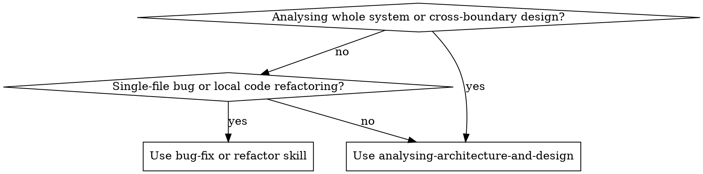

# Analysing Architecture and Design

## Overview

Software architecture consists of decisions that are expensive to change and systems that deliver core business value. Effective architectural analysis decomposes a project into explicit subsystems, ranks them from most critical to least critical, and evaluates state synchronisation, simplicity, resilience, and runtime performance across boundaries.

## When to Use



**Apply when:**
- Auditing a project for architectural simplicity, overengineering, or boundary leaks.
- Decomposing a system into subsystems and ranking them by business criticality.
- Investigating state drift, race conditions, or unhandled failures across datastores (relational, vector, object, queues).
- Evaluating client-server synchronisation, streaming protocols, or durable workflow lifecycles.
- Performing an architectural onboarding assessment of an existing codebase.

**Do NOT apply when:**
- Fixing an isolated single-function bug (use `bug-fix` or `systematic-debugging`).
- Reviewing local code style, formatting, or dead syntax.
- Planning isolated feature additions without cross-system implications.

---

## The 5-Phase Analysis Workflow

```
1. Topological Inventory ──► 2. Criticality Ranking ──► 3. Subsystem Audit ──► 4. Boundary & Anti-Patterns ──► 5. Synthesis Report
   (Routes, DBs, queues)       (Tiers 1 → 4 sorted)       (Sound vs flaws)       (State drift, races)          (Structured findings)
```

### Phase 1: Topological Inventory & Entrypoint Mapping
- Identify all entrypoints: HTTP API routes, Server Actions, RPC handlers, WebSocket/SSE endpoints, background queue triggers, and CLI commands.
- Enumerate all state engines: Relational DBs (PostgreSQL, MySQL), Vector DBs (Qdrant, pgvector), Object stores (S3, MinIO), in-memory caches, and browser stores.
- Trace primary data paths connecting user entrypoints to datastores and external third-party APIs.

### Phase 2: System Decomposition & Criticality Ranking
Group codebase modules into bounded subsystems and rank them strictly from **most critical to least critical** using the [System Criticality Ranking Framework](references/system-criticality-ranking.md):

| Criticality Tier | Role & Responsibilities | Typical Subsystems | Blast Radius |
|---|---|---|---|
| **Tier 1 (Mission-Critical)** | Core Value Engine & Primary State of Record | Primary DB, core transactional entities, authentication & tenancy, live user loop | System outage / data loss |
| **Tier 2 (Business-Critical)** | Supporting Domain Services & Durable Workflows | Background queues, RAG/vector retrieval, external model APIs, object storage | Degraded async workflows |
| **Tier 3 (Operational)** | Peripheral Capabilities, Aggregations & Caches | Read-model caches, telemetry sinks, export formatters, notifications | Slower reads / deferred notices |
| **Tier 4 (Auxiliary)** | Ephemeral Tooling & Developer Infrastructure | Local compose harnesses, seeders, dev inspection tools, test harnesses | Dev friction only (zero user impact) |

Calculate the 5-dimension criticality score ($0.30D + 0.25B + 0.20V + 0.15R + 0.10C$) to sort subsystems into an objective, ranked hierarchy.

### Phase 3: Subsystem Deep-Dive & Soundness Audit
Inspect each subsystem in ranked order by reading actual implementation files:
1. **Validate Sound Decisions First:** Explicitly identify well-designed patterns, defensive boundaries, and intentional trade-offs. Never invent flaws for working designs.
2. **Audit Architectural Dimensions:** Evaluate each subsystem using the [Architectural Evaluation Rubric](references/architectural-evaluation-rubric.md) across:
   - **Simplicity:** Unnecessary layers, competing caches, premature multi-cloud abstractions, dead configuration paths.
   - **Resilience:** Unhandled failure paths, missing rollbacks, timeout assumptions, circuit breaker absence.
   - **Performance:** N+1 queries, unthrottled streaming deltas, synchronous event-loop blocking, multi-megabyte over-fetching.

### Phase 4: Cross-Boundary Synchronisation & Anti-Pattern Check
Audit interconnections where subsystems interface with different operational guarantees using [Common Architectural Anti-Patterns](references/common-architectural-anti-patterns.md):
- **Dual-Write Drift:** Writing to PostgreSQL and S3/Qdrant without transactional compensation.
- **Race Conditions:** Fan-out jobs prematurely flipping coordinator status before worker completion.
- **Phantom Durability:** Durable workflows embedding multi-step loops inside a single engine checkpoint.
- **Protocol Parity:** Unawaited streaming emitters, out-of-order events, or missing tool-result pairs.

### Phase 5: Synthesis & Diagnostic Reporting
Deliver the audit using the [Architecture Diagnostic Report Template](references/architecture-report-template.md):
- State the overall architectural health and core stance.
- Present the ranked System Inventory table (Tier 1 down to Tier 4).
- Document every real flaw with:
  - **File & Location:** Exact file path, line numbers, and symbol name.
  - **Architectural Flaw:** Technical description of the structural defect.
  - **Failure & Performance Impact:** Concrete consequence (data loss, race, memory leak, infinite loop).
  - **Concrete Simplification / Fix:** Actionable architectural remediation.
- Provide a prioritised remediation roadmap (P0 Critical, P1 High, P2 Performance, P3 Simplification).

---

## Core Analysis Invariants

1. **Verify Implementation Files:** Always inspect actual source code. README files and high-level design documents are frequently outdated.
2. **Acknowledge Intentional Trade-Offs:** If a design choice is appropriate for the system's operational constraints (e.g. single-deployment simplicity over distributed microservices), validate it rather than flagging it as a defect.
3. **No Theoretical Speculation:** Every finding must cite exact file paths, line numbers, and an observable failure or performance impact under realistic usage.
4. **Concrete Fix over Generic Advice:** State the exact architectural change (e.g., "replace inner step loop with single step execution in `runTransformSteps`") rather than generic advice.

---

## Common Mistakes

| Mistake | Reality | Remedy |
|---|---|---|
| **Inventing defects in sound code** | Working code with intentional trade-offs is not broken. | Validate sound patterns explicitly before identifying real defects. |
| **Ranking by LOC instead of Criticality** | Massive auxiliary tooling (e.g., test runners, seeders) is less critical than a 200-line transactional auth guard. | Score systems strictly by data integrity risk and blast radius (Tier 1–4). |
| **Recommending Enterprise Overkill** | Suggesting Kubernetes, Kafka, or microservices for a single-deployment app introduces catastrophic complexity. | Recommend pragmatic, in-process or single-database patterns that preserve simplicity. |
| **Missing Cross-System Boundaries** | Auditing components in isolation misses dual-write drift, unhandled event timeouts, and queue desync. | Trace data flows across database, cache, storage, and worker boundaries. |

---

## Reference Guides

- [System Criticality Ranking Framework](references/system-criticality-ranking.md) – Methodology and scoring matrix for ranking systems from Tier 1 (Mission-Critical) to Tier 4 (Auxiliary).
- [Architectural Evaluation Rubric](references/architectural-evaluation-rubric.md) – Detailed criteria for simplicity, state synchronisation, failure resilience, and runtime performance.
- [Common Architectural Anti-Patterns](references/common-architectural-anti-patterns.md) – Catalogue of architectural smells, dual-write traps, and streaming bottlenecks with remediations.
- [Architecture Diagnostic Report Template](references/architecture-report-template.md) – Structured report template for delivering actionable architecture audits.
