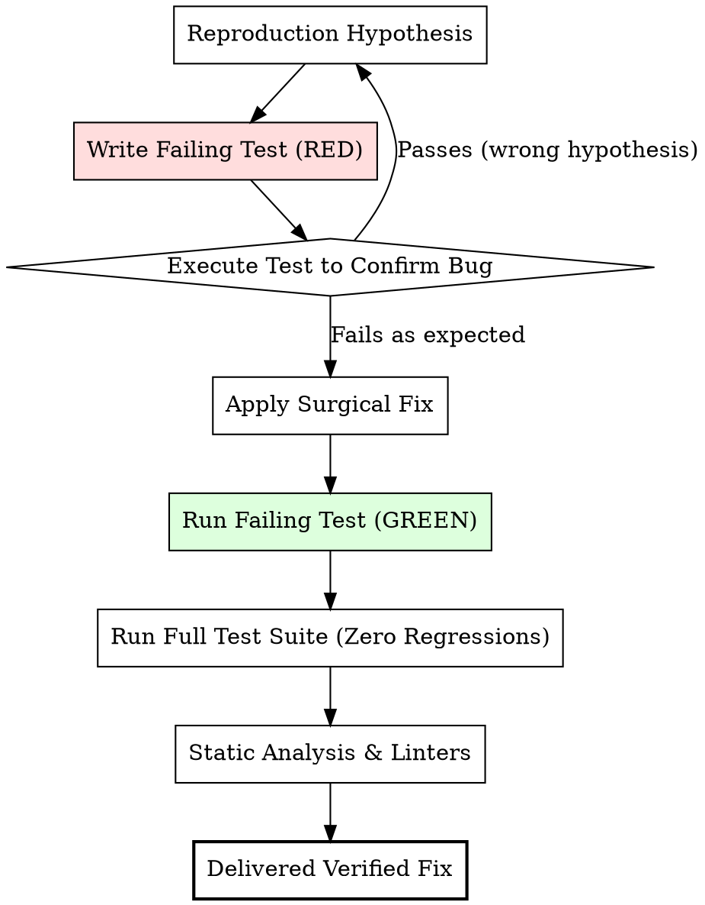

# Bug Verification & Regression Hardening Protocol

Authoritative verification protocol for isolating, reproducing, fixing, and proving defect resolution with zero regressions.

Use this reference during Step 2, Step 8, and Step 9 of the `bug-fix` implementation workflow.

---

## 1. The Red-Green-Verify Discipline

Every bug fix in Implementation Mode must follow an empirical test-first discipline:



### Invariants:
1. **Never Fix Without a Failing Test**: If code is modified before a test reproduces the exact bug symptom, the fix is unverified and vulnerable to superficial patching.
2. **Never Weaken Existing Tests**: If an existing test fails after applying a fix, investigate whether the test reflected an intentional contract or if the fix broke existing behavior. Never comment out, delete, or relax assertion thresholds on existing tests to make a change pass.
3. **No Special-Casing**: Avoid conditional branches that check for specific test fixture inputs. Solve the general problem.

---

## 2. Hardening Specific Bug Archetypes

### Concurrency & Race Conditions
- **Testing Strategy**: Spawn parallel asynchronous executions (`Promise.all` or worker threads) executing the exact same operation concurrently on a shared entity.
- **Assertion**:
  - Zero duplicate key constraint errors.
  - Final version or counter equals exact number of concurrent increments ($N$), not $1$.
  - All operations complete with valid state.

### Shared Resource Registries & Abort Handles
- **Testing Strategy**:
  1. Register handle 1 for `entityId`.
  2. Register handle 2 for `entityId` before handle 1 completes.
  3. Trigger completion/cleanup for handle 1.
  4. Assert that `registry.get(entityId)` still returns handle 2 (handle 2 was NOT evicted).
  5. Trigger abort on handle 2 and verify downstream cancellation succeeds.

### Multi-Store Partial Failure & Compensation
- **Testing Strategy**:
  1. Mock the secondary store (e.g. cloud storage or search index) to throw an error.
  2. Invoke the multi-store mutation.
  3. Assert that the operation rejects with the expected error.
  4. Assert that the primary store (database record) was deleted or marked `failed` via compensatory cleanup, leaving zero orphaned records.

### Session Boundary & Cache Hygiene
- **Testing Strategy**:
  1. Populate client stores and caches with User A data.
  2. Trigger the sign-out / session reset handler.
  3. Assert that all store selectors return initial/empty state.
  4. Assert that local and session storage keys matching the session namespace are removed.

### AI Model Multi-Step Budget Exhaustion
- **Testing Strategy**:
  1. Mock the model to return tool calls up to `maxSteps`.
  2. Run the orchestrator loop.
  3. Assert that the final result contains non-empty synthesized text (fallback pass triggered) rather than an empty string or dropped message.

### Conversational Tool-Call Protocol Parity
- **Testing Strategy**:
  1. Create a conversational history where an assistant message contains a `tool-call`.
  2. Mock the tool execution to throw, timeout, or return undefined/null output.
  3. Pass the raw history into the message assembly / model invocation pipeline.
  4. Assert that every `tool-call` is paired with an explicit `tool-result` (with `{ error: ... }` fallback payload) and that the model invocation succeeds without protocol rejection.

### Mount-Time Concurrent Collection Hydration
- **Testing Strategy**:
  1. Hydrate an active entity's detailed records (e.g. `chatId` with loaded messages) into the shared store.
  2. Concurrently invoke the layout/collection loader (`loadChats([summaryRows])`).
  3. Assert that the store retains the active entity's detailed records without destructive wipe.

### Pipeline Mutation Persistence Invariant
- **Testing Strategy**:
  1. Configure a pipeline step that triggers mutating tools (e.g. spreadsheet edit) but omit artifact persistence.
  2. Execute the step.
  3. Assert that the step halts with an explicit failure status (`failed`) and descriptive error, rather than reporting false success with stale output.

### Third-Party Event Callback Stale Closures
- **Testing Strategy**:
  1. Mount the component wrapping the third-party audio, WebSocket, or event driver.
  2. Mutate reactive store state (e.g. change repeat mode from `"OFF"` to `"ONE"`).
  3. Simulate completion callback (e.g. invoke `onend()` on the driver).
  4. Assert that the callback executes logic using the *updated* store state (`"ONE"`) and invokes methods on the live driver ref rather than no-oping on mount-time snapshots.

### Dynamic Media Fallback Degradation
- **Testing Strategy**:
  1. Render the media component with `imageUrl = null` or `imageUrl = undefined`.
  2. Assert that the component does not invoke framework image optimizers or pass empty/null `src`.
  3. Assert that the fallback UI container and accessible placeholder vector/icon (`screen.getByRole` or SVG query) are cleanly rendered in the document.

### Server Action Directive Boundaries & Result Envelopes
- **Testing Strategy**:
  1. Invoke the server action with invalid payload data.
  2. Assert that it returns `{ ok: false, error: ... }` rather than throwing unhandled rejections or returning bare `false`.
  3. Invoke with valid payload data and authorized session; assert that it returns `{ ok: true }` and executes mutation.

### Test Environment & Mock Path Synchronization
- **Testing Strategy**:
  1. In multi-module refactoring where files are renamed or relocated, execute `grep_search` across test files for the old import/mock paths.
  2. Run the test suite under strict environment isolation (verifying `test.env` supplies all mandatory environment variables) to confirm zero unhandled configuration import crashes.

### Pre-Submit File Schema Validation & Input Reset
- **Testing Strategy**:
  1. Render the upload component with an invalid file selection (e.g. file size exceeding `FILE_LIMITS` or invalid MIME type).
  2. Fire `change` event on the file input.
  3. Assert that error notification (toast or validation message) is immediately displayed.
  4. Assert that the native input value is cleared (`input.value === ""`) and invalid state does not persist to submission handlers.

### Proactive Storage Quota Metering & Capacity Enforcement
- **Testing Strategy**:
  1. Configure user account storage state at or near maximum quota.
  2. Render the management/account view; assert that storage meters accurately reflect current consumption and remaining capacity.
  3. Attempt an upload exceeding available quota; assert that client-side pre-flight or server action rejects with a clear capacity error without initiating unmetered binary storage writes.

### Unawaited Asynchronous Recursion & Floating Cascades
- **Testing Strategy**:
  1. Invoke the recursive mutation or cascade operation on a deeply nested hierarchy (e.g. 3+ levels of parent-child relationships).
  2. In the test assertion, immediately query descendant entities synchronously or verify transaction completion.
  3. Assert that all descendants across all levels have the updated state (e.g. `isArchived: true` or deleted), proving the handler awaited all child recursive executions before returning.

### Client-Only Browser API Hydration Gating
- **Testing Strategy**:
  1. Render the component in an environment simulating server-side rendering (e.g. `renderToString` or with mocked `window` properties).
  2. Verify that the initial server markup returns neutral fallbacks (e.g. empty string `""` or null) and does not throw `ReferenceError: window is not defined`.
  3. Mount the component in the client DOM environment; assert that `isMounted` triggers and the full interactive UI / origin string renders correctly post-hydration.

### Filter State Source Invariant & Toggle Persistence
- **Testing Strategy**:
  1. Render a listing component with an active toggle (e.g. "Show Archived").
  2. Simulate toggling the filter on (so all items, including archived items, are displayed).
  3. Assert that the toggle button or drawer control remains rendered and interactive in the DOM, proving it does not disappear when filtered item count matches source count.
  4. Toggle the filter back off; assert the list re-filters without state deadlock.

### Compound Component DOM Hierarchy & Selection
- **Testing Strategy**:
  1. Render a searchable combobox/command menu with test items.
  2. Simulate typing a search query that filters down to a subset of items.
  3. Assert that filtered-out items leave zero residual DOM wrapper elements (`button`, `div`) with height or padding.
  4. Assert that matching items render without phantom spacing and that keyboard down-arrow navigates sequentially across visible items only.

### Disabled Polymorphic Anchor Navigation Prevention
- **Testing Strategy**:
  1. Render a button with `disabled={true}` configured as an anchor or `<Link>`.
  2. Fire a click event on the element.
  3. Assert that `defaultPrevented` is true, URL navigation does not occur, and `aria-disabled="true"` is set.
  4. Simulate keyboard navigation; verify `tabIndex` is `-1`.

### Multi-Tab / View Mode Transient State Reset
- **Testing Strategy**:
  1. Mount a multi-tab view (e.g. Images vs Videos carousel).
  2. Navigate to slide 5 in the primary tab.
  3. Switch to the secondary tab containing only 2 items.
  4. Assert that active index resets to 0 and total count reflects 2 ("Slide 1 of 2"), with zero out-of-bounds index errors.

### Static Parameter Coverage on Dynamic Routes
- **Testing Strategy**:
  1. Invoke the exported `generateStaticParams()` function.
  2. Assert that returned parameter array covers 100% of non-archived or valid entity keys in the database.
  3. Assert that every returned route key resolves successfully without throwing `notFound()`.

### Markdown Preprocessor Code Span Partitioning
- **Testing Strategy**:
  1. Supply markdown content containing both fenced code blocks (```` ```...``` ````) and inline code spans (`` `$$x$$` ``) containing formula/macro delimiters.
  2. Run the text preprocessor.
  3. Assert that math/template transformations apply only to free body text and leave both fenced code blocks and inline code spans completely unchanged.

### Static Data Map Relational Symmetry & Key Invariants
- **Testing Strategy**:
  1. Write an automated integrity test that iterates over all static entity maps (roles, projects, skills).
  2. For every entity A referencing entity B in `relatedMaterials`, assert that entity B exists in its database map and symmetrically references entity A (or conforms to directional domain rules).
  3. Assert that zero dangling string keys exist across all entity arrays.

### Test Mock Hoisting & Path Invariant Assertion
- **Testing Strategy**:
  1. Verify all mocked variables accessed inside mock factories are instantiated via `vi.hoisted()`.
  2. Execute a pre-test assertion verifying that all mocked module paths resolve to actual files on disk.

### Multi-Filter Facet State Preservation
- **Testing Strategy**:
  1. Mount a multi-filter view with active state (e.g. `isArchived: true`, `page: 2`).
  2. Simulate selecting a different category facet or entering a search query.
  3. Assert that the resulting filter state retains `isArchived: true` rather than resetting it to false.

### Touch Screen Hover Media Query Isolation
- **Testing Strategy**:
  1. Inspect the CSS AST or computed styles for interactive buttons and chips.
  2. Assert that `:hover` transformations or color changes are scoped within `@media (hover: hover) and (pointer: fine)`.
  3. Simulate touch events without hover capabilities; verify the element returns to default resting styles upon touch-up.

### Dynamic Diagram Theme Synchronization
- **Testing Strategy**:
  1. Mount a diagram or chart component under light theme mode; assert light theme configuration passed to diagram renderer.
  2. Trigger application theme toggle to dark mode.
  3. Assert that diagram re-renders with dark-contrast color tokens and theme parameters.

### Date Tenure & Ongoing Milestone Calculation
- **Testing Strategy**:
  1. Unit test the tenure calculation utility with edge cases: 1-month stints, multi-year stints across leap years, and active ongoing roles (`endDate: null` or omitted).
  2. Assert correct month counting and string formatting without NaN or negative numbers.

### Priority Filter Fallback Verification
- **Testing Strategy**:
  1. Supply a dataset containing multiple valid items where none have `isMainSkill: true`.
  2. Assert that the component renders the top N general items rather than an empty blank section.

### Root-Relative API Endpoint Anchoring
- **Testing Strategy**:
  1. Render the component or invoke the API action within a deep nested URL subroute context (e.g. `/conversations/[id]`).
  2. Intercept the outbound HTTP request dispatched by `fetch` or `axios`.
  3. Assert that the request path begins with a leading root slash (`/api/...`) or is fully qualified, rather than appending relative to the active subroute path (`/conversations/[id]/api/...`).

### Lazy Browser SDK Instantiation & Server Isolation
- **Testing Strategy**:
  1. Import the universal/shared module in a test environment where `globalThis.window` is simulated as `undefined`.
  2. Assert that importing the module does not throw `ReferenceError: window is not defined` or trigger Node.js deprecation warnings (e.g. `DEP0169`).
  3. Assert that accessing properties in browser execution triggers lazy singleton instantiation, and repeated calls reuse the singleton instance.

### Post-Submission Form Reset Validation Neutrality
- **Testing Strategy**:
  1. Submit valid form data through the form component.
  2. Trigger post-submission programmatic clearing or reset of the input field.
  3. Assert that form state remains valid (`errors[field]` is `undefined`) and required-field validation error messages do not appear immediately after the reset.

### Schema Nullability and Database Ingestion
- **Testing Strategy**:
  1. Execute validation schema `safeParse` / `validate` on payloads containing explicit `null` values for optional fields (e.g. `{ image: null }`).
  2. Assert that parsing succeeds cleanly without throwing schema type errors.

### Test Environment Process State Sandboxing
- **Testing Strategy**:
  1. In unit tests that modify `process.env`, assert that environment changes are applied using runner sandboxing helpers (`vi.stubEnv`).
  2. Assert that `unstubAllEnvs()` restores process environment variables to initial states across subsequent test suites.

### Multi-Action Dispatcher Contract & Parameter Matrix
- **Testing Strategy**:
  1. Parameterize tests across every supported `action` of the coarse dispatcher.
  2. Invoke each action with explicit, valid arguments. Assert that the returned payload validates strictly against the declared Pydantic model / TypeScript discriminated union (not a raw string or bare dict).
  3. Invoke with optional arguments (`count=None`, `data=None`, `filter_direction="desc"`); assert that underlying services receive intended values rather than dropping them (parameter starvation) or inverting positions.
  4. Test payload key aliases (e.g. `range` and `cell_range`); assert both work identically.

### Sibling Document / Sheet Retention on In-Place Mutation
- **Testing Strategy**:
  1. Create a fixture multi-part document (e.g. workbook with 3 sheets: "Primary", "Reference", "Summary", plus custom metadata).
  2. Perform an in-place edit targeting only "Primary" (`output_file` = input file path).
  3. Re-read the modified file from disk; assert that sheets "Reference" and "Summary", their formulas, and workbook metadata remain completely intact.
  4. Mock a write failure mid-serialization; assert that the original file is not truncated to 0 bytes.

### Foreign Library Polymorphic Dimension Assertions
- **Testing Strategy**:
  1. Test range selection / array slicing with cardinalities:
     - Exact 1x1 single cell / scalar.
     - Single row / 1D vector.
     - Multi-row, multi-column 2D matrix.
     - Zero-row / empty sheet boundary.
  2. Assert that the wrapper normalizes all outputs to consistent 2D structures before indexing, verifying zero `IndexError` or `TypeError: 'Cell' object is not subscriptable`.
  3. Unit test optimization solvers with single vs multiple bounds; verify tuple and list formats are accepted.

### Sandbox Transitive Attribute Penetration Testing
- **Testing Strategy**:
  1. Execute a comprehensive test suite of malicious AST expressions targeting transitive I/O methods on pre-imported library objects (e.g. `df.to_csv('leak.txt')`, `pd.read_pickle(...)`, `np.load(...)`, `plt.savefig(...)`).
  2. Assert that the sandbox parser rejects 100% of transitive I/O attribute calls with a security error before evaluation.
  3. Verify legitimate in-memory methods (`df.sum()`, `np.mean()`) continue to evaluate successfully.

### Protocol Diagnostic Error Preservation & Exception Fidelity
- **Testing Strategy**:
  1. Trigger known domain validation failures (e.g. missing sheet name, invalid cell coordinate `ZZZ999999`, duplicate key).
  2. Intercept the resulting error at the API / MCP protocol boundary.
  3. Assert that the error response preserves the specific domain message, invalid field name, and diagnostic code rather than returning a generic `"Internal server error"` or blank envelope.

### Locale-Invariant Parsing & ISO Formatting Roundtrip
- **Testing Strategy**:
  1. Pass standardized ISO 8601 date strings (`"2024-05-01"`, `"2024-01-05"`) into the parsing utility.
  2. Assert that `"2024-05-01"` resolves strictly to May 1st regardless of ambient system locale or `dayfirst` settings.
  3. Format the parsed object back to string; assert 100% round-trip string identity (`parsed.isoformat() == "2024-05-01"`).

### Deep-Branch Dependency Reachability & Operator Flexibility
- **Testing Strategy**:
  1. Execute automated branch-coverage tests that exercise rare mathematical or analytical functions (e.g. IRR, NPV, straight-line depreciation, regex filters).
  2. Assert zero runtime `NameError` (confirming all required standard library modules like `math`, `re` are imported).
  3. Supply expressions using alternate operator forms (`==` vs `=`, `!=` vs `<>`, case variations `and` vs `AND`); assert that all forms evaluate with identical results.

---

## 3. Pre-Flight Verification Checklist

Before claiming any bug fix is complete:

- [ ] **Targeted Test Passes**: The newly created reproduction test passes cleanly.
- [ ] **Full Regression Suite Passes**: Run the entire project test suite for the affected subsystem (e.g. `npm test`, `pytest`, `cargo test`), not just the single modified file.
- [ ] **Type Checking Passes**: Run language type checks (`tsc --noEmit`, `pyright`, `mypy`) with zero errors.
- [ ] **Linter & Formatter Pass**: Run project linters/formatters (`biome check`, `eslint`, `ruff`) with zero warnings or errors.
- [ ] **No Dead Arms / Unreachable Code**: Confirm that introduced branches (e.g. error checks, default fallbacks) are reachable and covered by tests.
