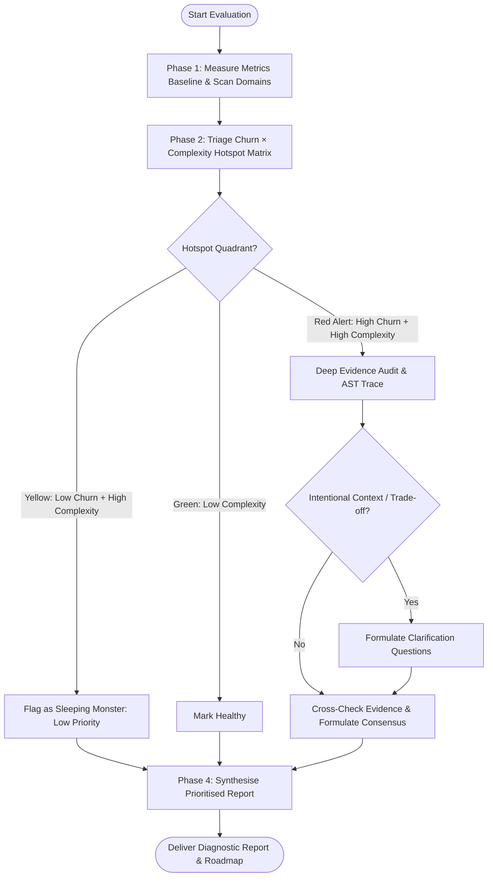

# Evaluation Skill

Comprehensive codebase evaluation system that assesses code quality, architecture, design patterns, cognitive complexity, test sufficiency, security, dependencies, and maintainability. Produces detailed, structured diagnostic reports across multiple quality dimensions.

**REQUIRED SUB-SKILL:** If the `ponytail` skill is not already loaded, load it. Its YAGNI lens keeps evaluation lean: report only what warrants change, not every theoretical alternative.

---

## When to Use & When NOT to Use

### Apply When
- Conducting an overall codebase health check across architecture, quality, security, and tests
- Diagnosing high-complexity hotspots (Cognitive Complexity $>15$, arrow code, god functions)
- Auditing for circular dependencies (`A ↔ B`), peer domain cycles, and architectural drift
- Detecting code duplication, declarative schema clones, and competing engine sprawl
- Tracing unreachable logic, unused exports, phantom events, and dead types
- Auditing over-abstraction, trivial passthrough wrappers, and excessive indirection
- Evaluating front-end UI architecture (monolithic views, presentation coupling, god hooks, root DOM hydration hazards, client-only browser API hydration gating, collapsible box-model leaks, empty-state deadlocks, theme contrast collisions, auth tri-state races, route transition state leakage, modal portal omission, z-index escalation, text truncation layout ejection, unvirtualized infinite scroll, hydration/focus/modal traps, filter source inversion paradoxes, compound component wrapper gaps, disabled polymorphic anchor traps, hitbox boundary mismatches, unreset multi-tab state, touch-screen sticky hover states, dynamic diagram dark-mode contrast collisions, mobile drawer nested scroll conflicts, orthogonal filter facet clobbering, SPA scroll restoration failures, mobile table clipping, priority filter fallbacks, and post-submission form reset validation re-trigger deadlocks)
- Checking security posture for secondary-library sandbox escapes (transitive I/O methods on Pandas/NumPy/scientific libraries), protocol error masking and diagnostic exception stripping, unmatched protected route omissions in auth gateways, missing cross-origin trusted origins, hardcoded localhost fallbacks in distributed client configs, layout auth scope mismatches, isomorphic server secret leaks, concurrency race conditions (TOCTOU, check-then-act upserts), cross-session cache bleed, tool shadowing, creator immutability, last-admin lockout, and unconfirmed destructive actions
- Auditing architecture and API contracts for coarse dispatcher contract drift, facade parameter starvation and argument inversion, public API contract erosion into untyped dictionaries, destructive in-place target and sibling document overwrites, cascading referential integrity breakage across sheets and tables, lifecycle hook omissions on code generation engines, auth adapter schema contract drift, schema nullability vs optionality ingestion mismatches, caught exception property shape assumptions, test environment process isolation and server context mocking, eager browser SDK instantiation in universal bundles, toolchain negation inversions, unawaited async recursive cascades, CI/CD workflow secret desynchronization, blocker dependency peer lockouts, bulk IN-clause limits, distributed cascade deletions, denormalized replica sync, unpartitioned concurrency, premature handle evictions, context bloat, static prerender parameter omissions, root-relative asset resolution drift, test mock hoisting TDZ, markdown code span bleed, static data map relational asymmetry, and uncompensated storage mutations
- Evaluating code quality for foreign library polymorphic return shape traps (scalar vs collection dimension collapse), destructive property setter hooks on empty values, unimported deep-branch dependencies, operator and syntax rigidity, and ambiguous format corruption via locale parsing heuristics


### Do NOT Apply When
- Actively writing feature implementations or modifying production code (use domain feature skills)
- Performing live code refactoring or structural edits (use `refactor` skill)
- Fixing immediate bugs or test failures (use `bug-fix` or `systematic-debugging` skills)
- Auditing stable, dormant legacy code with zero commit churn unless feature work is planned

---

## Evaluation Workflow



---

## Core Quantitative Metrics

Evaluations combine empirical static analysis with git history analysis to prevent bikeshedding:

| Metric | Measurement Tool / Basis | Target Baseline | Warning Threshold | Critical Debt Threshold |
|---|---|---|---|---|
| **Cognitive Complexity** | SonarQube structural jumps & nesting | $\le 15$ | $16 - 30$ | $> 30$ (God Function) |
| **Cyclomatic Complexity** | McCabe linear execution paths | $\le 10$ | $11 - 20$ | $> 20$ |
| **CRAP Metric** | $\text{comp}^2 \cdot (1 - \text{cov})^3 + \text{comp}$ | $\le 30$ | $31 - 60$ | $> 60$ (Untested Hazard) |
| **Indirection Debt** | Entrypoint to execution call stack hops | $\le 3$ hops | $4 - 6$ hops | $\ge 7$ hops (Lasagna Code) |
| **Git Commit Churn** | Revisions in past 3–12 months | Low | Moderate | High (Active Volatility) |

*For complete formulas and quadrant analysis, see [Complexity & Hotspots Reference](references/complexity-and-hotspots.md).*

---

## Authoritative References

- **[Code Smells Diagnostic Matrix](references/code-smells-matrix.md)** – Comprehensive catalogue mapping 203 code smells across 10 evaluation dimensions to detection heuristics, required evidence, and severity ratings.
- **[Complexity & Hotspots Reference](references/complexity-and-hotspots.md)** – Deep-dive guide covering Cognitive vs Cyclomatic complexity, the CRAP metric formula, the Churn × Complexity Hotspot Matrix, and Indirection Debt measurement.
- **[Architectural Invariants Reference](references/architectural-invariants.md)** – Authoritative evaluation criteria adapting the 149 Golden Rules across data contracts, UI state separation, modularity, tooling, and system boundaries.

---

## Specialised Evaluation Modules

This skill includes 10 dedicated evaluation modules:

### 1. **Project Evaluation** (`project-evaluation.md`)
Exhaustive health check across all 8 dimensions: Architecture, Code Quality, Design, UI Components, Security, Testing, Dependencies, and Documentation. Follows Discovery → Clarification → Evaluation → Reporting.

### 2. **Architecture & Design Analysis** (`architecture-design-analysis.md`)
Audits module graphs for circular dependencies (`A ↔ B`), peer domain cycles, multi-action coarse dispatcher contract drift, facade parameter starvation and argument inversion, public API contract erosion into opaque dictionaries, destructive in-place target and sibling document overwrites, cascading referential integrity breakage, auth adapter schema migration drift, eager browser SDK instantiation in universal bundles, unpartitioned entity queue concurrency, container host-gateway callback deadlocks, unpersisted pipeline mutations, storage impedance mismatches, direct persistence coupling, lasagna code, distributed cascade deletion leaks, recursive hierarchy depth modeling, multi-tier payload limit disparities, relational join cardinality drift, junction table trigger column assumptions, denormalized replica desynchronization (dual-write drift), layout auth scope boundary mismatches, isomorphic bundle server secret parsing, dynamic route static prerendering deadlocks, missing JIT identity synchronization, static dynamic route parameter parity omissions, canonical root-relative asset path drift, and static data map relational asymmetry.

### 3. **Quality Analysis** (`quality-analysis.md`)
Evaluates implementation quality against clean code standards. Measures Cognitive Complexity, CRAP scores, Arrow Code, Primitive Obsession, Feature Envy, foreign library polymorphic return shape traps (scalar vs array dimension collapse), destructive property setter hooks on empty values, deep-branch unimported standard library symbols, operator and syntax rigidity, canonical format corruption via ambiguous locale parsing heuristics, caught exception property shape assumptions, schema nullability vs optionality ingestion mismatches, eager browser SDK instantiation in SSR, Read-Modify-Write / check-then-act upsert races, unawaited async recursive cascades, shared handle registry evictions, unresolved tool-call parity violations, unpersisted pipeline mutations, context window bloat, step budget synthesis drops, relational join polymorphism fragility, binary base64 serialization bloat, event-handler parameter bleed, closed-enum error dictionary assumptions without fallbacks, asynchronous route parameter synchronous dereference, client-only browser API access without mount gating, bulk IN-clause parameter overflow, and resource handle leaks.

### 4. **Code Duplication** (`code-duplication.md`)
Rigorously identifies exact clones, semantic similarity, declarative ORM schema duplication, scattered inline variations, and competing engine duplication.

### 5. **Dead Code Analysis** (`dead-code.md`)
Traces entry points to identify unreachable logic, unused public exports (export minimization), phantom event dispatchers, zombie code, and ephemeral migration assets.

### 6. **Over-Abstraction Audit** (`over-abstraction.md`)
Identifies shallow abstraction layers, trivial passthrough wrappers, interfaces for one, speculative infrastructure schema debt, micro-tool catalog sprawl, and excessive granularity.

### 7. **Codebase Consistency** (`codebase-consistency.md`)
Audits topological directory architecture, strict file casing, framework route folder purity, 4-tier domain type architecture, validated environment schemas with empty-string normalization, canonical site URL registries, composite identifier format parity, toolchain exclusion negation inversion, centralised route/asset registries, and canonical data ingestion / syntax normalization consistency.

### 8. **Security Audit** (`security-audit.md`)
Audits code-level vulnerabilities, secondary-library sandbox escapes (transitive I/O methods on Pandas/NumPy/scientific libraries), protocol error masking and diagnostic exception stripping, unmatched protected route omissions in auth middleware/gateways, missing cross-origin trusted origins, hardcoded localhost fallbacks in distributed/client configurations, Read-Modify-Write / check-then-act races (TOCTOU), cross-session cache bleed / contamination, untrusted spread precedence (tool shadowing), SSRF canonical IPv6 normalisation bypasses, scattered authorization checks, layout auth scope boundary mismatches, client-server environment variable leaks, unbounded datastore queries, inverse route protection deficits (guest auth bypasses), creator immutability and last-admin tenancy lockout, and unconfirmed destructive action execution.

### 9. **Dependency Usage** (`use-dependencies.md`)
Audits custom logic that reinvents standard libraries or existing packages (Hand-Rolled Utility Sprawl), micro-package dependency drag, multi-tool toolchain sprawl, deep-branch unimported dependencies or scoped import fragility, lifecycle hook omissions for code generation engines, test environment process isolation and server context mocking, blocker dependency peer lockouts and deadlock pruning, experimental compiler flag deadlocks, CI/CD workflow action secret injection parity, and CI/CD runtime engine and test dependency drift.

### 10. **UI & Component Analysis** (`ui-component-analysis.md`)
Audits front-end views for monolithic components, presentation-mutation coupling, God Hooks managing disparate state, post-submission form reset validation re-trigger deadlocks, mount-time destructive hydration overwrites, hook callback identity instability, unmemoized dependency reference thrashing, premature empty-state flashes, root DOM hierarchy hydration hazards, client-only browser API access without mount gating (`isMounted`), zero-dimension box-model padding leakage, empty-state action deadlocks, theme surface contrast collisions, portaled focus-trap collisions, interactive nesting hydration hazards, invisible responsive layout overlay traps, mobile viewport navigation occlusions, responsive image dimension collapse, user media aspect clipping, dual-mode form clone drift, premature guard evaluation in asynchronous auth tri-state lifecycles, route transition state leakage, transient container modal trapping, modal DOM portal omission, stacking context clamping, arbitrary z-index escalation, unbounded text sibling layout ejection, unvirtualized infinite scroll memory bloat, recursive tree depth exhaustion, dynamic route null-loading hangs, nested form submit collisions, filter source inversion paradoxes, compound component wrapper gaps, disabled polymorphic anchor traps, hitbox boundary mismatches, unreset multi-tab state, touch-screen sticky hover states, dynamic diagram dark-mode contrast collisions, mobile drawer nested scroll capture conflicts, orthogonal filter facet clobbering, nested scroll container SPA restoration failures, unbounded data table clipping, priority filter empty-state fallbacks, and accessible design system primitives.


---

## Key Diagnostic Principles

- **Thorough Analysis** – Evaluate each quality dimension systematically using objective metrics.
- **Evidence-Based Findings** – Every issue must cite specific file paths, line numbers, and architectural evidence.
- **Objective Assessment** – Report findings without prescribing implementation code or premature rewrites.
- **Change-Worthiness** – Only report issues whose remediation would meaningfully improve maintainability, defect rates, or security. If fixing something would not change outcomes, it is noise.
- **Cost-Weighted Findings** – Weigh remediation effort against practical risk. Dormant, stable code with zero churn is classified as Yellow (Sleeping Monster) rather than an urgent crisis.
- **Prefer the Working Solution** – Working, readable code that introduces no measurable friction is not a defect merely because an alternative pattern exists.

---

## Required Inputs

When invoking this skill, provide:

1. **Codebase Path** – Full path to the project directory to evaluate
2. **Evaluation Type**:
   - `project-evaluation` for comprehensive multi-dimensional assessment
   - Specific module name(s) for targeted analysis (e.g. `architecture-design-analysis`, `quality-analysis`)
3. **Scope** (Optional) – Specific subdirectories or modules to focus on
4. **Known Context** (Optional) – Intentional architecture decisions, framework constraints, or migration roadmaps

---

## Output Format & Standards

All evaluation reports follow a structured Markdown format with:

- **Executive Summary** – High-level health score and risk level by dimension
- **Hotspot Matrix Breakdown** – Red Alert vs Yellow (Sleeping Monster) quadrant mapping
- **Detailed Findings** – Each issue with Location, Severity, Metric Baseline, Evidence, and Consensus Status
- **Domain Scorecards** – Per-dimension qualitative and quantitative assessments
- **Actionable Roadmap** – Most impactful improvements ranked by ROI and risk reduction

### Quality Standards
- All findings are **specific** – cite exact file paths, line numbers, or symbol identifiers
- All findings are **evidence-backed** – supported by code snippets, AST traces, or vulnerability records
- All findings are **objective** – utilise concrete metrics (Cognitive Complexity, CRAP, hop counts)
- All reports use **British English** spelling and grammar
- All reports follow **ASD-STE100** principles – short sentences, plain vocabulary, one idea per sentence

---

## Example Invocations

### 1. Comprehensive Project Health Check
```
Run a complete codebase evaluation on [PROJECT_PATH].
Use the project-evaluation module to assess all dimensions.
Include git commit churn correlation, Cognitive Complexity baselines,
and CRAP scores for high-risk modules.
```

### 2. Architecture & Cycle Audit
```
Analyse the architecture of [PROJECT_PATH] for circular dependencies,
indirection debt, and storage impedance mismatches.
Use the architecture-design-analysis and over-abstraction modules.
Provide Mermaid diagrams for cyclic paths.
```

### 3. Quality & Complexity Deep Dive
```
Evaluate [PROJECT_PATH] for code quality, arrow code, and concurrency races.
Use the quality-analysis and code-duplication modules.
Calculate Cognitive Complexity and CRAP scores for all functions exceeding 40 LOC.
```

### 4. Front-End UI Audit
```
Audit the front-end architecture of [PROJECT_PATH].
Use the ui-component-analysis and codebase-consistency modules.
Identify monolithic views, presentation coupling, and god hooks.
```

---

## Related Skills

- **ponytail** – YAGNI lens that keeps evaluation lean; load if not already loaded
- **refactor** – Systematic code remediation patterns, 100 Golden Rules, and code smell fixes
- **writing-code** – Pragmatic clean coding standards and defensive architecture
- **karpathy-guidelines** – Disciplines to avoid overcomplication and LLM coding mistakes
- **writing-skills** – Authoring and verifying agent skills
