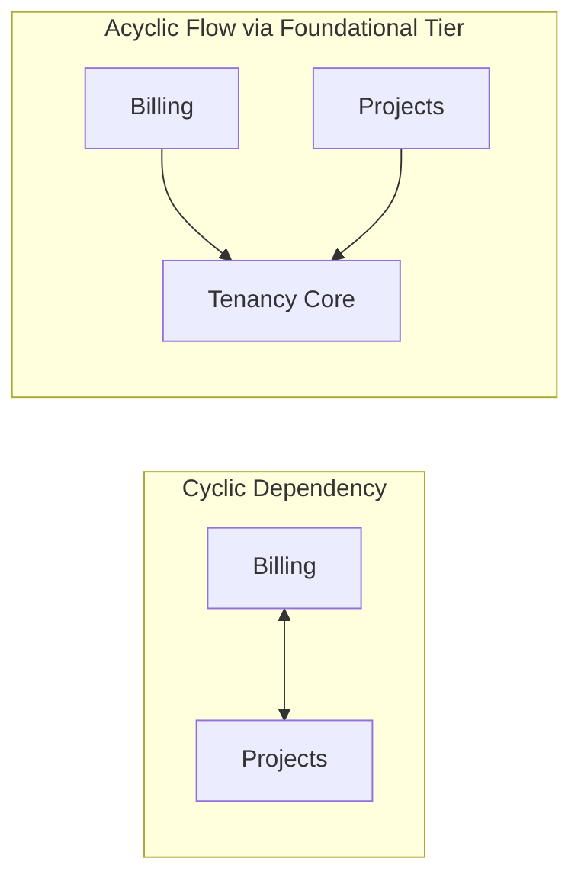

# Architecture & Design Analysis Module

Identifies structural anti-patterns, architectural cycles, unnecessary complexity, over-engineering, and excessive decoupling. Flags patterns that obscure logic or introduce structural fragility without providing functional benefits.

For comprehensive catalogs and metric formulas, see [Code Smells Matrix](references/code-smells-matrix.md) and [Complexity & Hotspots Reference](references/complexity-and-hotspots.md).

## When to Use

Use this module when you need to:
- Assess the overall structural simplicity and architectural integrity of a codebase
- Detect circular dependencies and bidirectional module cycles (`A ↔ B`)
- Identify over-engineered components and unnecessary abstraction layers
- Find instances of Lasagna Code (excessive layering without data transformation)
- Detect direct persistence coupling (actions/controllers executing inline database queries)
- Identify storage impedance mismatches and distributed cascade deletion leaks
- Evaluate if decoupling mechanisms add meaningful value or just increase cognitive load
- Generate Mermaid visualisations of current vs proposed simplified architecture

## Key Analysis Areas

### 1. Circular Dependencies & Architectural Cycles
Bidirectional imports between files, packages, or feature domains (`A ↔ B`). Includes:
- **Direct Cycles**: File `A` imports `B` while `B` imports `A`.
- **Peer Domain Cycles**: Two feature modules importing each other horizontally rather than sharing via a foundational domain tier (`A → foundational ← B`).
- **Shared Leaf State Cycles**: Components cyclic through shared store mutations.

### 2. Over-Engineering & Speculative Architecture
Instances where complex design patterns (e.g. abstract factory, event brokers, multi-tiered command buses) are used for simple, deterministic tasks that require only direct functions.

### 3. Excessive Decoupling & Lasagna Code
- **Lasagna Code**: Data passing through $\ge 4$ layers (e.g. Controller → Adapter → Service → Manager → Repository) without transforming or validating data.
- **Interfaces for One**: Interface or abstract class with only a single concrete implementation and zero polyglot/test need.

### 4. Indirection Debt
The count of execution hops from an entrypoint to the core business logic. Hops $\ge 7$ indicate high indirection debt and excessive cognitive overhead.

### 5. Direct Persistence Coupling
Actions, HTTP controllers, or UI components issuing direct raw database driver queries inline instead of routing through cohesive domain services or repositories (DAO pattern).

### 6. Storage Impedance Mismatch & Polyglot Decoupling
Forcing non-relational workloads (such as vector embeddings, heavy full-text search, or ephemeral pub/sub queues) into traditional relational tables using unindexed JSON blobs.

### 7. Distributed Cascade Deletion Leaks
Relational database cascade deletes (`ON DELETE CASCADE`) that remove database rows but leave corresponding assets in external object storage (S3, GCS) orphaned forever.

### 8. Conflated State Lifecycles (God Provider)
Monolithic application state providers bundling API clients, authentication sessions, modal toggles, and server caches in a single reactive container, causing system-wide re-render thrashing.

### 9. Unserialized Entity Queue Concurrency
Asynchronous background jobs, event handlers, or queue pipelines processing operations on the same entity or aggregate root without concurrency keys or partition locks (`concurrency: { key, limit: 1 }`), causing out-of-order execution, stream corruption, and race collisions.

### 10. Polyglot Storage Compensation Absence
Multi-store operations spanning relational databases, cloud object storage, and vector indices lacking explicit compensation logic or two-phase status transitions, leaving orphaned external assets or ghost records on partial failure.

### 11. Container Host-Gateway Callback Deadlock
Background queue runners, webhook consumers, or microservices running in container network namespaces attempting to invoke callbacks on the host using `host.docker.internal` or default loopback addresses, failing due to bridge network packet drops without configurable serve origins (`SERVE_ORIGIN`).

### 12. Unpersisted Pipeline Mutation (Silent State Loss)
Automated pipelines, batch transformations, or step runners executing side-effect mutations without verifying that the resulting modified artifacts are extracted and saved to persistent storage before declaring step success.

### 13. Multi-Tier Gateway/Server Payload Limit Disparity
Configuring endpoint or action payload limits (e.g. 50MB) without matching outer edge middleware, reverse proxy, or framework request limits (`middlewareClientMaxBodySize`), producing silent request rejections before execution reaches the backend handler.

### 14. Decoupled Identity Synchronization (Missing JIT Provisioning)
Architectures decoupling third-party identity providers from application database tables without lazy Just-In-Time provisioning fallback (`getOrCreateDbUser`), causing post-login operations to crash on missing user profiles due to webhook latency or dropped triggers.

### 15. Framework Route Cache Staleness on Dynamic Dashboards
Administrative views or data-mutating pages defaulting to static pre-rendering without explicit dynamic segment directives (`export const dynamic = "force-dynamic"`), serving stale cached data across user visits.

### 16. Relational Join Cardinality Drift & Polymorphic Ingestion
Code consuming joined database relations across ORMs or query builders assuming joined relations are strictly single objects without checking for array shapes, leading to unhandled runtime TypeErrors when join cardinality shifts between 1:1 and 1:N relations.

### 17. Generic Trigger & Lifecycle Hook Column Assumptions
Applying schema-wide database triggers (such as `set_updated_at()`) or ORM lifecycle hooks that assume audit columns (e.g. `updatedAt`) exist across all tables, causing fatal database exceptions when inserting or updating many-to-many junction tables that lack audit columns.

### 18. Denormalized Replica Desynchronization (Dual-Write Drift)
Mutating primary canonical entities while omitting atomic fan-out updates across distributed denormalized projections, user membership subcollections, or embedded summary snippets, leaving views permanently out-of-sync.

### 19. Distributed Cascade Deletion & Referential Integrity Leaks
Deleting parent aggregate roots in document or NoSQL datastores lacking relational foreign key cascades (`ON DELETE CASCADE`), leaving orphaned bookmarks, saved references, and votes pointing to non-existent entities, and stranding assets in cloud storage buckets.

### 20. Recursive Hierarchy Depth Modeling Deficit
Designing self-referencing hierarchical entities (nested comments, reply trees, category taxonomies) without schema-level depth or level fields, making it impossible to enforce query depth limits or prevent unbounded recursion at the data tier.

### 21. Database Trigger Storage Boundary Inversion
Enforcing external storage object deletion from inside relational database triggers or transaction blocks (e.g. `BEFORE/AFTER DELETE ON entity EXECUTE FUNCTION delete_storage_object()`). External network timeouts or storage API errors cause the primary database transaction to roll back, locking user data and coupling transactional consistency to non-transactional cloud storage. Storage cleanup must be orchestrated at the service layer with asynchronous compensation or soft deletes.

### 22. Dynamic Route-Level 404 Boundary Omission
Failing to colocate route-level 404 views (`not-found.tsx`) with dynamic route segments (e.g. `app/[id]/not-found.tsx`). When an entity lookup returns null, calling `notFound()` without a localized boundary falls back to unstyled root handlers or throws uncaught errors, degrading user experience and breaking navigation context.

### 23. Shared Metadata Ownership Attribution Deficit
Omitting user/creator identity columns (`uploader_id`, `created_by`) on shared metadata entities (such as artists, categories, tags) in multi-tenant or user-generated content systems. Without creator attribution, systems cannot enforce granular Row Level Security (RLS), attribute uploads, or prevent unauthorized modifications across user accounts.

### 24. Proactive Storage Quota Metering & Soft Limit Feedback
Multi-tenant or user-quota storage architectures executing file upload operations without pre-flight quota metering and explicit capacity visualization. When global or per-user storage ceilings are reached, uploads fail late with raw datastore exceptions or silent transaction drops. Architectures must expose authoritative quota aggregation functions (e.g. database RPC or service usage meters) and enforce pre-flight capacity checks in application upload handlers, notifying users proactively before asset dispatch.

### 25. Layout Auth Scope Boundary Leakage
Placing components or state machines that execute authenticated backend queries (e.g. search bars, notification listeners, document listing fetchers) inside global root layouts (`app/layout.tsx`) that wrap both public (landing, marketing, login) and authenticated routes. Causes unauthenticated visitors to trigger backend auth exceptions, or forces unnecessary auth checks on public pages. Authenticated queries and commands must strictly reside within protected layout boundaries (e.g. `(main)/layout.tsx`) that verify authentication status.

### 26. Isomorphic Bundle Server Secret Eager Evaluation
Importing unified environment validation modules that evaluate server-only secrets at top-level module scope inside client components or isomorphic boundary files. During SSR or static site generation in Node.js, `typeof window === "undefined"` is true, causing server schema validation to execute in environments where server secrets are omitted. Architectures must decouple client-safe schemas (`clientEnv`) from server schemas (`serverEnv`), and ensure server secrets are evaluated lazily on demand via getters or Proxies.

### 27. Dynamic Route Static Prerendering of Dynamic SDK Handlers
API route handlers instantiating SDK clients that depend on runtime request state (e.g. dynamic credentials, upload handlers) at module scope without declaring `export const dynamic = "force-dynamic"`. Framework compilers attempting to prerender these routes statically at build time abort with missing credentials or dynamic header evaluation errors. Handlers must declare explicit dynamic execution mode and evaluate SDK handlers lazily.

### 28. Static Dynamic Route Parameter Parity (Static Prerender Export Omission)
Dynamic parameterized routes (`[id]`, `[slug]`, `[key]`) lacking static parameter generators (`generateStaticParams`, `getStaticPaths`) in static export or SSG deployment targets. Routes function properly in local development SSR because parameters are evaluated on-demand per request, but fail with 404 Not Found or static generation errors in production deployment environments. Architectures targeting static output must uniformly export parameter enumeration functions across all dynamic route leaves.

### 29. Canonical Root-Relative Asset & Route Path Resolution
Constructing asset paths, internal API URLs, or navigation links using relative slices (`BASE_DIR.slice(1)`) or relative strings (`"projects/cover.png"`) rather than domain root-relative paths (`"/projects/cover.png"`). Assets load cleanly on root pages (`/projects`) but 404 on nested subroutes (`/projects/item/report`) because browsers resolve relative paths against the current subroute depth. Architectures must enforce strict root-relative path formatting or centralized URL builders.

### 30. Static Data Map Relational Symmetry & Referential Integrity
Maintaining static databases, seed datasets, or relation maps with manual bidirectional relationships (e.g. Project linking to Role, Role linking to Project) without automated referential integrity assertion tests. Manual edits lead to asymmetric links, dead orphan references to deleted entities, and broken view relations. Architectures maintaining static relational maps must decouple keys from display labels and back datasets with automated bidirectional symmetry test suites.

### 31. Auth Adapter Schema Contract Parity & Migration Drift
Maintaining ORM schemas (Prisma, Drizzle, TypeORM) alongside authentication engine adapters (e.g. Better Auth, NextAuth, Lucia) without auditing adapter-required fields, foreign keys, or casing invariants. When schema migrations or ORM models omit fields required by adapter queries or change nullability unexpectedly, auth flows (account linking, session refreshing, token verification) crash at runtime with database query or constraint exceptions.

### 32. Eager Browser SDK Instantiation in Universal / SSR Bundles
Instantiating browser-dependent SDK clients or client-only singletons (e.g. realtime WebSockets, browser notification services, canvas engines) directly at top-level module scope rather than inside lifecycle hooks (`useEffect`) or behind lazy getters. In SSR/universal architectures, importing these modules triggers build-time evaluation or server rendering crashes due to missing global objects (`window`, `navigator`).

### 33. Multi-Action Dispatcher Contract & Return Drift
Consolidating dozens of fine-grained tools, operations, or API endpoints into coarse mega-dispatchers (e.g. `manage_data(action=...)`) without enforcing discriminated union schemas and typed return models per action. The outer dispatcher degrades into returning loose untyped dicts, raw strings, or mismatched structures, causing contract drift, client deserialization crashes, and loss of schema discoverability for API consumers and AI agents.

### 34. Facade Parameter Starvation & Argument Inversion
Introducing coarse facade adapters or dispatchers that forward parameters to underlying domain services without 1:1 parameter mapping. Results in parameter starvation (where optional arguments like `count`, `data`, or `filter` are omitted or passed as `None`, causing domain defaults to be ignored) or positional argument inversion (transposing `source` and `target` or `row` and `col`), leading to silent logic failures and corrupt state.

### 35. Public API Contract Erosion & Opaque Dictionary Degradation
Replacing strongly typed domain contracts (Pydantic models, TypeScript interfaces, Rust structs) with untyped dictionaries (`dict[str, Any]`, `list[dict]`, `Record<string, any>`) across public boundaries. OpenAPI / MCP JSON schemas degrade into empty `{ "type": "object" }`, eliminating static and runtime validation and allowing malformed payloads to penetrate system boundaries.

### 36. Destructive In-Place Target / Sibling Document Overwrite
Mutating composite multi-part documents (Excel workbooks, zip archives, multi-table database files) by reading only the targeted sub-element (e.g. single sheet or partition) and serializing it directly to the target path. Overwrites and obliterates all unreferenced sibling sheets, archive members, macros, formulas, and metadata. Architectures must load composite containers completely and stage writes to temporary files before atomic replacement.

### 37. Cascading Referential Integrity & Cross-Entity Identifier Breakage
Mutating or renaming entities, worksheets, tables, or columns without dynamically updating cross-referencing formulas, expressions, or queries (e.g. `'Sheet1'!A1:B10`, structured references `Table1[Column]`, database join keys). Also includes join key asymmetry (`left_on != right_on`) and unhandled column collisions during bulk multi-entity merges. Downstream consumers face `#REF!` formula errors, silent data drops in asymmetric table joins, or unhandled merge conflicts. Architectures must normalize qualified coordinates into structured models before transformation and validate referential integrity across the entire composite graph.

---

## Quality Principles

- **KISS** (Keep It Simple, Stupid) – Could a new engineer follow the logic without jumping through multiple files?
- **YAGNI** (You Ain't Gonna Need It) – Does an abstraction support an active requirement or speculative future-proofing?
- **Acyclic Dependency Principle** – Module dependency graphs must be directed acyclic graphs (DAGs).
- **Maintainability Over Sophistication** – Simple code that works is superior to clever architecture that requires extensive documentation.
- **DRY Preservation** – Do not suggest flattening architecture if it duplicates core business rules.

---

## What This Module Does NOT Do

- Does not suggest massive, disruptive architectural rewrites (e.g. migrating Monolith to Microservices)
- Does not suggest changes that violate framework conventions (e.g. Next.js App Router rules, Spring Boot conventions)
- Does not provide refactored code—only diagnostic assessments and structural simplifications
- Does not flag standard patterns required by established frameworks

---

## Report Structure

Each finding includes:

- **Finding Title** – Descriptive name of the architectural defect
- **Status / Category** – Circular Dependency / Over-Engineered / Lasagna Code / Direct Persistence / High Indirection
- **Current Assessment** – Concrete explanation of why this design is sub-optimal
- **Evidence** – File paths, call stack hop count, cycle traces, specific pattern names
- **Proposed Simplification** – Specific, small-scale structural remediation target
- **Impact** – Measurable reduction in lines of code, call hops, or regression risk
- **Visualisation** – Mermaid diagram contrasting current vs simplified topology

---

## Example Findings

**Example 1: Circular Module Dependency Cycle**
- **Status**: Circular Dependency (`A ↔ B`)
- **Current Assessment**: Feature module `billing` imports `projects` to calculate usage, while `projects` imports `billing` to verify subscription status.
- **Evidence**: `src/modules/billing/usage.ts` (line 4) imports `projects/service.ts`; `src/modules/projects/service.ts` (line 8) imports `billing/plans.ts`.
- **Proposed Simplification**: Re-home shared subscription status checks into a foundational `auth` or `tenancy` domain tier (`billing → tenancy ← projects`).
- **Impact**: Eliminates build-time cycle warnings, prevents undefined runtime exports, and restores unidirectional data flow.
- **Visualisation**:


**Example 2: Shallow Generic Repository Layer (Lasagna Code)**
- **Status**: Over-engineered / Lasagna Code
- **Current Assessment**: Generic `Repository<T>` and `Service<T>` abstraction used with only one implementation per entity; data passes through unchanged.
- **Evidence**: `src/repositories/UserRepository.ts` forwards calls to `GenericRepository<User>`, which calls ORM directly. Call depth is 5 hops.
- **Proposed Simplification**: Inline ORM queries into the domain service layer; prune generic repository interfaces.
- **Impact**: Eliminates 2 indirection hops, removes 180+ lines of pass-through boilerplate code.

---

## Example Invocation

```
Analyse the architecture of [PROJECT_PATH] for over-engineering, circular dependencies, and unnecessary indirection.
Identify:
- Circular dependencies between modules (A ↔ B)
- Components with high indirection debt (hops >= 6)
- Interfaces with single implementations (Interfaces for One)
- Excessive layering (Lasagna Code)
- Direct persistence coupling in UI or controllers
- Conflated state lifecycles and storage impedance mismatches

Provide Mermaid diagrams for complex paths and propose concrete structural simplifications.
```
