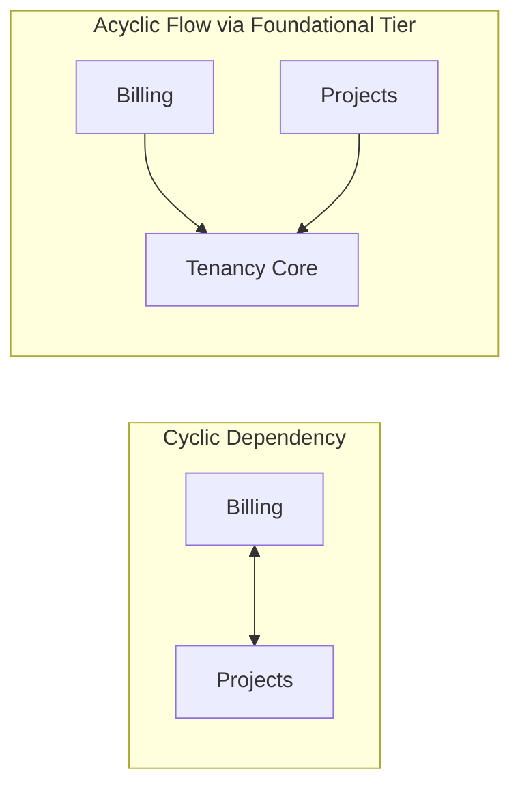

# Architecture & Design Analysis Module

Identifies structural anti-patterns, architectural cycles, unnecessary complexity, over-engineering, and excessive decoupling. Flags patterns that obscure logic or introduce structural fragility without providing functional benefits.

For comprehensive catalogs and metric formulas, see [Code Smells Matrix](references/code-smells-matrix.md) and [Complexity & Hotspots Reference](references/complexity-and-hotspots.md).

## When to Use

Use this module when you need to:
- Assess the overall structural simplicity and architectural integrity of a codebase
- Detect circular dependencies and bidirectional module cycles (`A ↔ B`)
- Identify over-engineered components and unnecessary abstraction layers
- Find instances of Lasagna Code (excessive layering without data transformation)
- Detect direct persistence coupling (actions/controllers executing inline database queries)
- Identify storage impedance mismatches and distributed cascade deletion leaks
- Evaluate if decoupling mechanisms add meaningful value or just increase cognitive load
- Generate Mermaid visualisations of current vs proposed simplified architecture

## Key Analysis Areas

### 1. Circular Dependencies & Architectural Cycles
Bidirectional imports between files, packages, or feature domains (`A ↔ B`). Includes:
- **Direct Cycles**: File `A` imports `B` while `B` imports `A`.
- **Peer Domain Cycles**: Two feature modules importing each other horizontally rather than sharing via a foundational domain tier (`A → foundational ← B`).
- **Shared Leaf State Cycles**: Components cyclic through shared store mutations.

### 2. Over-Engineering & Speculative Architecture
Instances where complex design patterns (e.g. abstract factory, event brokers, multi-tiered command buses) are used for simple, deterministic tasks that require only direct functions.

### 3. Excessive Decoupling & Lasagna Code
- **Lasagna Code**: Data passing through $\ge 4$ layers (e.g. Controller → Adapter → Service → Manager → Repository) without transforming or validating data.
- **Interfaces for One**: Interface or abstract class with only a single concrete implementation and zero polyglot/test need.

### 4. Indirection Debt
The count of execution hops from an entrypoint to the core business logic. Hops $\ge 7$ indicate high indirection debt and excessive cognitive overhead.

### 5. Direct Persistence Coupling
Actions, HTTP controllers, or UI components issuing direct raw database driver queries inline instead of routing through cohesive domain services or repositories (DAO pattern).

### 6. Storage Impedance Mismatch & Polyglot Decoupling
Forcing non-relational workloads (such as vector embeddings, heavy full-text search, or ephemeral pub/sub queues) into traditional relational tables using unindexed JSON blobs.

### 7. Distributed Cascade Deletion Leaks
Relational database cascade deletes (`ON DELETE CASCADE`) that remove database rows but leave corresponding assets in external object storage (S3, GCS) orphaned forever.

### 8. Conflated State Lifecycles (God Provider)
Monolithic application state providers bundling API clients, authentication sessions, modal toggles, and server caches in a single reactive container, causing system-wide re-render thrashing.

---

## Quality Principles

- **KISS** (Keep It Simple, Stupid) – Could a new engineer follow the logic without jumping through multiple files?
- **YAGNI** (You Ain't Gonna Need It) – Does an abstraction support an active requirement or speculative future-proofing?
- **Acyclic Dependency Principle** – Module dependency graphs must be directed acyclic graphs (DAGs).
- **Maintainability Over Sophistication** – Simple code that works is superior to clever architecture that requires extensive documentation.
- **DRY Preservation** – Do not suggest flattening architecture if it duplicates core business rules.

---

## What This Module Does NOT Do

- Does not suggest massive, disruptive architectural rewrites (e.g. migrating Monolith to Microservices)
- Does not suggest changes that violate framework conventions (e.g. Next.js App Router rules, Spring Boot conventions)
- Does not provide refactored code—only diagnostic assessments and structural simplifications
- Does not flag standard patterns required by established frameworks

---

## Report Structure

Each finding includes:

- **Finding Title** – Descriptive name of the architectural defect
- **Status / Category** – Circular Dependency / Over-Engineered / Lasagna Code / Direct Persistence / High Indirection
- **Current Assessment** – Concrete explanation of why this design is sub-optimal
- **Evidence** – File paths, call stack hop count, cycle traces, specific pattern names
- **Proposed Simplification** – Specific, small-scale structural remediation target
- **Impact** – Measurable reduction in lines of code, call hops, or regression risk
- **Visualisation** – Mermaid diagram contrasting current vs simplified topology

---

## Example Findings

**Example 1: Circular Module Dependency Cycle**
- **Status**: Circular Dependency (`A ↔ B`)
- **Current Assessment**: Feature module `billing` imports `projects` to calculate usage, while `projects` imports `billing` to verify subscription status.
- **Evidence**: `src/modules/billing/usage.ts` (line 4) imports `projects/service.ts`; `src/modules/projects/service.ts` (line 8) imports `billing/plans.ts`.
- **Proposed Simplification**: Re-home shared subscription status checks into a foundational `auth` or `tenancy` domain tier (`billing → tenancy ← projects`).
- **Impact**: Eliminates build-time cycle warnings, prevents undefined runtime exports, and restores unidirectional data flow.
- **Visualisation**:


**Example 2: Shallow Generic Repository Layer (Lasagna Code)**
- **Status**: Over-engineered / Lasagna Code
- **Current Assessment**: Generic `Repository<T>` and `Service<T>` abstraction used with only one implementation per entity; data passes through unchanged.
- **Evidence**: `src/repositories/UserRepository.ts` forwards calls to `GenericRepository<User>`, which calls ORM directly. Call depth is 5 hops.
- **Proposed Simplification**: Inline ORM queries into the domain service layer; prune generic repository interfaces.
- **Impact**: Eliminates 2 indirection hops, removes 180+ lines of pass-through boilerplate code.

---

## Example Invocation

```
Analyse the architecture of [PROJECT_PATH] for over-engineering, circular dependencies, and unnecessary indirection.
Identify:
- Circular dependencies between modules (A ↔ B)
- Components with high indirection debt (hops >= 6)
- Interfaces with single implementations (Interfaces for One)
- Excessive layering (Lasagna Code)
- Direct persistence coupling in UI or controllers
- Conflated state lifecycles and storage impedance mismatches

Provide Mermaid diagrams for complex paths and propose concrete structural simplifications.
```
