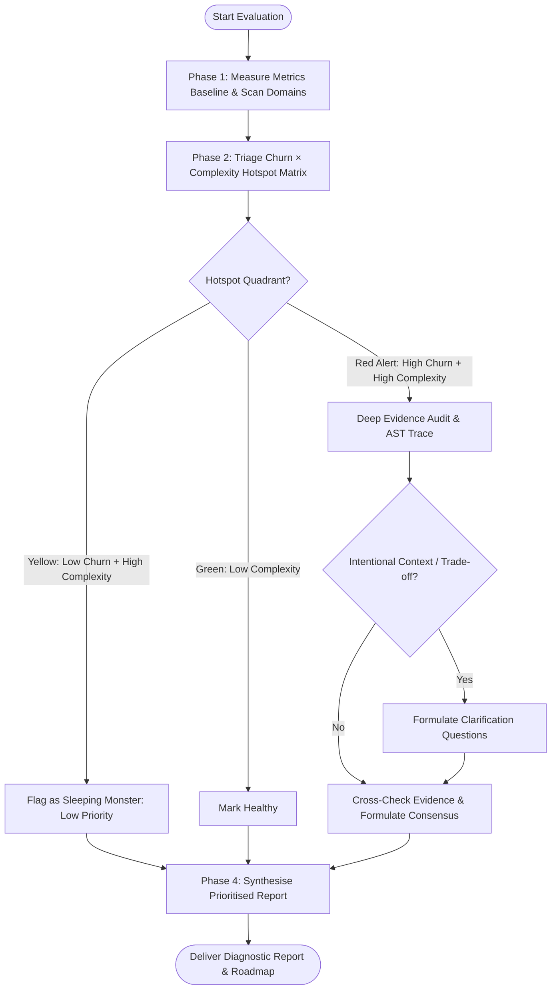

# Evaluation Skill

Comprehensive codebase evaluation system that assesses code quality, architecture, design patterns, cognitive complexity, test sufficiency, security, dependencies, and maintainability. Produces detailed, structured diagnostic reports across multiple quality dimensions.

**REQUIRED SUB-SKILL:** If the `ponytail` skill is not already loaded, load it. Its YAGNI lens keeps evaluation lean: report only what warrants change, not every theoretical alternative.

---

## When to Use & When NOT to Use

### Apply When
- Conducting an overall codebase health check across architecture, quality, security, and tests
- Diagnosing high-complexity hotspots (Cognitive Complexity $>15$, arrow code, god functions)
- Auditing for circular dependencies (`A ↔ B`), peer domain cycles, and architectural drift
- Detecting code duplication, declarative schema clones, and competing engine sprawl
- Tracing unreachable logic, unused exports, phantom events, and dead types
- Auditing over-abstraction, trivial passthrough wrappers, and excessive indirection
- Evaluating front-end UI architecture (monolithic views, presentation coupling, god hooks)
- Checking security posture for concurrency race conditions (TOCTOU) and client secret leaks

### Do NOT Apply When
- Actively writing feature implementations or modifying production code (use domain feature skills)
- Performing live code refactoring or structural edits (use `refactor` skill)
- Fixing immediate bugs or test failures (use `bug-fix` or `systematic-debugging` skills)
- Auditing stable, dormant legacy code with zero commit churn unless feature work is planned

---

## Evaluation Workflow



---

## Core Quantitative Metrics

Evaluations combine empirical static analysis with git history analysis to prevent bikeshedding:

| Metric | Measurement Tool / Basis | Target Baseline | Warning Threshold | Critical Debt Threshold |
|---|---|---|---|---|
| **Cognitive Complexity** | SonarQube structural jumps & nesting | $\le 15$ | $16 - 30$ | $> 30$ (God Function) |
| **Cyclomatic Complexity** | McCabe linear execution paths | $\le 10$ | $11 - 20$ | $> 20$ |
| **CRAP Metric** | $\text{comp}^2 \cdot (1 - \text{cov})^3 + \text{comp}$ | $\le 30$ | $31 - 60$ | $> 60$ (Untested Hazard) |
| **Indirection Debt** | Entrypoint to execution call stack hops | $\le 3$ hops | $4 - 6$ hops | $\ge 7$ hops (Lasagna Code) |
| **Git Commit Churn** | Revisions in past 3–12 months | Low | Moderate | High (Active Volatility) |

*For complete formulas and quadrant analysis, see [Complexity & Hotspots Reference](references/complexity-and-hotspots.md).*

---

## Authoritative References

- **[Code Smells Diagnostic Matrix](references/code-smells-matrix.md)** – Comprehensive catalogue mapping 81 code smells across 10 evaluation dimensions to detection heuristics, required evidence, and severity ratings.
- **[Complexity & Hotspots Reference](references/complexity-and-hotspots.md)** – Deep-dive guide covering Cognitive vs Cyclomatic complexity, the CRAP metric formula, the Churn × Complexity Hotspot Matrix, and Indirection Debt measurement.
- **[Architectural Invariants Reference](references/architectural-invariants.md)** – Authoritative evaluation criteria adapting the 100 Golden Rules across data contracts, UI state separation, modularity, tooling, and system boundaries.

---

## Specialised Evaluation Modules

This skill includes 10 dedicated evaluation modules:

### 1. **Project Evaluation** (`project-evaluation.md`)
Exhaustive health check across all 8 dimensions: Architecture, Code Quality, Design, UI Components, Security, Testing, Dependencies, and Documentation. Follows Discovery → Clarification → Evaluation → Reporting.

### 2. **Architecture & Design Analysis** (`architecture-design-analysis.md`)
Audits module graphs for circular dependencies (`A ↔ B`), peer domain cycles, storage impedance mismatches, direct persistence coupling, lasagna code, and distributed cascade deletion leaks.

### 3. **Quality Analysis** (`quality-analysis.md`)
Evaluates implementation quality against clean code standards. Measures Cognitive Complexity, CRAP scores, Arrow Code, Primitive Obsession, Feature Envy, Read-Modify-Write races, and resource handle leaks.

### 4. **Code Duplication** (`code-duplication.md`)
Rigorously identifies exact clones, semantic similarity, declarative ORM schema duplication, scattered inline variations, and competing engine duplication.

### 5. **Dead Code Analysis** (`dead-code.md`)
Traces entry points to identify unreachable logic, unused public exports (export minimization), phantom event dispatchers, zombie code, and ephemeral migration assets.

### 6. **Over-Abstraction Audit** (`over-abstraction.md`)
Identifies shallow abstraction layers, trivial passthrough wrappers, interfaces for one, speculative infrastructure schema debt, micro-tool catalog sprawl, and excessive granularity.

### 7. **Codebase Consistency** (`codebase-consistency.md`)
Audits topological directory architecture, strict file casing, framework route folder purity, 4-tier domain type architecture, validated environment schemas, and centralised route/asset registries.

### 8. **Security Audit** (`security-audit.md`)
Audits code-level vulnerabilities, Read-Modify-Write concurrency races (TOCTOU), scattered authorization checks, client-server environment variable leaks, and unbounded datastore queries.

### 9. **Dependency Usage** (`use-dependencies.md`)
Audits custom logic that reinvents standard libraries or existing packages (Hand-Rolled Utility Sprawl), micro-package dependency drag, and multi-tool toolchain sprawl.

### 10. **UI & Component Analysis** (`ui-component-analysis.md`)
Audits front-end views for monolithic components, presentation-mutation coupling, God Hooks managing disparate state, dual-mode form clone drift, and accessible design system primitives.

---

## Key Diagnostic Principles

- **Thorough Analysis** – Evaluate each quality dimension systematically using objective metrics.
- **Evidence-Based Findings** – Every issue must cite specific file paths, line numbers, and architectural evidence.
- **Objective Assessment** – Report findings without prescribing implementation code or premature rewrites.
- **Change-Worthiness** – Only report issues whose remediation would meaningfully improve maintainability, defect rates, or security. If fixing something would not change outcomes, it is noise.
- **Cost-Weighted Findings** – Weigh remediation effort against practical risk. Dormant, stable code with zero churn is classified as Yellow (Sleeping Monster) rather than an urgent crisis.
- **Prefer the Working Solution** – Working, readable code that introduces no measurable friction is not a defect merely because an alternative pattern exists.

---

## Required Inputs

When invoking this skill, provide:

1. **Codebase Path** – Full path to the project directory to evaluate
2. **Evaluation Type**:
   - `project-evaluation` for comprehensive multi-dimensional assessment
   - Specific module name(s) for targeted analysis (e.g. `architecture-design-analysis`, `quality-analysis`)
3. **Scope** (Optional) – Specific subdirectories or modules to focus on
4. **Known Context** (Optional) – Intentional architecture decisions, framework constraints, or migration roadmaps

---

## Output Format & Standards

All evaluation reports follow a structured Markdown format with:

- **Executive Summary** – High-level health score and risk level by dimension
- **Hotspot Matrix Breakdown** – Red Alert vs Yellow (Sleeping Monster) quadrant mapping
- **Detailed Findings** – Each issue with Location, Severity, Metric Baseline, Evidence, and Consensus Status
- **Domain Scorecards** – Per-dimension qualitative and quantitative assessments
- **Actionable Roadmap** – Most impactful improvements ranked by ROI and risk reduction

### Quality Standards
- All findings are **specific** – cite exact file paths, line numbers, or symbol identifiers
- All findings are **evidence-backed** – supported by code snippets, AST traces, or vulnerability records
- All findings are **objective** – utilise concrete metrics (Cognitive Complexity, CRAP, hop counts)
- All reports use **British English** spelling and grammar
- All reports follow **ASD-STE100** principles – short sentences, plain vocabulary, one idea per sentence

---

## Example Invocations

### 1. Comprehensive Project Health Check
```
Run a complete codebase evaluation on [PROJECT_PATH].
Use the project-evaluation module to assess all dimensions.
Include git commit churn correlation, Cognitive Complexity baselines,
and CRAP scores for high-risk modules.
```

### 2. Architecture & Cycle Audit
```
Analyse the architecture of [PROJECT_PATH] for circular dependencies,
indirection debt, and storage impedance mismatches.
Use the architecture-design-analysis and over-abstraction modules.
Provide Mermaid diagrams for cyclic paths.
```

### 3. Quality & Complexity Deep Dive
```
Evaluate [PROJECT_PATH] for code quality, arrow code, and concurrency races.
Use the quality-analysis and code-duplication modules.
Calculate Cognitive Complexity and CRAP scores for all functions exceeding 40 LOC.
```

### 4. Front-End UI Audit
```
Audit the front-end architecture of [PROJECT_PATH].
Use the ui-component-analysis and codebase-consistency modules.
Identify monolithic views, presentation coupling, and god hooks.
```

---

## Related Skills

- **ponytail** – YAGNI lens that keeps evaluation lean; load if not already loaded
- **refactor** – Systematic code remediation patterns, 100 Golden Rules, and code smell fixes
- **writing-code** – Pragmatic clean coding standards and defensive architecture
- **karpathy-guidelines** – Disciplines to avoid overcomplication and LLM coding mistakes
- **writing-skills** – Authoring and verifying agent skills
